# Developer Guide

Select a diagram to enlarge it.

## Acknowledgements

* The project started from the [CS2113 project template](https://github.com/NUS-CS2113-AY2627-S1/tp).
* The architecture diagram's presentation is inspired by the
  [EduReserve Developer Guide](https://ay2627s1-cs2113-w14-2.github.io/tp/DeveloperGuide.html).
  Its component responsibilities and dependencies describe TutorLedger's own implementation.

* The default hourly rate UML figures are rendered with [PlantUML](https://plantuml.com/),
  using the [SE-EDU PlantUML guide](https://se-education.org/guides/tutorials/plantUml.html) for tooling guidance.
* The lesson UML figures follow the notation of the [SE-EDU textbook](https://se-education.org/se-book/)
  and are rendered with [PlantUML](https://plantuml.com/).

## Design

### Overall architecture

TutorLedger is a single-process command-line application. A shared in-memory store holds the tutor's
records, feature handlers interpret commands, and persistence saves the records in a local text file.
The diagram groups the existing classes by responsibility; these boxes are not separate services or
separate Java packages. All application classes belong to `seedu.tutorledger`.

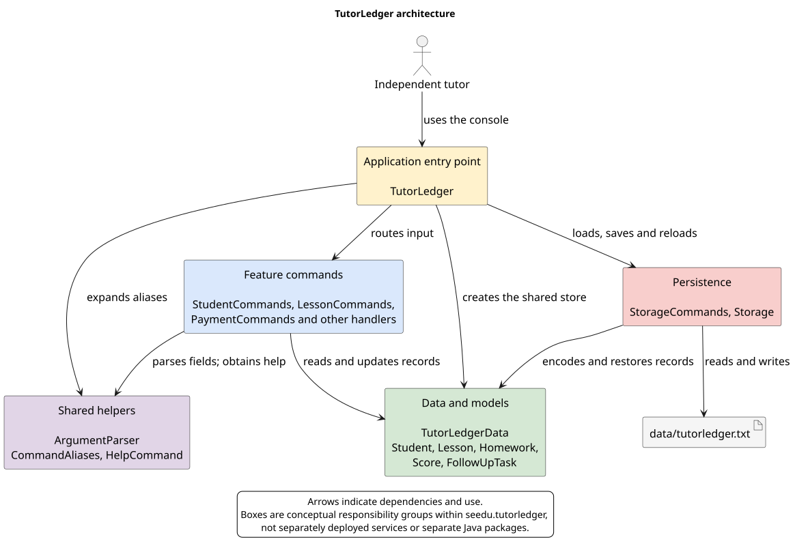

*Architecture overview. Arrows indicate dependencies and use, rather than chronological execution.*

| Responsibility | Main classes | Role |
| --- | --- | --- |
| Application entry point | `TutorLedger` | Creates the shared store and handlers, reads console input, routes commands and coordinates automatic saving. |
| Feature commands | `StudentCommands`, `LessonCommands`, `PaymentCommands`, `HomeworkCommands`, `ScoreCommands`, `TaskCommands`, `TopicCommands`, `LessonFilterCommand` | Validate feature-specific input, read or update records, and return display text. |
| Shared helpers | `ArgumentParser`, `CommandAliases`, `HelpCommand` | Parse prefixed fields, expand command shortcuts, and provide help text. |
| Data and models | `TutorLedgerData`, `Student`, `Lesson`, `Homework`, `Score`, `FollowUpTask` | Own record collections and permanent ID counters; validate values and represent records as immutable objects. |
| Persistence | `StorageCommands`, `Storage` | Load and reload the shared store, compare snapshots, and encode or decode `data/tutorledger.txt`. |

At startup, `TutorLedger` creates one `TutorLedgerData` and passes it to the handlers and persistence
coordinator. `StorageCommands.loadOnStartup()` restores that store before the input loop starts.
Each line is expanded through `CommandAliases`; `handles` checks route it to the appropriate handler.
Unclaimed input reaches `StudentCommands`, which also handles help and unknown commands.

Before an ordinary feature command, the entry point records a storage snapshot. After the handler
returns, it calls `saveIfChanged`; persistence writes only when the records changed. Explicit `save`
and `reload` commands use the persistence path directly. Feature handlers do not save files themselves,
and the data model does not depend on persistence.

Sharing a store makes edits immediately visible to other commands without duplicating records. Keeping
file operations in persistence allows commands to operate on in-memory data during tests. This design
does not require a common command interface: the current handlers use static `handles` methods and
instance `execute` methods. The more detailed class, sequence and activity diagrams below explain the
selected implementation decisions.

## Implementation

### Storage

The storage feature keeps every record in one
plain-text file, `data/tutorledger.txt`, so that data survives restarts and a tutor can fix or bulk-edit
records in a text editor.

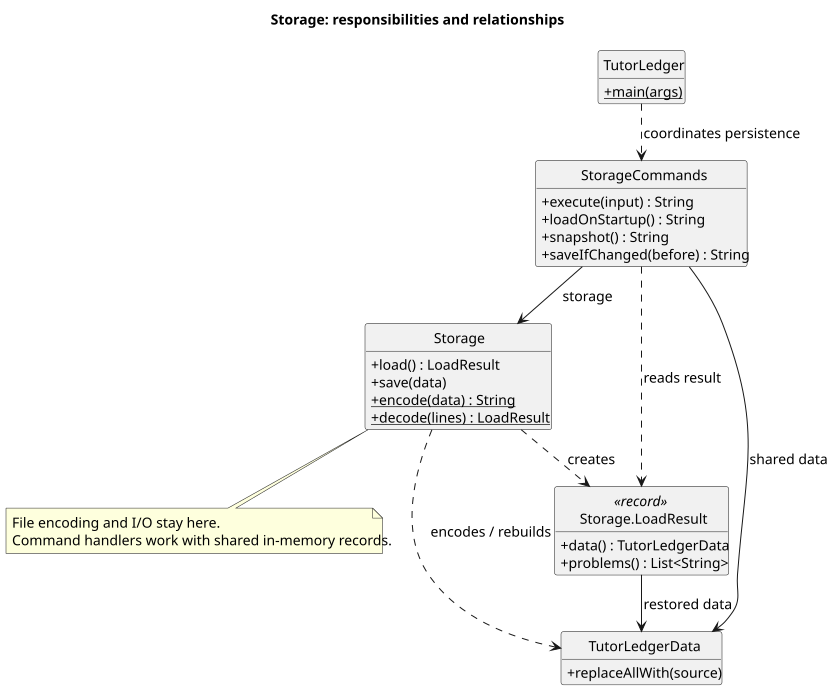

*Storage responsibilities. The entry point coordinates persistence; StorageCommands shares the live store and delegates encoding and file I/O to Storage.*

* **`Storage`** knows the file format and does the file input/output. It never prints anything, so it can
  be tested on its own.
* **`StorageCommands`** runs `save` and `reload`, loads the file at startup and saves automatically. It turns
  file errors into messages for the user, following the same `handles`/`execute` pattern as the other
  command classes.
* **`TutorLedgerData`** gained `importLesson`, `importHomework`, `setNextLessonNumber`,
  `setNextHomeworkNumber` and `replaceAllWith` so that records can be restored with their saved IDs.

#### File format

Each record is one line of fields separated by a vertical bar, `|`, with a space on each side:

```
NEXT | S3 | L2 | H2 | A2 | T2
S | S1 | Amirah Binte Rahman | Sec 3 | 91234567 | E Math | A Math
L | L1 | S1 | 15-09-2026 | 1600 | A Math | 60 | present | paid | Quadratics \| discriminant |  | 60 | 60
H | H1 | S1 | 29-09-2026 | outstanding | Worksheet 4A
A | A1 | S1 | 07-09-2026 | 28 | 40 | WA1
T | T1 | pending | 16-10-2026 | S1 | Bring Worksheet 4B
```

* The `NEXT` line saves the ID counters. Without it, deleting the newest student and restarting would
  hand the deleted student's ID to the next new student, breaking the rule that IDs are never reused.
* A `|` or `\` inside a value is escaped as `\|` or `\\`, so notes and subjects can contain any text.
* Values are written in the same format the user types them (e.g. `DD-MM-YYYY`), so a hand-edited file
  uses the rules users already know.

*Alternatives considered:* JSON (via a library such as Jackson) handles nesting and escaping for us, but it
is harder for a tutor to edit by hand, and it needs a third-party library. CSV is similar to the chosen
format, but its quoting rules are less obvious to people editing it by hand.

#### Loading and validation

`Storage.decode` first reads students and the `NEXT` line, then processes rates, archive markers,
lessons, homework, scores and follow-up tasks. This permits linked records to appear before their student
line. Student-linked records must resolve to a valid student; follow-up tasks may also be unlinked.
Imports reuse model validation and reject malformed values, duplicate IDs and occupied lesson slots.
Command-specific restrictions, such as requiring restoration before scheduling for an archived student,
are separate from loading historical records.

Current lesson rows have thirteen fields, ending with `NOTES | CANCELLATION_REASON | MINUTES | AMOUNT_PAID`.
The loader also accepts older lesson layouts. Fees are loaded as saved and are not recomputed from
current rates. Rate and archive metadata use separate `R` and `ARCHIVED` lines so legacy subject fields
remain unambiguous.

A line that fails a check is skipped and reported as `Line N: reason`. Loading carries on with the
remaining lines, so one typo does not lose the whole file.

#### Automatic saving

Before each command, the main loop takes a `snapshot()` (the text the file would contain). After the
command, `saveIfChanged` compares a new snapshot with it and writes the file only if they differ.

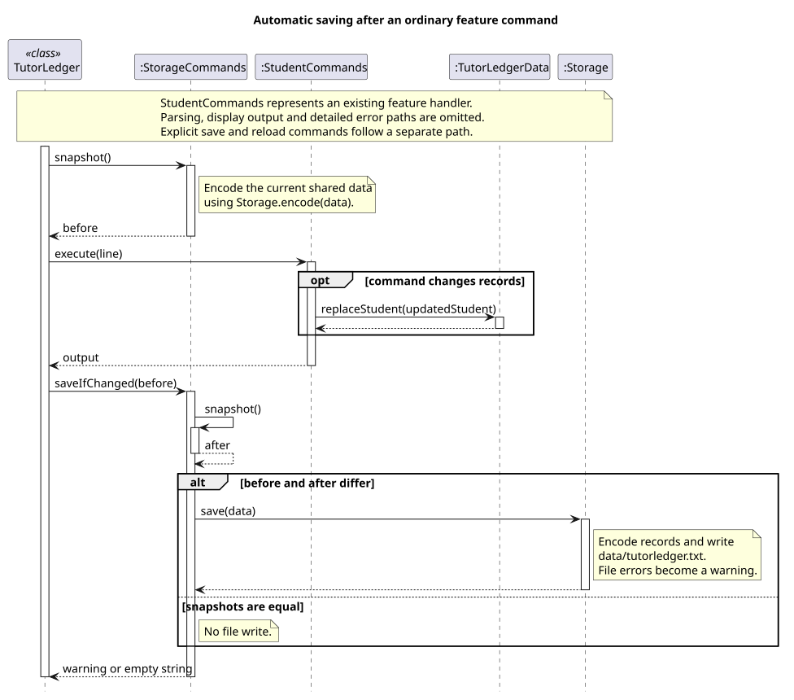

*Automatic saving. StudentCommands is one representative feature handler. A changed snapshot triggers a save; unchanged records leave the file untouched.*

* Comparing snapshots means a command that teammates add later is saved automatically. Nobody has to
  remember to update a list of "commands that change data".
* Commands that only display data never write the file, so they cannot overwrite a tutor's hand edits
  before `reload`.
* `save` and `reload` skip the automatic save. In particular, `reload` must not save, or the lines it just
  skipped would be erased before the tutor could fix them.
* The trade-off is encoding the data twice per ordinary command. The work grows with the stored
  records; this guide does not assume a measured response-time guarantee.

*Alternative considered:* saving after every command, whether or not it changed anything, is simpler. But a
read-only command such as `list` would then overwrite hand edits made while the app is open.

*Possible improvement:* write to a temporary file and then rename it over the data file. A temporary-file replacement can reduce
the risk of a partial write; an implementation would also need to handle filesystem and rename failures.

### Income summaries

`PaymentCommands` handles `income MM-YYYY` and `income YYYY`. Monthly summaries select non-cancelled
lessons with a positive `amountPaid`, group them by lesson date, and sum `Lesson.getAmountPaid()`.
Yearly summaries apply the same rule to each of the twelve months, including months with a zero total.
Partial payments contribute the amount actually received; an unpaid lesson contributes nothing.
A free lesson is settled but contributes no income. The reporting period uses the lesson date, not a
separate payment timestamp, because no transaction-date ledger is stored.

The output is calculated from the current lesson collection without changing any records. Cancelled
lessons remain in the history but are excluded from income. Editing a fee preserves the amount already
received; the fee-edit rules below prevent an edit from manufacturing or discarding a payment.

### Scores and progress

These features let a tutor record test results and review a
student at the end of a term.

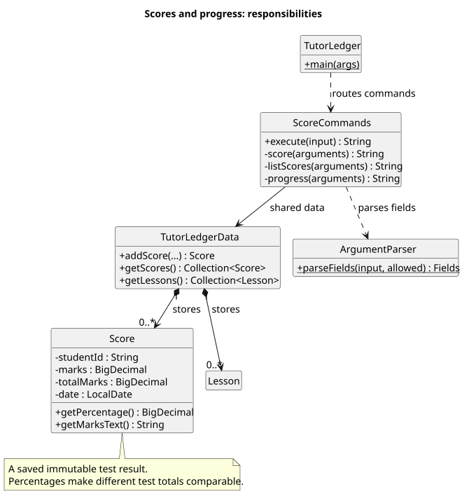

* **`Score`** is an immutable record of one test result, like `Lesson` and `Homework`. Its constructor
  checks every value, for example that the marks are not more than the total. A score therefore cannot
  exist in an invalid state, whether it was typed in or loaded from a hand-edited file.
* **`ScoreCommands`** follows the same `handles`/`execute` pattern as the other command classes. The main
  loop routes `score`, `scores` and `progress` to it.
* **`TutorLedgerData`** stores scores in a map keyed by ID, with a counter that never decreases, as it does
  for lessons and homework. `deleteStudent` also removes the student's scores, and `Deletion` reports how
  many were removed.
* **`Storage`** saves each score as an `A` line. The score counter is a fifth, optional field on the `NEXT`
  line, so data files written before this feature still load.

#### Recording a score

The sequence diagram below shows `score S1 WA2 m/33/40`.

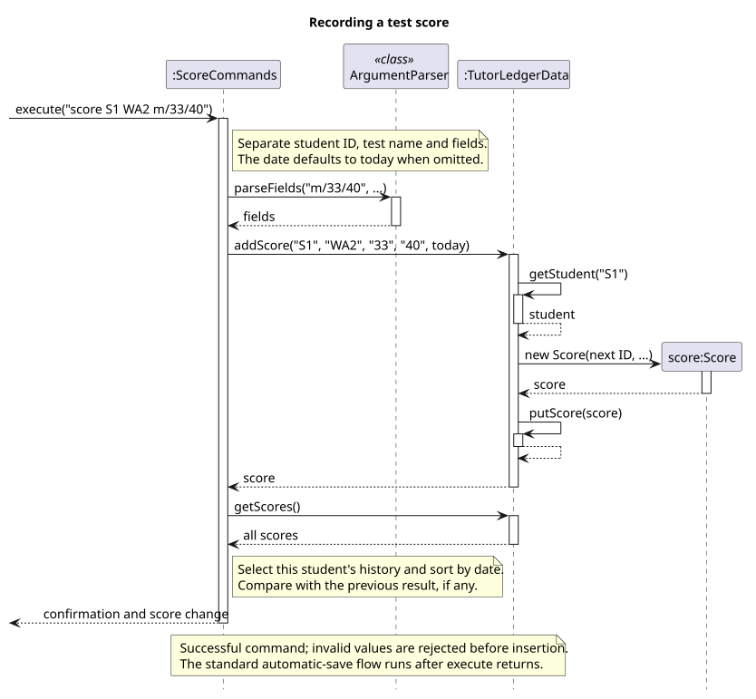

1. The test name is everything before the first `m/` or `d/`, so it can contain spaces, like an `assign`
   description. The rest goes to the shared `ArgumentParser`, so `m/` and `d/` can be typed in any order.
2. `TutorLedgerData.addScore` looks up the student first, so a score can never belong to a missing student.
   It then creates the `Score`, which validates the values, and stores it under the next ID.
3. `ScoreCommands` sorts the student's scores by date and compares the new score with the one before it.
   The tutor sees at once whether the student did better or worse.

Any invalid value throws `IllegalArgumentException` before anything is stored. `execute` turns this into an
`Error: ...` message and logs it at `WARNING` level.

**Design decisions**

* *Marks are `BigDecimal`, not `double`.* Half marks such as 17.5 are common, and `double` cannot store
  some decimals exactly. The data file would then show values like `17.499999`. Lesson fees use
  `BigDecimal` for the same reason.
* *Scores are compared as percentages.* Tests have different totals (40 marks for a class test, 100 for an
  exam), so raw marks cannot be compared. Percentages are rounded to 1 decimal place with `HALF_UP`.
* *The date defaults to today.* Tutors usually record a score on the day the script is returned.
  *Alternative considered:* making `d/` compulsory is stricter, but it adds typing for the most common case.

#### Summarising progress

`progress STUDENT_ID [from/DATE] [to/DATE]` gathers the student's lessons and scores in the period and
summarises them. The activity diagram shows how each lesson is counted.

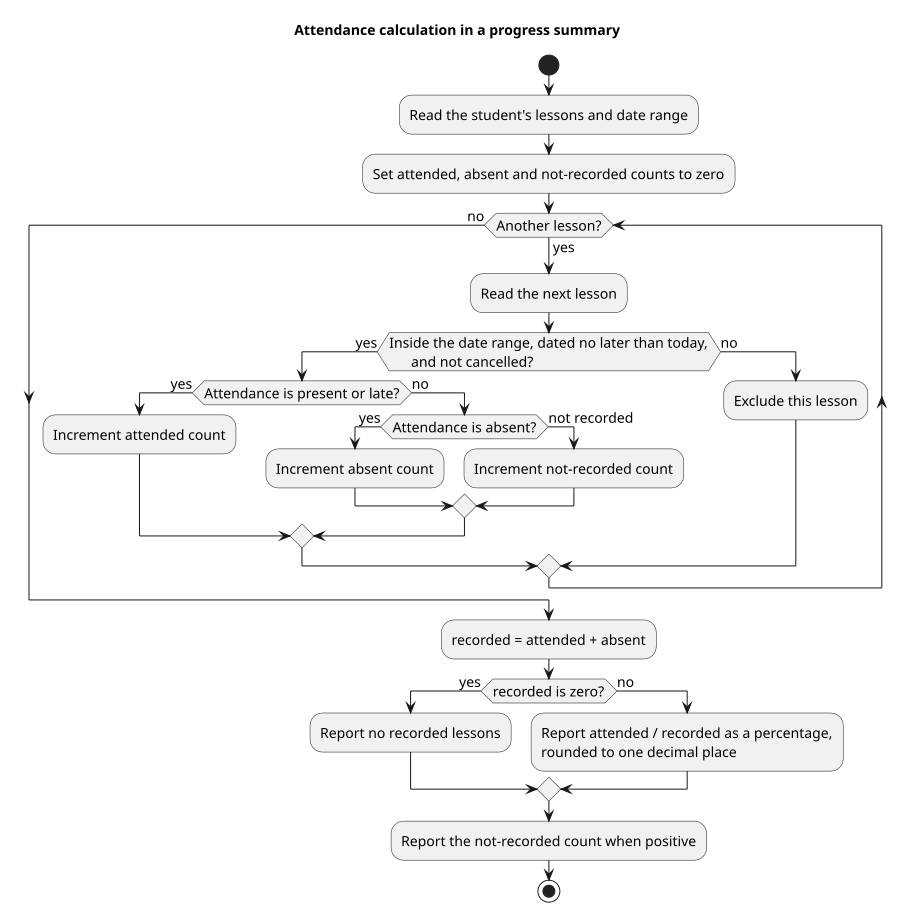

* Cancelled lessons are excluded before attendance is counted.
* Lessons after today are skipped because they cannot have attendance yet. Counting them as "not
  recorded" would wrongly suggest the tutor forgot to record them.
* Unrecorded past lessons are reported, but they are left out of the rate. Otherwise a tutor who has not
  yet recorded yesterday's lesson would see a lower rate than the student deserves.
* A late arrival counts as attending. The tutor still taught the lesson, and the separate `late` count
  keeps lateness visible.
* Without `from/`, the period starts at `LocalDate.MIN`, so all of the student's records are included.

`scores` and `progress` share the private helpers `scoreTable` and `trend`, so the score list looks the same
in both commands.

*Alternative considered:* storing term dates, so a tutor could type `progress S1 term/3`. Schools' term
dates differ, and a tutor would have to set them up first. `from/` and `to/` work for any period with no
setup.

*Possible improvements:* let `edit` and `delete` accept a `SCORE_ID`, so a mistyped score can be fixed
without editing the data file. Also show the average score by subject, once scores record a subject.

### Follow-up tasks

Between lessons, a tutor collects small jobs: bring a worksheet, return a marked script, print a calendar.
Follow-up tasks keep these reminders in TutorLedger, next to the lessons they belong to:

| Command | Purpose |
|---|---|
| `task [STUDENT_ID] DESCRIPTION [d/DUE_DATE]` | Log a reminder, optionally for one student and by a date |
| `tasks [STUDENT_ID]` | List pending reminders, soonest due first, with overdue ones marked |
| `done TASK_ID` | Tick a reminder off |

`next` also lists the student's pending reminders, so they are seen at the moment the tutor prepares for
the lesson.

#### Responsibilities and object relationships

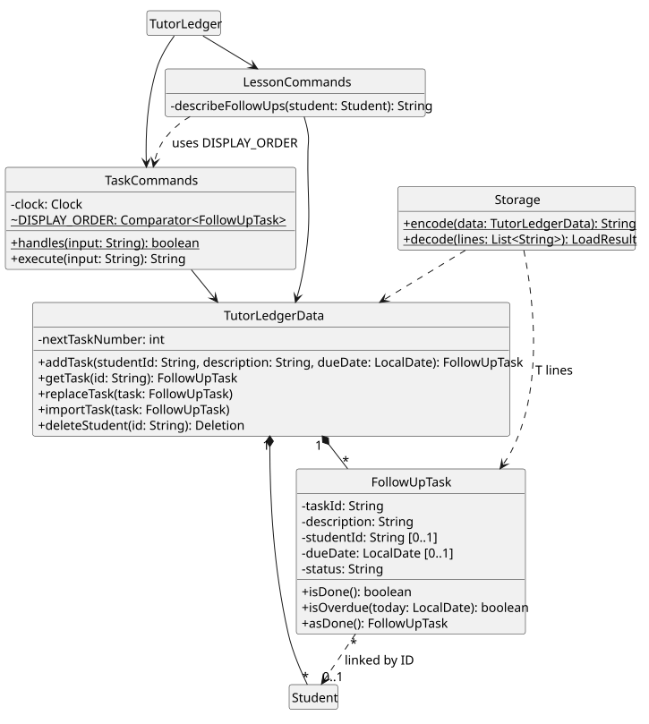

* **`FollowUpTask`** is an immutable record, like `Homework`. Its student and due date are optional, because
  some reminders (such as "Print term calendar") are not about one student or day. The getters return
  `Optional`, so callers cannot forget to handle a task that has neither.
* **`TaskCommands`** follows the same `handles`/`execute` pattern as the other command classes. The main loop
  routes `task`, `tasks` and `done` to it.
* **`TutorLedgerData`** stores tasks in a map keyed by ID, with a counter that never decreases, as for every
  other record. A task links to a student by ID rather than holding the `Student` object. Student profiles
  are replaced whenever they are edited, so a stored object would go stale, but an ID always stays valid.
* **`LessonCommands.describeFollowUps`** adds a `Follow-ups:` line to `next`. It reuses
  `TaskCommands.DISPLAY_ORDER`, so reminders are sorted the same way in both commands.

#### Logging a task

The sequence diagram below shows `task S1 Bring Worksheet 4B d/16-10-2026`.

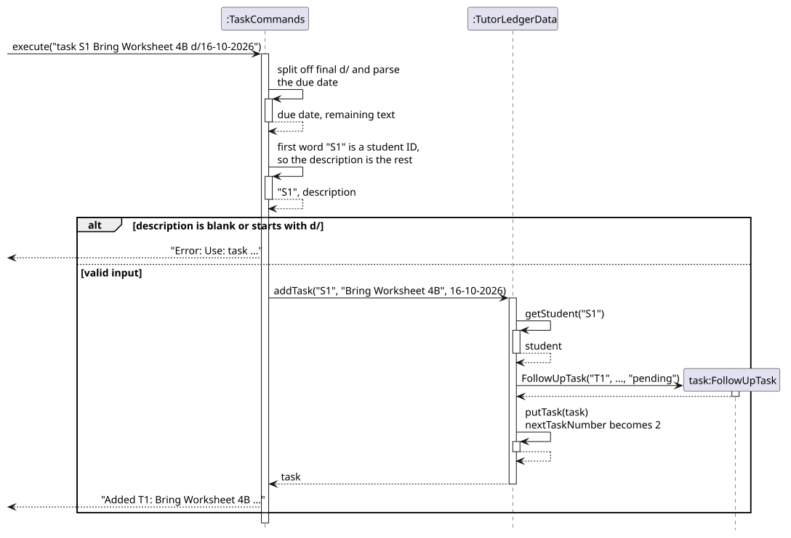

1. A regular expression splits off a final `d/DUE_DATE`. As with `assign`, the date must come last, so the
   description may contain spaces and commas.
2. If the first remaining word looks like a student ID (`S1`), the task is linked to that student and the
   rest is the description. Otherwise the whole text is the description.
3. `TutorLedgerData.addTask` looks the student up first. A task can therefore never point to a missing
   student. It then creates the task with the next `T` ID.

`done TASK_ID` works the same way as `submit` for homework. `FollowUpTask.asDone()` returns a copy with the
new status, and `replaceTask` stores it under the same ID.

#### Design considerations

* *Student ID as an optional first word, rather than a prefix such as `for/S1`.* Most other commands put
  the student ID first (`assign S1 ...`, `score S1 ...`), so the tutor does not need to learn another
  prefix. A description that happens to start with a word like `S1` would be read as a student ID. This
  is unlikely, and the confirmation line (`for S1 ...`) makes it obvious.
* *Mark done, rather than delete.* A done task stays in the data file, so the tutor can still see in the file
  what was done. `tasks` and `next` simply leave done tasks out. *Alternative considered:* deleting the
  task on `done` keeps the file smaller, but loses the record.
* *Show reminders in `next`.* The story's goal is to avoid forgetting things "between lessons". A separate
  list is easy to forget to check, but `next` is already what the tutor runs before a lesson. The line only
  appears when there are pending reminders, so the usual `next` output is unchanged.
* *Deleting a student deletes their tasks.* A reminder about a student who is no longer taught is not
  useful. Tasks not linked to anyone are kept. Because the tasks are removed too, a student with follow-up
  tasks gets the deletion warning (see *Student deletion warnings*), so reminders are never lost silently.

#### Defensive checks and persistence

* Invalid input (an unknown student, an impossible date, a blank description, a repeated `done`) throws
  `IllegalArgumentException` before anything is stored. `execute` turns it into an `Error: ...` message
  and logs it at `WARNING` level.
* Assertions check things that only a coding mistake could break: a new task is pending, the counter
  advanced, `done` really stored a done copy, and `tasks` lists no done tasks.
* `Storage` saves each task as a `T` line with six fields. A missing due date or student is an empty field.
  The task counter is an optional sixth field on the `NEXT` line, so data files saved before this
  feature still load.
* `TaskCommandsTest` and `StorageTest` cover each command, the `next` integration, cascade deletion, and
  loading old and hand-edited files.

*Possible improvements:* let `edit` change a task's description or date, and accept a time
(e.g. `d/16-10-2026 t/1500`) for reminders that must be done before a particular lesson.

### Lesson scheduling and records

A tutor's week revolves around lessons, so these commands let them plan lessons, record what happened, and
change plans when real life gets in the way:

| Command | Purpose |
|---|---|
| `schedule STUDENT_ID d/DATE t/TIME s/SUBJECT [f/FEE] [dur/MINUTES] [w/WEEKS]` | Plan one lesson, or the same slot for 2–52 weeks |
| `log STUDENT_ID d/DATE t/TIME s/SUBJECT f/FEE a/ATTENDANCE [note/NOTES]` | Add a lesson that already took place, with its outcome |
| `lessons [week]` | List today's or this week's lessons, earliest first |
| `next [STUDENT_ID]` | Summarise the next lesson and what to prepare for it |
| `record LESSON_ID a/ATTENDANCE [note/NOTES]` | Record attendance and notes for a lesson that has taken place |
| `edit LESSON_ID ...` / `delete LESSON_ID` | Correct any detail of a lesson, or remove one entered by mistake |
| `reschedule LESSON_ID [d/DATE] [t/TIME]` | Move a lesson that has not taken place yet |
| `cancel LESSON_ID r/REASON` | Call off a lesson but keep it, with the reason, in the history |

#### Responsibilities and object relationships

`LessonCommands` parses and runs every lesson command. Like the other command classes, it follows the
`handles`/`execute` pattern: the main loop asks `LessonCommands.handles(line)` whether the line is a lesson
command, then passes the line to `execute`, which returns the text to display. `edit` and `delete` are also
student commands, so `handles` claims them only when the ID after the command word starts with `L`. For
example, `edit L3 t/1700` is routed here, while `edit S1 p/91234567` is left for `StudentCommands`.

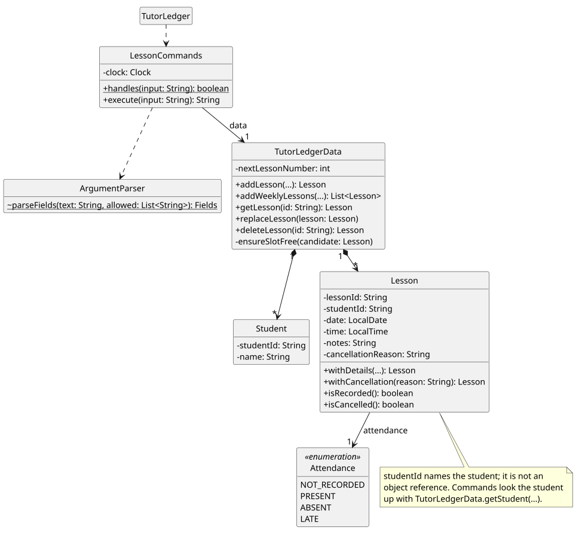

*Figure 1. `LessonCommands` changes lessons only through `TutorLedgerData`, which owns every `Lesson`.*

* **`TutorLedgerData`** is the only class that stores lessons. It gives each new lesson the next ID (`L1`,
  `L2`, ...) and checks that no two lessons start at the same date and time (`ensureSlotFree`). It never
  reuses an ID, even after a lesson is deleted, so an ID in an old note or message never points at a
  different lesson.
* **`Lesson`** is immutable: a change produces a new copy through `withDetails` or `withCancellation`, and
  `TutorLedgerData.replaceLesson` swaps the copy in. Attendance is a separate enumeration, so a cancelled
  lesson (`cancellationReason` is set) is never confused with one the student missed (`ABSENT`).
* **`ArgumentParser`** splits prefixed values such as `d/01-12-2026 s/A Math`. It was extracted from
  `StudentCommands` so that every command reads a prefix the same way. The values may be in any order,
  values may contain spaces, and a repeated or unknown prefix is rejected.

Fees and durations are omitted from Figure 1; see [Default hourly rates](#default-hourly-rates)
for how a lesson's fee is chosen.

#### Scheduling a weekly slot

Most students have one regular weekly slot, so `schedule ... w/WEEKS` adds that many lessons in one
command. Figure 2 shows `schedule S1 d/01-12-2026 t/1600 s/A Math f/60 w/3`. Every lesson command begins by
splitting its arguments in the same way, so that step is drawn once, in Figure 3, and referred to with a
`ref` frame.

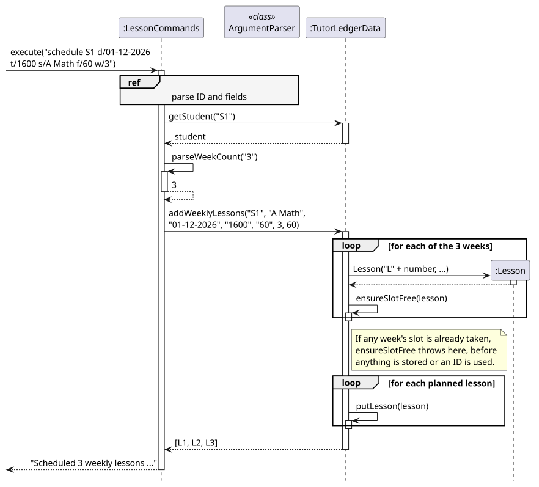

*Figure 2. Every week is checked before any lesson is stored.*

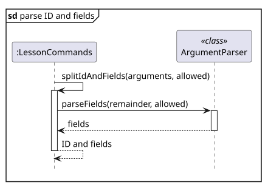

*Figure 3. The `parse ID and fields` fragment used by Figures 2 and 5.*

1. `LessonCommands` looks up the student and checks that they take the subject. It uses the student's own
   spelling of the subject, so `a math` and `A Math` are not stored as two subjects.
2. `TutorLedgerData.addWeeklyLessons` builds one `Lesson` per week, numbering them from the next lesson ID,
   and checks each slot as it goes.
3. Only after every slot passes does it store the lessons. If week 3 clashes with an existing lesson, the
   tutor sees `Error: <ID> already starts at that date and time.` and no lesson is added. The counter only
   moves when lessons are stored, so a rejected command never skips an ID.

Figure 4 shows the objects after this command and a later `cancel L2 r/Student sick`. Each week is an
ordinary, separate lesson, so `L2` could be cancelled without affecting `L1` or `L3`.

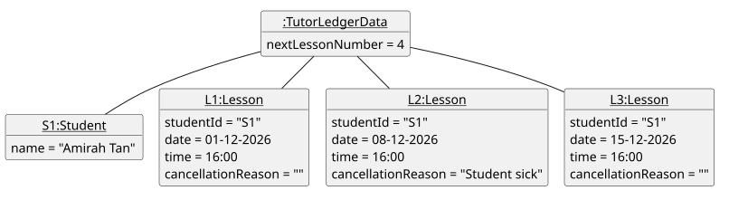

*Figure 4. After `schedule ... w/3` and `cancel L2 r/Student sick`. The counter has moved past `L3`.*

#### Changing a lesson: record, edit, reschedule and cancel

These four commands share one pattern: get the lesson, make a changed copy, check it, then call
`replaceLesson`. Figure 5 shows `reschedule L3 d/16-12-2026`.

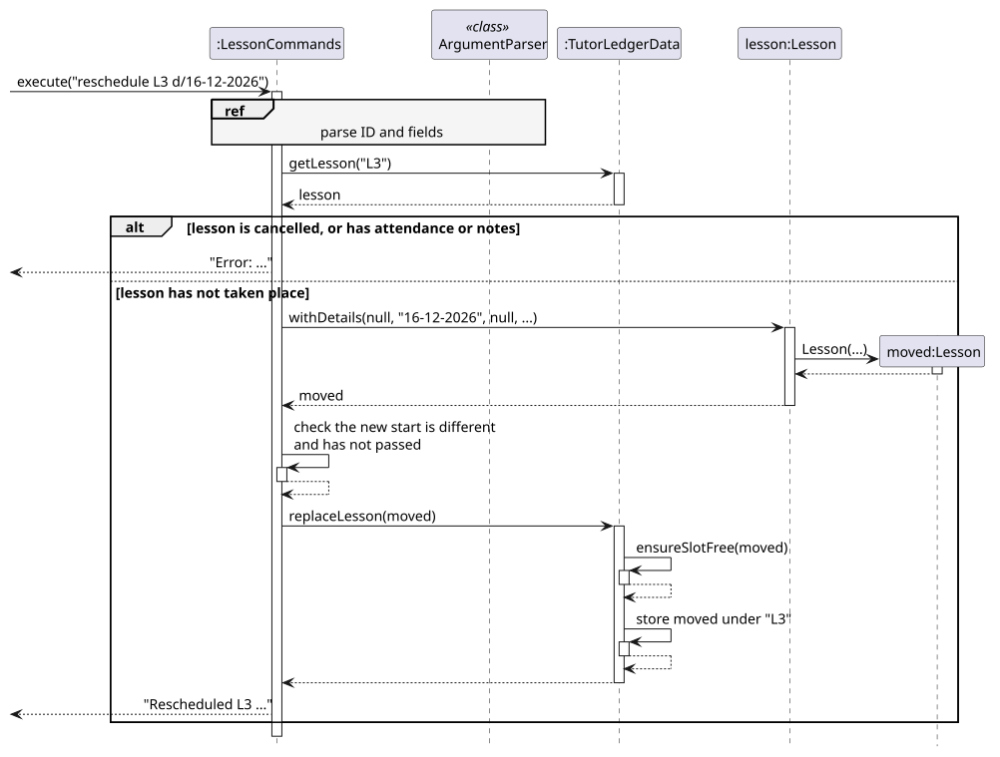

*Figure 5. The original lesson stays in the store until its validated replacement is stored.*

* `replaceLesson` checks the slot only when the date or time has changed, so recording attendance on a busy
  day is never blocked by a clash check.
* If any check fails, nothing has been replaced, so a rejected command never leaves a half-changed lesson.
  The store replaces its reference only after validation. The handler may still read the original
  object when displaying the old slot; map replacement does not explicitly destroy a Java object.
* `edit` and `reschedule` both change the slot, but they serve different purposes. `edit` corrects a
  record, so it can change any lesson, including a past one. `reschedule` describes a real-life change of
  plan, so it rejects a lesson that has already taken place (it has attendance or notes), a cancelled lesson,
  an unchanged slot, and a time that has already passed.
* `record` and `log` only accept lessons dated today or earlier, because a lesson that has not happened has
  no attendance yet. `edit` enforces the same rule when it sets attendance or notes.
* `cancel` keeps the lesson with its reason. A cancelled lesson frees its slot, is left out of `owed` and
  `unpaid`, and still appears in `lessons` marked `(cancelled: REASON)`. Any positive amount received,
  including a partial payment, triggers a reminder to refund or carry over that amount. No refund is
  recorded automatically.

#### Preparing for the next lesson

`next [STUDENT_ID]` gathers everything a tutor checks just before a lesson. Figure 6 shows how the lesson is
chosen and summarised.

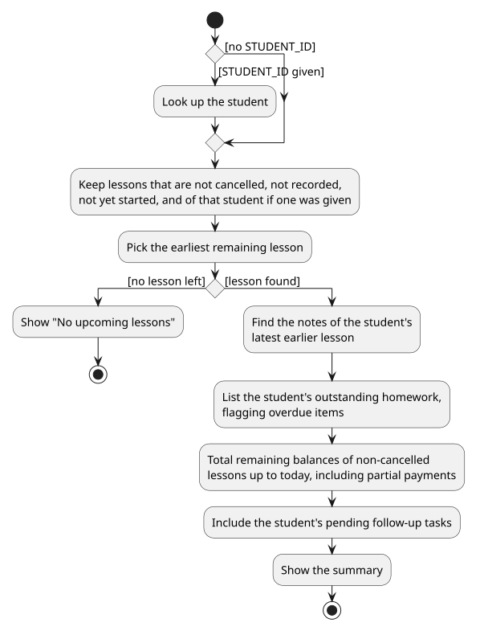

*Figure 6. Only lessons that can still take place are considered.*

The summary is built from existing records each time; nothing extra is stored. "Unpaid" totals the
remaining balances of non-cancelled lessons up to today, including partially paid lessons, using the same
balance rule as `owed`. Pending follow-up tasks for the selected student appear when there are any.

#### Design considerations

**Aspect: How a lesson is changed**

* **Alternative 1 (current choice):** `Lesson` is immutable; each change creates a copy that
  `TutorLedgerData.replaceLesson` swaps in.
  * Pros: a failed check leaves the stored lesson untouched. Every change goes through one method, so the
    slot check cannot be skipped by accident.
  * Cons: each change creates a new object, and copy methods must carry over every field (assertions in
    `withDetails` check this).
* **Alternative 2:** give `Lesson` setters and change it in place.
  * Pros: simpler to write, and no copying.
  * Cons: a command that fails half-way leaves a half-changed lesson. Any code holding the lesson could
    move it into an occupied slot without the store noticing.

**Aspect: How a weekly slot is stored**

* **Alternative 1 (current choice):** expand `w/WEEKS` into separate lessons when scheduling.
  * Pros: each week can be recorded, rescheduled, cancelled or paid for on its own. The storage format and
    every other command work unchanged.
  * Cons: a slot is limited to 52 weeks, and changing the time of the whole slot means changing each lesson.
* **Alternative 2:** store a recurring rule and generate lessons when they are needed.
  * Pros: no end date, and one change moves every future week.
  * Cons: every exception (one week moved or cancelled) must be stored against the rule. Every command
    that reads lessons, including payments and storage, would need to understand rules.

**Aspect: How a called-off lesson is handled**

* **Alternative 1 (current choice):** `cancel` keeps the lesson with a reason.
  * Pros: the history shows why a lesson did not happen, which matters when a parent asks about a payment.
  * Cons: commands that list, count or charge lessons must remember to skip cancelled ones.
* **Alternative 2:** delete the lesson.
  * Pros: no special cases elsewhere.
  * Cons: the record of a lesson that was planned (and perhaps paid for) disappears. `delete` remains
    available for lessons entered by mistake.

#### Defensive checks and testing

User mistakes, such as a bad date or a clashing slot, throw `IllegalArgumentException`. `execute` turns
this into an `Error: ...` message, so the program never crashes on bad input and the checks work whether or
not assertions are enabled. Assertions check things only a bug could break, for example that a recorded
copy really has attendance and that the lesson counter advanced after storing. Each command logs what it did
at `FINE` level, so the trace is available for debugging without appearing on the tutor's screen.

`LessonCommandsTest` covers each command's normal use and its rejections, and uses a fixed `Clock` so tests
about "today" and "the past" do not depend on the real date. `TutorLedgerDataTest` covers ID allocation,
slot conflicts and the all-or-nothing weekly scheduling.

### Default hourly rates

An independent tutor often charges the same student the same hourly rate for many lessons. Requiring
`f/60` every time repeats information and makes it easy to enter an inconsistent fee. This enhancement
lets the tutor store that rate on the student and schedule a lesson using its duration. For example,
after `edit S1 r/60`, `schedule S1 d/20-10-2026 t/1600 s/E Math dur/90` creates a lesson costing
$90.00. Omitting `dur/` means 60 minutes. An explicit `f/25` instead charges $25 for the whole lesson.

#### Responsibilities and object relationships

The feature extends the existing command, model and storage components. `StudentCommands` parses `r/`
on `add` and `edit`; `LessonCommands` parses optional `dur/` and `f/` on `schedule`. Both use
`ArgumentParser`, so prefixes keep their existing case-insensitive, order-independent behaviour.
`TutorLedgerData` chooses the total fee when creating a lesson. This puts the business rule at the
shared data boundary rather than only in a particular command handler.

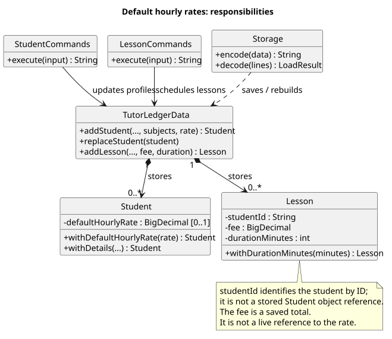

*Figure 1. The store owns student and lesson records; a lesson identifies its student by permanent ID.*

`Student` stores an optional `BigDecimal` rate. Its getter returns `Optional<BigDecimal>` so callers
must distinguish an unset rate from a valid rate of zero. A missing rate means that scheduling needs an
explicit fee; zero means that the lesson is free. Existing constructors still create students without
a rate. Existing `withDetails` operations preserve the rate, including subject changes.

`Lesson` stores both `durationMinutes` and its total `fee`. These are immutable values. Existing lesson
constructors default to 60 minutes, while the new overload accepts a validated duration. Copies created
for attendance, notes, payment status and other edits retain the duration unless it is explicitly edited.
This preserves existing callers without requiring changes to unrelated feature handlers.

#### Setting and clearing a rate

`add ... r/60` creates the entire profile, including subjects and rate, before the data store inserts
anything. Invalid rates therefore cannot leave a partially created student or consume an ID.
`edit S1 r/65` creates a replacement profile, validates it, then replaces the existing map entry.
The original profile remains available until all validation succeeds.

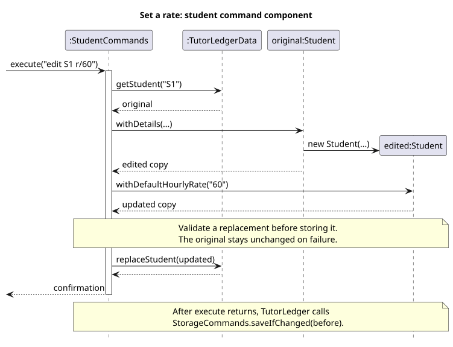

*Figure 2. A rate edit replaces a validated student and uses the existing automatic-save path.*

Omitting `r/` during an edit preserves the current rate. A bare `edit S1 r/` deliberately clears it,
matching the existing convention for clearing subjects with `s/`. A bare `r/` on `add` is rejected:
there is no existing rate to clear, so omission already expresses that intent. Repeated `r/` prefixes
are rejected rather than choosing a value silently. `view S1` reports either the dollar rate per hour
or `Default hourly rate: not set`.

#### Scheduling and keeping charges stable

The new `addLesson` overload accepts duration and an optional explicit fee. An explicit fee has priority
and represents the entire lesson charge, regardless of duration. Otherwise, the method obtains the
student's default rate. If neither source is available, it returns an error explaining both remedies:
set the student's rate or supply `f/FEE`.

Single and weekly scheduling share `resolveLessonFee`, so `schedule ... dur/90 w/3` gives each of the
three lessons the same fixed duration-based fee. Weekly scheduling still validates every slot before
inserting any lessons. A conflict in a later week therefore leaves records and ID counters unchanged.

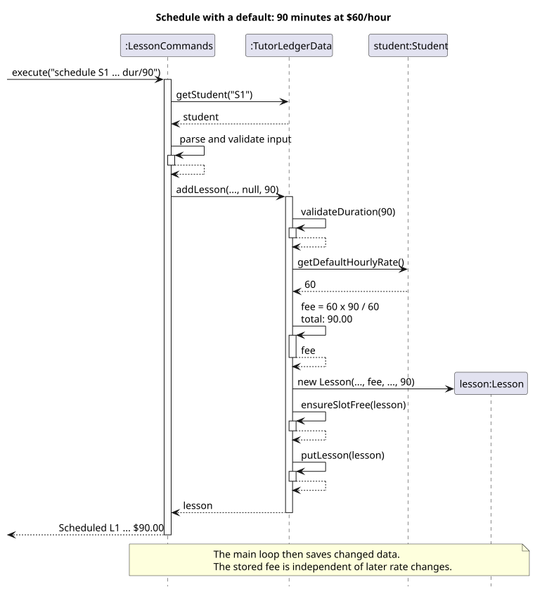

*Figure 3. Calculation happens before insertion; the result is stored as the lesson's fixed charge.*

The calculation is `hourly rate × duration in minutes ÷ 60`. All money uses `BigDecimal`; conversion to
`double` would introduce binary floating-point approximation. Division rounds once to two decimal
places using `HALF_UP`. For example, $60.01/hour for 30 minutes produces $30.005 before rounding and
$30.01 afterwards. Multiplication is performed before division to avoid rounding an hourly rate down
to a per-minute rate too early.

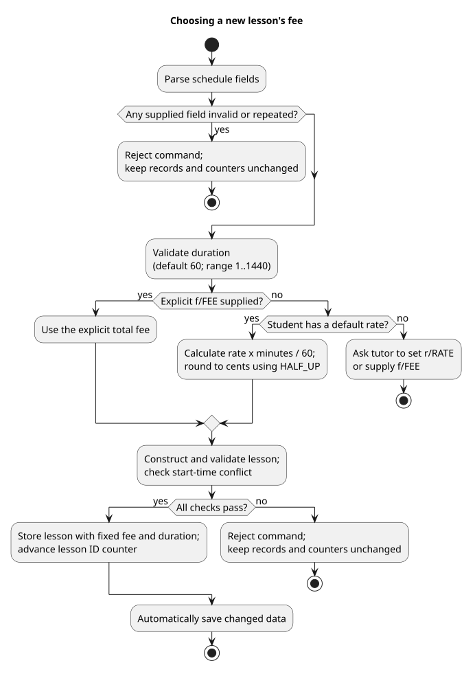

*Figure 4. Invalid explicit values are rejected; they do not trigger a fallback to the default rate.*

Changing the student's rate affects newly scheduled lessons only. Previously scheduled lessons,
including future appointments, keep their saved fee. Editing a lesson's duration also keeps its fee;
the tutor must use `edit L1 f/AMOUNT` to change the charge. This protects negotiated prices and prevents
an administrative edit from changing payment history. Fee statements read `Lesson.getFee()` for the
saved charge; income reads `getAmountPaid()`, while outstanding-balance summaries read `getAmountOwed()`.

An explicit fee edit also preserves the amount received. Raising the fee of a paid lesson creates a
remaining balance; reducing it exactly to the amount received settles the lesson. A fee below the amount
already paid is rejected before any detail is replaced. Constructors and copy operations derive status
consistently: a zero-fee lesson is already paid, with zero income.

#### Defensive checks and persistence

Rates accept non-negative decimal dollar amounts with at most two fractional digits. Durations accept
whole minutes from 1 to 1440. Model validation throws `IllegalArgumentException`, so these rules apply
to direct calls and hand-edited files even when assertions are disabled. The command layer catches
these exceptions and returns `Error: ...`. Assertions check programming invariants, such as preserving
student identity and advancing counters only after successful insertion. Debug logging records rate
changes, calculation results and rejected commands without adding messages to normal command output.

The data file keeps the legacy student layout because every trailing student field is already a
subject. Inserting a rate into that layout could misread an existing subject as money. Instead, an
optional `R | S1 | 60` record stores a student's rate. New lesson lines end with `NOTES |
CANCELLATION_REASON | MINUTES | AMOUNT_PAID`, using an empty cancellation reason for active lessons. Separate fields
prevent a cancellation reason such as `90` from being confused with a 90-minute duration. Legacy
ten-field rows and upstream eleven-field cancellation rows still load, with a default duration of 60.
Files saved by the earlier hourly-rate branch used field eleven for duration; their generated
`NOTES | MINUTES` header identifies that layout. Headerless eleven-field rows retain upstream's
cancellation semantics. Loading preserves the saved total fee and never recalculates it from current rates.

Immutable lesson copies retain both cancellation and duration. Rescheduling keeps the chosen fee;
cancelling retains its recorded amount for history while excluding it from amounts owed. An edit to a
cancelled lesson cannot give it attendance, even if it also changes the duration.

Students load in the first pass. The second pass applies rates and imports linked records, allowing
lines in any order. Invalid or orphaned rate lines are skipped with their line numbers; a duplicate
rate line cannot override the first valid rate. A bad rate does not discard the student or their
history. Encoding includes rate records and durations, so the existing snapshot comparison automatically
saves changes. The new application reads old files; older application versions cannot read all new
records, so keep a backup before using the new version if a downgrade may be necessary.

#### Alternatives, limits and verification

A separate `rate` command was considered. Extending `add` and `edit` uses familiar commands and supports
entering a complete student in one line. Storing only the rate on lessons and calculating fees whenever
displayed was also considered. Saving the chosen total instead keeps historical amounts stable.
Per-subject rates, effective-date rate histories and automatic recalculation are possible future
extensions; they would need explicit rules for existing and paid lessons.

Duration currently supports billing and display. Conflict checking retains the existing identical-start
rule; it does not detect overlapping lesson intervals. Adding interval scheduling would be a separate
enhancement requiring corresponding tests and documentation.

`DefaultHourlyRateTest` exercises command validation, decimal rounding, overrides, rate clearing,
immutable copies, payment totals, legacy files, malformed records and save/restart behaviour. The manual
scenario below provides a reproducible acceptance check. UML sources and rendering instructions are
kept in [diagrams/README.md](diagrams/README.md); rendered SVGs display on GitHub Pages without a client-side
diagram renderer.

### Fee statements

`fee_statement STUDENT_ID` is handled by `PaymentCommands`. It resolves the student, reads the shared
lesson collection, and builds the statement when requested; no separate statement record is stored.
The command includes every stored lesson for that student, whether paid, partially paid or unpaid and whether in the
past or future. Rows are ordered by date, start time, then lesson ID, and display the saved fee and
payment status alongside the lesson ID, date and subject. Partial-payment rows also show the amount received. A missing or extra argument and an unknown
student produce an error; a valid student with no lessons gets an explicit empty-history message.

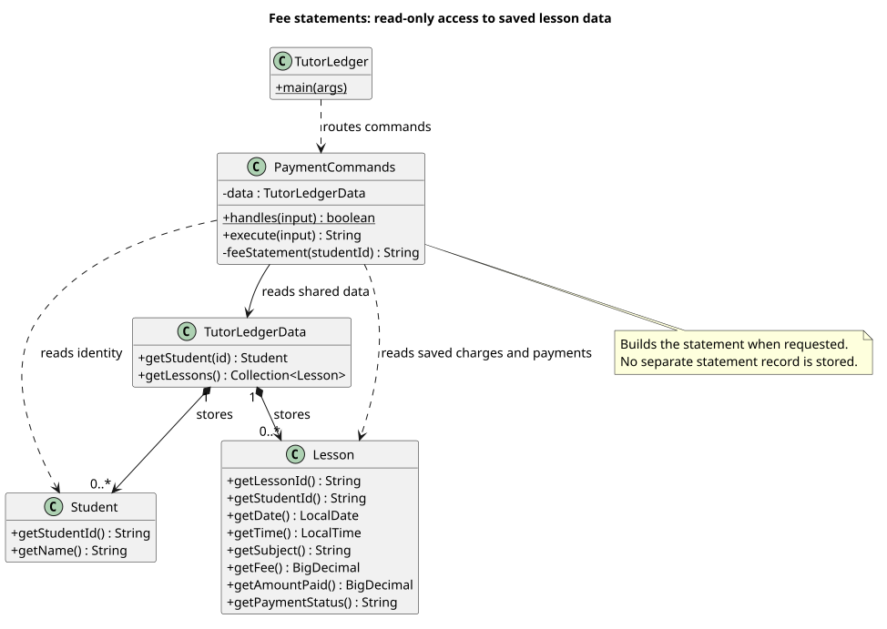

*Figure 5. The statement is assembled from the selected student and their stored lessons; it does not
introduce a new domain object.*

The command validates that exactly one student ID was supplied before looking up the student. It then
filters lessons by that student's ID and sorts them before formatting each row. This is deliberately
different from `unpaid` and `owed`, which consider remaining balances on non-cancelled lessons dated today or earlier.
Fees and payment statuses come from each `Lesson`, so the statement does not recalculate charges or
change payment state.

#### Routing and persistence checks

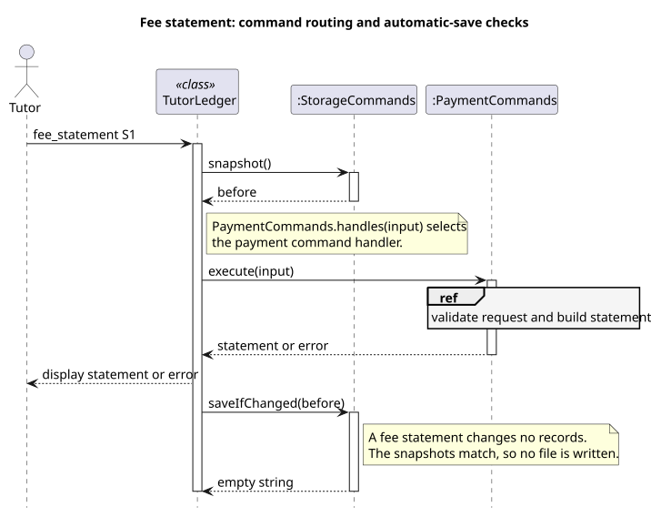

*End-to-end flow. The command handler is selected before execution. A snapshot is taken before the
request, and the usual save check runs after its result is displayed. The matching snapshots prevent a
file write. The `ref` frame expands into the request-validation fragment below.*

#### Request and validation

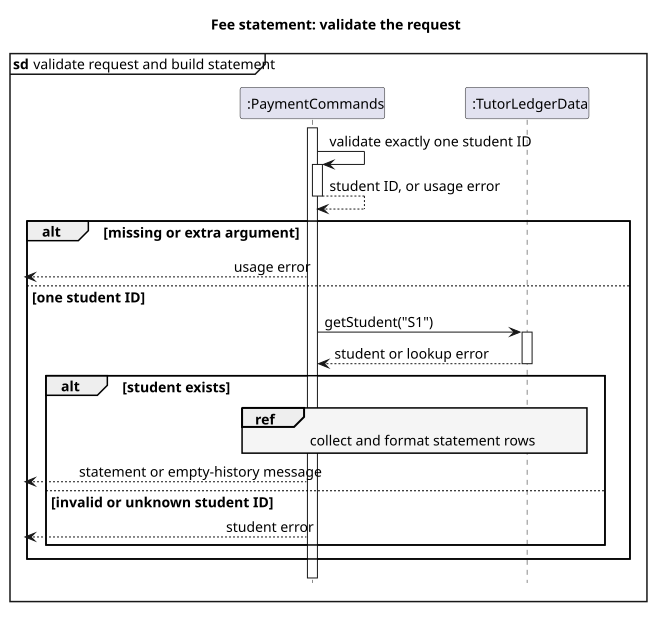

*Request flow. The `ref` frame delegates the row-building detail to the fragment below, keeping
argument errors and student lookup separate from formatting.*

#### Collecting and formatting rows

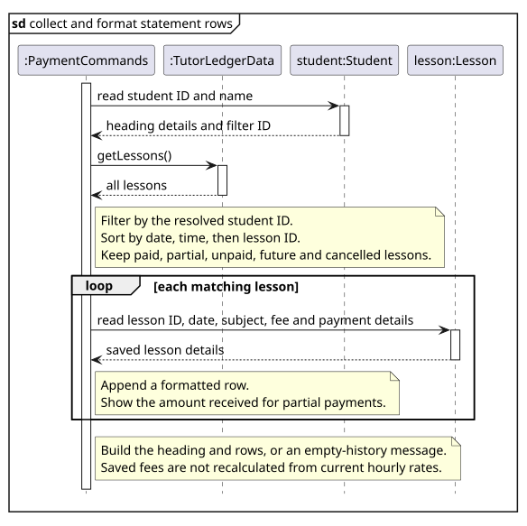

*Referenced fragment: collect and format statement rows. The request diagram resumes after these rows
have been assembled; this fragment reads existing records without changing them.*

#### Interaction with payment and lesson features

The statement reads each lesson's saved total fee and payment status. It does not consult the student's
current hourly rate or recalculate a fee, so changing a rate affects future scheduling but cannot rewrite
the amounts shown for existing lessons. Recording attendance and rescheduling preserve payments.
Editing the fee preserves the amount received but may change the derived payment status: a larger charge
can turn a paid lesson into a partially paid one; reducing the charge to the amount received settles it.
An edit below the amount received is rejected. Free lessons are always settled and add no income.

`mark LESSON_ID paid` and `mark LESSON_ID unpaid` update payment status on a replacement `Lesson` in
`TutorLedgerData`. The next fee statement displays that status. By contrast, `unpaid` and `owed` are
outstanding-balance views: they include non-cancelled lessons dated today or earlier with a
remaining balance, including partial payments, and report the amount still owed.
`fee_statement` intentionally shows the full stored history, including paid, future and cancelled
lessons. A cancellation therefore remains visible in the history, even though it is excluded from the
amounts due.

#### Defensive checks and persistence

The command requires exactly one student ID: an empty value or any extra whitespace-separated argument
returns the usage message. `TutorLedgerData.getStudent` validates the ID format, normalises it to the
canonical uppercase key and reports an unknown student; the statement converts that exception to a
user-facing error. Matching lessons are filtered against the resolved student ID without regard to case.
`getLessons()` returns a copy of the collection, and the command sorts a stream into a new list, leaving
the stored order unchanged. Sorting by date, time and lesson ID produces deterministic output even when
lessons share a date or start time.

Lesson constructors validate fees as non-negative dollar amounts with at most two decimal places and
store them as `BigDecimal`. The statement formats those already-validated values to two decimal places
without converting through floating point. Dates use the English weekday formatter so display is
consistent regardless of the machine's default locale.

The statement creates no data and writes no statement record. The main loop still takes its usual
pre-command storage snapshot and calls `saveIfChanged` afterwards, but this read-only command leaves the
snapshot unchanged, so no file write occurs. `mark` does change a lesson; the standard snapshot check
then saves its updated payment status along with the lesson's existing fee. The storage format keeps
these values on the lesson record, so the statement after restart reads the same fee and latest saved
status.

#### Alternatives, limits and verification

Generating a statement from the live lesson collection avoids a second payment-history store that could
drift out of sync with lesson edits, deletions or reloads. It also means the statement reflects the
current stored lesson details rather than preserving a separate point-in-time document. The feature
formats output for the terminal; exporting or printing a statement would be a separate capability.

`PaymentCommandsTest` checks that statements include only the selected student's lessons, include both
paid and unpaid fees in date order, and report empty histories and invalid student arguments. The same
suite checks payment-status updates that the statement reads, as well as the intentionally narrower
date and cancellation filters used by `unpaid` and `owed`.

## Appendix A: Product scope

### Target user profile

Independent tutors teaching primary-school, secondary-school and junior-college students, who are
comfortable entering commands in a terminal and need to manage their own tutoring records locally.

### Value proposition

TutorLedger keeps student profiles, lesson schedules, homework, scores, payments and follow-up tasks
together. Default rates reduce repeated entry, historical records support lesson preparation, and
explicit deletion confirmation helps prevent accidental loss. The application records payments; it
does not process money, deliver online lessons, or send messages to students and parents.

## Appendix B: User stories

|Version| As a ... | I want to ... | So that I can ...|
|--------|----------|---------------|------------------|
|v1.0|new user|see usage instructions|refer to them when I forget how to use the application|
|v1.0|independent tutor|schedule a lesson for a student on a given date and time|have one place that holds my whole teaching schedule|
|v1.0|independent tutor|list today's and this week's lessons in chronological order|know who I am teaching next and when|
|v1.0|independent tutor|record attendance and notes for a lesson|track who has been coming and what we covered|
|v1.0|independent tutor|edit or delete a lesson|correct mistakes without re-entering the record|
|v2.0|independent tutor|add a recurring weekly slot for a student|avoid entering the same lesson week after week|
|v2.0|busy tutor|see one summary of my next lesson|prepare in a single glance between lessons|
|v2.0|forgetful tutor|add a lesson record for a past date after the fact|keep my records accurate even when I forget on the day|
|v2.0|independent tutor|reschedule a lesson to a new date and time|keep my schedule matching what is actually happening|
|v2.0|independent tutor|cancel a lesson and give a reason|tell cancellations apart from student absences|
|v2.0|independent tutor|set a default hourly rate for each student|avoid re-entering the fee for every lesson|
|v2.0|independent tutor|add and edit primary-school, secondary-school and junior-college students|keep all my students in one place|
|v2.0|careless tutor|be warned before deleting a student who has lesson history|avoid losing months of records by accident|
|v2.0b|independent tutor|archive a student who has stopped lessons|keep my active list uncluttered while preserving history|
|v2.0b|independent tutor|list the topics already covered with a student|avoid repeating material we have finished|

## Appendix C: Non-functional requirements

* **Runtime:** the application is built for Java 25 and is operated through a terminal.
* **Offline operation:** the product's commands use local data and do not require a network service.
* **Persistence:** records are kept in a human-editable local file and restored across restarts.
  The working directory must permit file writes; failed saves are reported to the user.
* **Monetary precision:** money uses decimal arithmetic with explicit rounding for calculated charges.
* **Input errors:** rejected commands report a useful message without applying a partial update.

## Appendix D: Glossary

| Term | Meaning |
| --- | --- |
| Default hourly rate | An optional per-student rate used to choose a new lesson's fee when no explicit fee is supplied. |
| Archived student | A retained profile hidden from the default active list; restore it before scheduling new lessons. |
| Amount paid | The amount received and allocated to a lesson, rather than its total charge. |
| Outstanding balance | The saved fee minus the amount paid; summaries apply their documented date and cancellation filters. |
| Follow-up task | A pending or completed reminder, optionally linked to a student and a due date. |
| Snapshot | The encoded records used to detect whether a command changed data and needs an automatic save. |

## Appendix E: Instructions for manual testing

Start each scenario with its own empty working directory and use Java 25 with assertions enabled:
`java -ea -jar /absolute/path/to/tutorledger.jar`. This keeps student and record IDs reproducible.
Use dates before today for logged attendance and dates after today for upcoming lessons. The fixed
examples below target the October 2026 release; adapt both input dates and expected dates when testing
later. Back up any real data before testing deletion, reload or hand-edited files.

### Student book and command help

1. Run `add n/Alice Tan l/Pri5 p/91234567 s/Math r/60`. Expected: S1, canonical level `Pri 5`,
   subject Math and a $60.00/hour rate.
2. Run `subject S1 s/Physics`, `list alice` and `view S1`. Expected: one matching active profile;
   the view includes both subjects and the saved rate.
3. Run `edit S1 p/82345678`, then `edit S1 l/JC3`. Expected: the phone edit succeeds and the invalid
   level is rejected without changing the profile. `help` and `help extra` both show command help.
4. Exit and restart. Expected: the phone and subjects remain. The archive and deletion scenarios below
   cover their additional state changes.

### Homework

1. Add S1, then run `assign S1 Worksheet d/01-12-2026`. Expected: H1 is created and appears in `homework S1`.
2. Run `submit H1`, then `homework S1`. Expected: H1 is no longer outstanding. Repeating `submit H1`
   reports that it is already submitted without adding a record.
3. Exit and restart. Expected: H1 remains submitted; `view S1` does not list it as outstanding homework.

### Payments and fee-edit boundaries

1. Add `add n/Alice Tan l/Pri5 p/91234567 s/Math`, then log lessons:
   `log S1 d/01-09-2026 t/1600 s/Math f/60 a/present` and
   `log S1 d/02-09-2026 t/1600 s/Math f/55 a/present`.
2. Run `pay S1 80 L1 L2`. Expected: L1 is paid and L2 has $20.00 paid with $35.00 remaining.
   `unpaid S1`, `owed` and `filter S1 pay/unpaid` include L2. `income 09-2026` totals $80.00.
3. Run `edit L1 f/80`. Expected: L1 retains $60.00 paid and now owes $20.00; income remains $80.00.
   Run `edit L2 f/10`. Expected: an error and no loss of its $20.00 payment.
4. Log `log S1 d/03-09-2026 t/1600 s/Math f/0 a/present`. Expected: L3 is settled without a crash
   or an increase in income. `mark L2 paid` settles its balance; `mark L2 unpaid` resets its payment.
5. Schedule `schedule S1 d/01-12-2026 t/1600 s/Math f/60`, run `pay S1 20 L4`, then
   `cancel L4 r/Unavailable`. Expected: a reminder to refund or carry over $20.00, with the payment retained.
6. Exit and restart. Expected: the latest allocations, free-lesson status, edited fees and cancellation
   remain in `fee_statement S1`. Partial payments and cancelled lessons follow the same reporting rules.

### Follow-up tasks

1. Logging tasks
   1. Add a student (S1). Run `task S1 Bring Worksheet 4B d/16-10-2026`.
      Expected: `Added T1: Bring Worksheet 4B` and `for S1 ..., by Fri 16-10-2026`.
   1. Run `task Print term calendar`. Expected: `Added T2: Print term calendar` with no second line.
   1. Run `task S1 Bring notes d/31-02-2026`. Expected: an error, and `tasks` still lists 2 tasks.
1. Listing and finishing tasks
   1. Run `task S1 Return script d/01-01-2020`, then `tasks`. Expected: T3 is first and marked `OVERDUE`; T2
      (no date) is last.
   1. Run `done T3`, then `done T3` again. Expected: the second gives `Error: T3 is already done.`
1. Reminders in `next`
   1. Schedule a future lesson for S1, then run `next`. Expected: a final line `Follow-ups: T1 Bring Worksheet 4B
      (by ...)`.
1. Saving and deleting
   1. Restart TutorLedger. Expected: `tasks` shows the same tasks.
   1. Run `delete S1 confirm`. Expected: `Also deleted 2 follow-up tasks.` (T1 and T3); T2 (not linked) is kept.

### Lessons

Use an empty working directory and Java 25 with `-ea`. The steps assume today is before 01-12-2026.

1. Run `add n/Amirah Tan l/Sec 3 p/91234567 s/A Math`, then
   `schedule S1 d/01-12-2026 t/1600 s/A Math f/60 w/3`.
   Expected: L1 to L3, every Tuesday at 1600 from 01-12-2026 to 15-12-2026.
2. Run `schedule S1 d/15-12-2026 t/1600 s/A Math f/60`. Expected: `Error: L3 already starts at that date
   and time.` Run `schedule S1 d/22-12-2026 t/1600 s/A Math f/60 w/2`. Expected: L4 and L5, with no ID
   skipped by the rejected command.
3. Run `reschedule L3 d/16-12-2026`, then `cancel L2 r/Student sick`. Expected: L3 moves to Wednesday, and
   L2 is cancelled with its reason. `schedule S1 d/08-12-2026 t/1600 s/A Math f/60` now succeeds, because a
   cancelled lesson frees its slot.
4. Try `reschedule L2 t/1700`, `record L1 a/present` and `cancel L1 r/`. Expected: each is rejected with
   an error, because L2 is cancelled, L1 has not happened yet and the reason is blank.
5. Run `log S1 d/20-10-2026 t/1600 s/A Math f/60 a/present note/Quadratic inequalities`, then `next S1`.
   Expected: the next lesson is L1, its last topic is `Quadratic inequalities`, and one $60.00 lesson is
   unpaid.
6. Run `edit L1 t/1530`, `delete L5` and `lessons week`. Expected: L1 now starts at 1530 and L5 is gone.
   `lessons` lists only lessons in the current week, so it may show none.
7. Exit, restart and run `next S1`. Expected: the same summary as in step 5, showing L1 at 1530.

### Student deletion warnings

Use an empty working directory and run the packaged application with Java 25 and `-ea`.

1. Run `add n/Alice Tan l/Pri5 p/91234567 s/Math r/60` and
   `add n/Bob Tan l/JC2 p/81234567 s/Math`.
   Schedule `schedule S1 d/01-12-2026 t/1600 s/Math`, assign
   `assign S1 Worksheet d/02-12-2026` and record `score S1 WA1 m/8/10 d/15-09-2026`.
2. Run `delete s1`. Expected: a warning identifies Alice, lists one lesson, one homework item and one
   score, and instructs `delete S1 confirm`. No records are deleted. Run `view S1` and `scores S1`
   to check that the records remain. Repeat `delete S1`; it must warn again.
3. Run `delete S1 yes` and `delete S1 confirm extra`. Expected: usage errors without deletion.
   Run `help`; it must list the optional `confirm` token and explain the warning.
4. Cancel the lesson with `cancel L1 r/Student away`, then run `delete S1`. Expected: the cancelled
   lesson still triggers the warning. Exit without confirming, restart and run `view S1` and
   `delete S1` again. All records remain and the warning appears again.
5. Run `delete S1 confirm`. Expected: Alice and her linked lesson, homework and score are deleted.
   Bob remains. Restart; Alice's records must remain absent. Add another student; its ID must be S3.
6. Run `delete S2`. Expected: immediate deletion because Bob has no linked records. Add a student with
   only homework, only a score or only a follow-up task, and run `delete` on them. Expected: a warning
   each time. A single `delete LESSON_ID` remains immediate.
7. Repeat the warning and malformed-confirmation checks with Java's `-da` option. Expected: the same
   protection and error messages; input validation does not depend on assertions.

### Archiving students

Use an empty working directory and Java 25 with `-ea`.

1. Add `add n/Alice Tan l/Pri5 p/91234567 s/Math r/60` and
   `add n/Bob Tan l/JC2 p/81234567 s/Math r/70`.
2. Run `log S1 d/15-09-2026 t/1600 s/Math f/60 a/present note/Vectors`,
   `schedule S1 d/01-12-2026 t/1600 s/Math`, `assign S1 Worksheet d/02-12-2026` and
   `score S1 WA1 m/8/10 d/15-09-2026`.
3. Run `archive S1`, then `list`. Expected: only Bob is listed. `list status/archived` finds Alice;
   `list tan status/all` finds both in ID order, with Alice marked `[archived]`.
4. Run `view S1`, `scores S1`, `owed` and `next S1`. Expected: Alice's original details, historical
   records, unpaid balance and future lesson remain available. Archiving has not cancelled L2.
5. Try `schedule S1 d/02-12-2026 t/1600 s/Math w/2`. Expected: a restore instruction and no new lessons.
   Repeating `archive S1` reports that the student is already archived.
6. Restart and run `list status/archived` and `view S1`. Expected: archive status, rate and history persist.
   Run `restore S1`, then repeat the rejected schedule. Expected: L3 and L4 are created, with no skipped IDs.
7. Try `list status/other`, `archive S99` and `restore S1 extra`. Expected: errors without data changes.
   Repeat the scheduling guard with `-da`; protection must remain enabled without assertions.

### Covered topics

Use an empty working directory and Java 25 with `-ea`.

1. Run `add n/Alice Tan l/Pri5 p/91234567 s/Math s/Physics r/60` and
   `add n/Bob Tan l/JC2 p/81234567 s/Math r/70`.
2. Run `log S1 d/15-09-2026 t/1600 s/Math f/60 a/present note/Vectors`,
   `log S1 d/16-09-2026 t/1600 s/Physics f/60 a/late note/Forces` and
   `log S1 d/17-09-2026 t/1600 s/Math f/60 a/absent note/Not covered`.
3. Run `topics s1`. Expected: L2 and L1, newest first, with dates, subjects and full notes. The absent
   lesson is excluded. `topics S1 s/mAtH` lists only L1; `topics S2` reports no topics recorded.
4. Run `edit S1 s/Physics`, then `topics S1 s/Math`. Expected: L1 is still found despite the subject
   being removed from the profile. `edit L1 note/` removes L1 from the topics list.
5. Try `topics`, `topics S99`, `topics S1 s/` and `topics S1 s/Math s/Physics`.
   Expected: errors without changing any records or consuming IDs. `help` lists the new command.
6. Exit and restart; `topics S1` should still show Forces. Run with `-da` and repeat the invalid-input
   checks; validation must remain active without assertions.

### School levels

Use an empty working directory and run the packaged application with Java 25 and `-ea`.

1. Run `add n/Alice Tan l/pRi6 p/91234567 s/Math r/40` and
   `add n/Bob Tan l/JC2 p/81234567`. Expected: S1 is `Pri 6` and S2 is `JC 2`.
2. Run `edit S1 l/jc1`, then `edit S1 l/sec1`. Expected: each stage change succeeds and `view S1`
   finally shows `Sec 1`, subject `Math` and the same $40.00/hour rate.
3. Run `edit S1 l/JC3 r/99`. Expected: an error lists all three supported ranges; S1 remains `Sec 1`
   with the $40.00/hour rate.
4. Try `add n/Carol Tan l/Pri7 p/87654321`, then
   `add n/Carol Tan l/Pri1 p/87654321`. Expected: the first command fails; the second creates S3,
   demonstrating that the rejected command consumed no ID.
5. Run `help`. Expected: the `LEVELS` section lists all ranges and examples such as `l/Pri5` and `l/JC1`.
6. Exit and restart, then run `list`. Expected: S1 is `Sec 1`, S2 is `JC 2` and S3 is `Pri 1`, without
   any skipped-line warning. `view S1` still shows its subjects and default rate.

### Default hourly rates

Use an empty working directory and run the packaged application with Java 25 and `-ea`.

1. Add a student: `add n/Amirah l/Sec 3 p/91234567 s/E Math r/60`.
   Expected: S1 is created with `Default hourly rate: $60.00/hour`.
2. Run `schedule S1 d/20-10-2026 t/1600 s/E Math dur/90`.
   Expected: L1 is scheduled for 90 minutes with a total fee of $90.00.
3. Run `edit S1 r/100`, then `view S1`.
   Expected: the new rate is $100.00/hour; L1 still costs $90.00.
4. Run `edit L1 dur/30`, then `view S1`.
   Expected: L1 is 30 minutes long and still costs $90.00. `edit L1 f/50` explicitly changes it to $50.00.
5. Run `schedule S1 d/21-10-2026 t/1600 s/E Math f/25 dur/90`.
   Expected: L2 costs $25.00 in total, overriding the rate.
6. Run `edit S1 r/`, then try `schedule S1 d/22-10-2026 t/1600 s/E Math`.
   Expected: an error asks for a default rate or explicit fee; no lesson or ID is consumed.
7. Try `edit S1 r/-1` and `edit L1 dur/0 f/999`.
   Expected: both are rejected; S1's rate stays unset and L1's fee stays $50.00.
8. Exit and restart. Run `view S1`.
   Expected: both lessons retain their durations and fees, and the default rate remains unset.

### Fee statements

1. Create two students and schedule or log several lessons for one of them on different dates and times,
   including a future lesson. Mark at least one lesson as paid, and add a lesson for the other student.
   Add a third student, S3, without lessons for the empty-history check.
2. Run `fee_statement S1`. Expected: all of S1's lessons appear in date/time order, including the paid
   lesson, with each saved fee and current payment status; the other student's lesson is absent.
3. Run `fee_statement S3` for the student with no lessons. Expected: an empty-history message.
4. Try `fee_statement`, `fee_statement S99`, and `fee_statement S1 extra`. Expected: usage errors for
   missing/extra arguments and a student-not-found error for S99.
5. Run `mark L1 paid`, then `fee_statement S1`. Expected: L1 now shows as paid. Exit and restart TutorLedger,
   then run the statement again; the paid status and saved fee should be unchanged.

### Saving and loading data

1. Automatic save and restart
   1. Start TutorLedger in an empty folder. Expected: `No saved data yet...`.
   1. Run `add n/Amirah Binte Rahman l/Sec 3 p/91234567`, then `exit`.
   1. Start TutorLedger again. Expected: `Loaded 1 student, 0 lessons and 0 homework items...`.
1. Deleted IDs are not reused
   1. Add two students (S1, S2), `delete S2`, then restart TutorLedger.
   1. Add another student. Expected: it is given the ID S3, not S2.
1. Hand-editing and `reload`
   1. Open `data/tutorledger.txt` and change a student's phone number, then run `reload`.
      Expected: `view` shows the new number.
   1. Change a lesson's date to `31-02-2026`, then run `reload`.
      Expected: that line is reported as skipped with its line number; all other records load.
   1. Delete `data/tutorledger.txt`, then run `reload`.
      Expected: `No data file found...` and the current data is unchanged.
1. Backups
   1. Run `save backups/test.txt`. Expected: the file and the `backups` folder are created.

### Scores and progress

1. Recording scores
   1. Add a student (S1). Run `score S1 WA1 m/28/40 d/07-09-2026`. Expected: `Recorded A1 ...` with 70.0%.
   1. Run `score S1 Mid-year exam m/55/100 d/21-09-2026`. Expected: `Down 15.0 points from WA1 (70.0%)`.
   1. Run `score S1 WA2 m/45/40`. Expected: an error, and `scores S1` still lists 2 scores.
1. Listing scores
   1. Run `scores S1`. Expected: scores oldest first, a `-15.0` change on the second row, and a trend line.
1. Progress summary
   1. Schedule three past lessons for S1 and `record` them as `present`, `late` and `absent`.
   1. Run `progress S1`. Expected: `attended 2 of 3 recorded lessons (66.7%)` and both scores with their
      average.
   1. Run `progress S1 from/15-09-2026`. Expected: only lessons and scores from 15-09-2026 onwards.
1. Saving and deleting
   1. Restart TutorLedger. Expected: `scores S1` shows the same scores.
   1. Run `delete S1`. Expected: a warning appears because S1 has linked records, and the scores remain;
      run `delete S1 confirm` to complete the deletion. The success output says the scores were deleted too.

### Income summaries

1. Create or log several lessons in different months, mark some paid and leave others unpaid. Include a
   cancelled lesson marked paid.
2. Run `income 09-2026`. Expected: the total and payment details include positive amounts received for non-cancelled lessons
   dated in September 2026.
3. Run `income 2026`. Expected: all 12 months appear with their monthly totals and payment details; months
   without received payments show `$0.00`.
4. Try `income 13-2026`, `income 0000`, and `income 2026 extra`. Expected: each input is rejected with a
   usage or date-range error.
