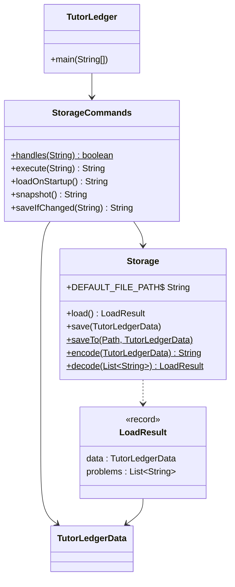
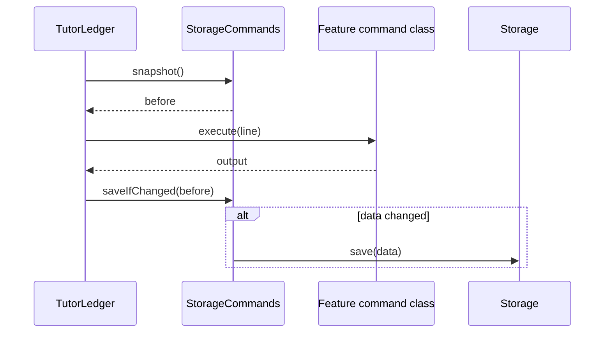
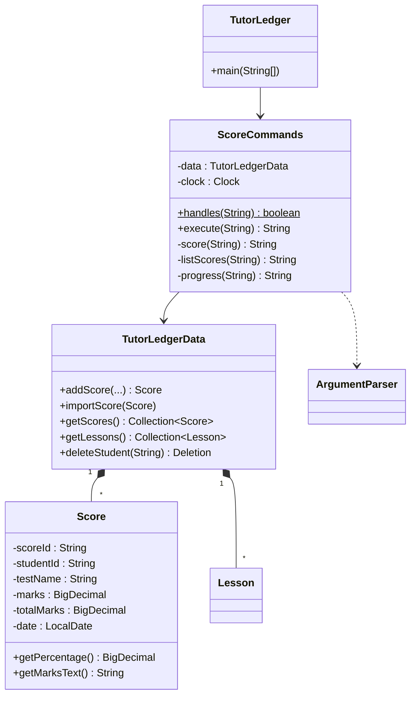
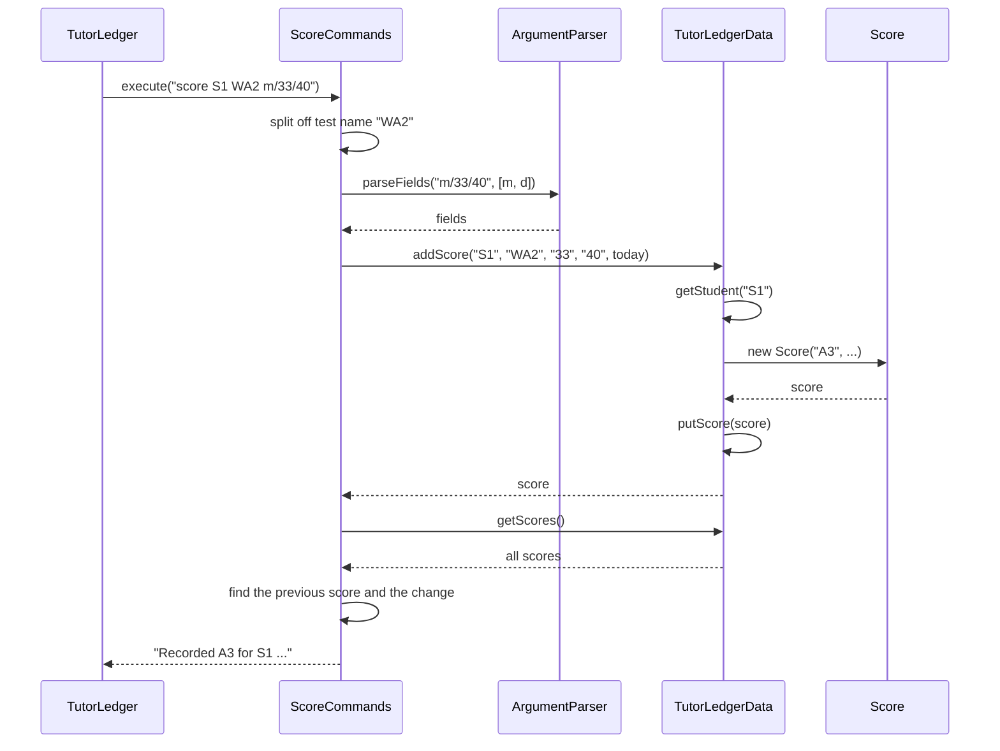
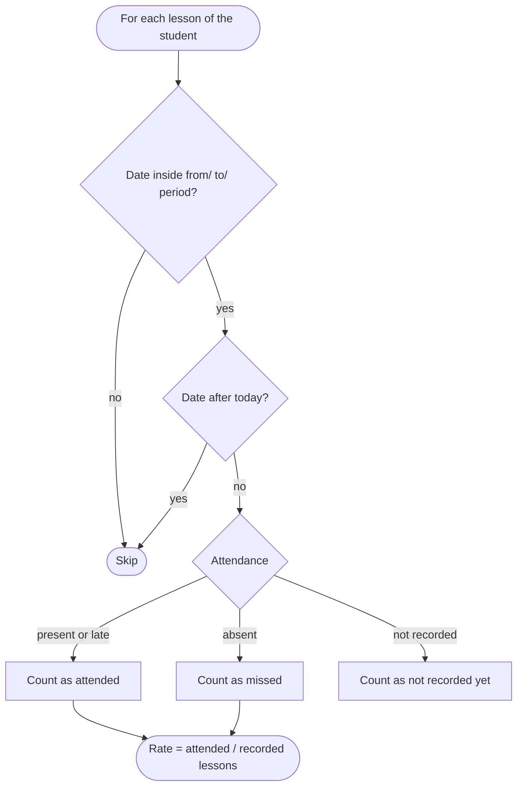
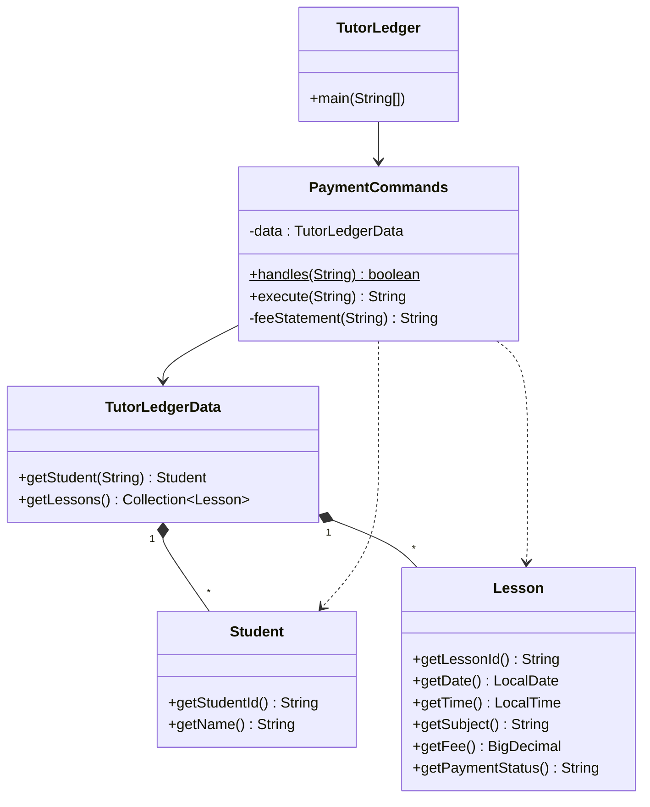
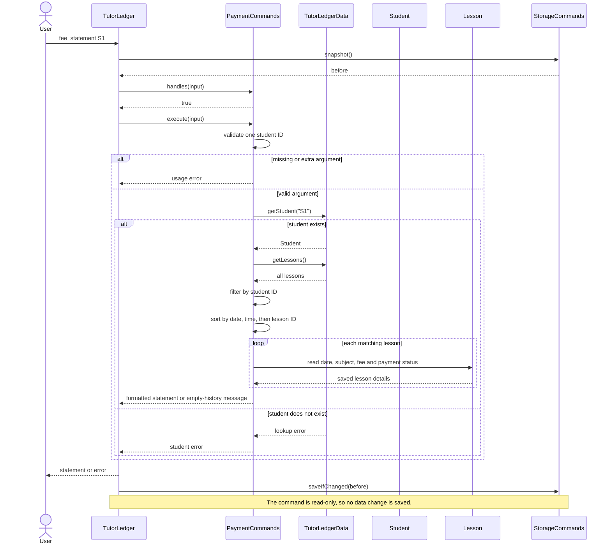

# Developer Guide

## Acknowledgements

{list here sources of all reused/adapted ideas, code, documentation, and third-party libraries -- include links to the original source as well}

* The default hourly rate UML figures are rendered with [PlantUML](https://plantuml.com/),
  using the [SE-EDU PlantUML guide](https://se-education.org/guides/tutorials/plantUml.html) for tooling guidance.

## Design & implementation

{Describe the design and implementation of the product. Use UML diagrams and short code snippets where applicable.}

### Storage

The storage feature (F5.1 automatic save, F5.2 human-editable data file) keeps every record in one
plain-text file, `data/tutorledger.txt`, so that data survives restarts and a tutor can fix or bulk-edit
records in a text editor.



* **`Storage`** knows the file format and does the file input/output. It never prints anything, so it can
  be tested on its own.
* **`StorageCommands`** runs `save` and `reload`, loads the file at startup and saves automatically. It turns
  file errors into messages for the user, following the same `handles`/`execute` pattern as the other
  command classes.
* **`TutorLedgerData`** gained `importLesson`, `importHomework`, `setNextLessonNumber`,
  `setNextHomeworkNumber` and `replaceAllWith` so that records can be restored with their saved IDs.

#### File format

Each record is one line of fields separated by ` | `:

```
NEXT | S3 | L2 | H2 | A2
S | S1 | Amirah Binte Rahman | Sec 3 | 91234567 | E Math | A Math
L | L1 | S1 | 15-09-2026 | 1600 | A Math | 60 | present | paid | Quadratics \| discriminant
H | H1 | S1 | 29-09-2026 | outstanding | Worksheet 4A
A | A1 | S1 | 07-09-2026 | 28 | 40 | WA1
```

* The `NEXT` line saves the ID counters. Without it, deleting the newest student and restarting would
  hand the deleted student's ID to the next new student, breaking the rule that IDs are never reused.
* A `|` or `\` inside a value is escaped as `\|` or `\\`, so notes and subjects can contain any text.
* Values are written in the same format the user types them (e.g. `DD-MM-YYYY`), so a hand-edited file
  uses the rules users already know.

*Alternatives considered:* JSON (via a library such as Jackson) handles nesting and escaping for us, but it
is harder for a tutor to edit by hand, and it needs a third-party library. CSV is similar to the chosen
format, but its quoting rules are less obvious to people editing it by hand.

#### Loading and validation

`Storage.decode` reads the file in two passes: students (and the `NEXT` line) first, then lessons,
homework and scores. Lessons, homework and scores must belong to an existing student, so this order lets lines appear in any
order in the file. Every record is rebuilt through the same constructors and `TutorLedgerData` methods that
commands use, so a hand-edited file is checked by exactly the same rules as typed input. For example, the
rules reject an invalid date, a duplicate ID, two lessons in one slot, or a lesson for a missing student.

A line that fails a check is skipped and reported as `Line N: reason`. Loading carries on with the
remaining lines, so one typo does not lose the whole file.

#### Automatic saving

Before each command, the main loop takes a `snapshot()` (the text the file would contain). After the
command, `saveIfChanged` compares a new snapshot with it and writes the file only if they differ.



* Comparing snapshots means a command that teammates add later is saved automatically. Nobody has to
  remember to update a list of "commands that change data".
* Commands that only display data never write the file, so they cannot overwrite a tutor's hand edits
  before `reload`.
* `save` and `reload` skip the automatic save. In particular, `reload` must not save, or the lines it just
  skipped would be erased before the tutor could fix them.
* The cost is encoding the data twice per command. For the few hundred records a tutor has, this takes
  well under a millisecond.

*Alternative considered:* saving after every command, whether or not it changed anything, is simpler. But a
read-only command such as `list` would then overwrite hand edits made while the app is open.

*Possible improvement:* write to a temporary file and then rename it over the data file. This means a crash
part-way through writing can never leave a half-written data file.

### Scores and progress

These features let a tutor record test results (F7.1 `score`, F7.2 `scores`, story US19) and review a
student at the end of a term (F7.3 `progress`, story US44).



* **`Score`** is an immutable record of one test result, like `Lesson` and `Homework`. Its constructor
  checks every value, for example that the marks are not more than the total. A score therefore cannot
  exist in an invalid state, whether it was typed in or loaded from a hand-edited file.
* **`ScoreCommands`** follows the same `handles`/`execute` pattern as the other command classes. The main
  loop routes `score`, `scores` and `progress` to it.
* **`TutorLedgerData`** stores scores in a map keyed by ID, with a counter that never decreases, as it does
  for lessons and homework. `deleteStudent` also removes the student's scores, and `Deletion` reports how
  many were removed.
* **`Storage`** saves each score as an `A` line. The score counter is a fifth, optional field on the `NEXT`
  line, so data files written before this feature still load.

#### Recording a score

The sequence diagram below shows `score S1 WA2 m/33/40`.



1. The test name is everything before the first `m/` or `d/`, so it can contain spaces, like an `assign`
   description. The rest goes to the shared `ArgumentParser`, so `m/` and `d/` can be typed in any order.
2. `TutorLedgerData.addScore` looks up the student first, so a score can never belong to a missing student.
   It then creates the `Score`, which validates the values, and stores it under the next ID.
3. `ScoreCommands` sorts the student's scores by date and compares the new score with the one before it.
   The tutor sees at once whether the student did better or worse.

Any invalid value throws `IllegalArgumentException` before anything is stored. `execute` turns this into an
`Error: ...` message and logs it at `WARNING` level.

**Design decisions**

* *Marks are `BigDecimal`, not `double`.* Half marks such as 17.5 are common, and `double` cannot store
  some decimals exactly. The data file would then show values like `17.499999`. Lesson fees use
  `BigDecimal` for the same reason.
* *Scores are compared as percentages.* Tests have different totals (40 marks for a class test, 100 for an
  exam), so raw marks cannot be compared. Percentages are rounded to 1 decimal place with `HALF_UP`.
* *The date defaults to today.* Tutors usually record a score on the day the script is returned.
  *Alternative considered:* making `d/` compulsory is stricter, but it adds typing for the most common case.

#### Summarising progress

`progress STUDENT_ID [from/DATE] [to/DATE]` gathers the student's lessons and scores in the period and
summarises them. The activity diagram shows how each lesson is counted.



* Lessons after today are skipped because they cannot have attendance yet. Counting them as "not
  recorded" would wrongly suggest the tutor forgot to record them.
* Unrecorded past lessons are reported, but they are left out of the rate. Otherwise a tutor who has not
  yet recorded yesterday's lesson would see a lower rate than the student deserves.
* A late arrival counts as attending. The tutor still taught the lesson, and the separate `late` count
  keeps lateness visible.
* Without `from/`, the period starts at `LocalDate.MIN`, so all of the student's records are included.

`scores` and `progress` share the private helpers `scoreTable` and `trend`, so the score list looks the same
in both commands.

*Alternative considered:* storing term dates, so a tutor could type `progress S1 term/3`. Schools' term
dates differ, and a tutor would have to set them up first. `from/` and `to/` work for any period with no
setup.

*Possible improvements:* let `edit` and `delete` accept a `SCORE_ID`, so a mistyped score can be fixed
without editing the data file. Also show the average score by subject, once scores record a subject.


### Default hourly rates — Yan Hern

**v2.0 enhancement · US5 · [Issue #11](https://github.com/AY2627S1-CS2113-W12-2/tp/issues/11)**

An independent tutor often charges the same student the same hourly rate for many lessons. Requiring
`f/60` every time repeats information and makes it easy to enter an inconsistent fee. This enhancement
lets the tutor store that rate on the student and schedule a lesson using its duration. For example,
after `edit S1 r/60`, `schedule S1 d/20-10-2026 t/1600 s/E Math dur/90` creates a lesson costing
$90.00. Omitting `dur/` means 60 minutes. An explicit `f/25` instead charges $25 for the whole lesson.

#### Responsibilities and object relationships

The feature extends the existing command, model and storage components. `StudentCommands` parses `r/`
on `add` and `edit`; `LessonCommands` parses optional `dur/` and `f/` on `schedule`. Both use
`ArgumentParser`, so prefixes keep their existing case-insensitive, order-independent behaviour.
`TutorLedgerData` chooses the total fee when creating a lesson. This puts the business rule at the
shared data boundary rather than only in a particular command handler.


*Figure 1. The store owns student and lesson records; a lesson identifies its student by permanent ID.*

`Student` stores an optional `BigDecimal` rate. Its getter returns `Optional<BigDecimal>` so callers
must distinguish an unset rate from a valid rate of zero. A missing rate means that scheduling needs an
explicit fee; zero means that the lesson is free. Existing constructors still create students without
a rate. Existing `withDetails` operations preserve the rate, including subject changes.

`Lesson` stores both `durationMinutes` and its total `fee`. These are immutable values. Existing lesson
constructors default to 60 minutes, while the new overload accepts a validated duration. Copies created
for attendance, notes, payment status and other edits retain the duration unless it is explicitly edited.
This preserves existing callers without requiring changes to unrelated feature handlers.

#### Setting and clearing a rate

`add ... r/60` creates the entire profile, including subjects and rate, before the data store inserts
anything. Invalid rates therefore cannot leave a partially created student or consume an ID.
`edit S1 r/65` creates a replacement profile, validates it, then replaces the existing map entry.
The original profile remains available until all validation succeeds.


*Figure 2. A rate edit replaces a validated student and uses the existing automatic-save path.*

Omitting `r/` during an edit preserves the current rate. A bare `edit S1 r/` deliberately clears it,
matching the existing convention for clearing subjects with `s/`. A bare `r/` on `add` is rejected:
there is no existing rate to clear, so omission already expresses that intent. Repeated `r/` prefixes
are rejected rather than choosing a value silently. `view S1` reports either the dollar rate per hour
or `Default hourly rate: not set`.

#### Scheduling and keeping charges stable

The new `addLesson` overload accepts duration and an optional explicit fee. An explicit fee has priority
and represents the entire lesson charge, regardless of duration. Otherwise, the method obtains the
student's default rate. If neither source is available, it returns an error explaining both remedies:
set the student's rate or supply `f/FEE`.

Single and weekly scheduling share `resolveLessonFee`, so `schedule ... dur/90 w/3` gives each of the
three lessons the same fixed duration-based fee. Weekly scheduling still validates every slot before
inserting any lessons. A conflict in a later week therefore leaves records and ID counters unchanged.


*Figure 3. Calculation happens before insertion; the result is stored as the lesson's fixed charge.*

The calculation is `hourly rate × duration in minutes ÷ 60`. All money uses `BigDecimal`; conversion to
`double` would introduce binary floating-point approximation. Division rounds once to two decimal
places using `HALF_UP`. For example, $60.01/hour for 30 minutes produces $30.005 before rounding and
$30.01 afterwards. Multiplication is performed before division to avoid rounding an hourly rate down
to a per-minute rate too early.


*Figure 4. Invalid explicit values are rejected; they do not trigger a fallback to the default rate.*

Changing the student's rate affects newly scheduled lessons only. Previously scheduled lessons,
including future appointments, keep their saved fee. Editing a lesson's duration also keeps its fee;
the tutor must use `edit L1 f/AMOUNT` to change the charge. This protects negotiated prices and prevents
an administrative edit from changing payment history. Payment summaries and fee statements continue
reading `Lesson.getFee()`, so they need no separate pricing logic.

#### Defensive checks and persistence

Rates accept non-negative decimal dollar amounts with at most two fractional digits. Durations accept
whole minutes from 1 to 1440. Model validation throws `IllegalArgumentException`, so these rules apply
to direct calls and hand-edited files even when assertions are disabled. The command layer catches
these exceptions and returns `Error: ...`. Assertions check programming invariants, such as preserving
student identity and advancing counters only after successful insertion. Debug logging records rate
changes, calculation results and rejected commands without adding messages to normal command output.

The data file keeps the legacy student layout because every trailing student field is already a
subject. Inserting a rate into that layout could misread an existing subject as money. Instead, an
optional `R | S1 | 60` record stores a student's rate. New lesson lines end with `NOTES |
CANCELLATION_REASON | MINUTES`, using an empty cancellation reason for active lessons. Separate fields
prevent a cancellation reason such as `90` from being confused with a 90-minute duration. Legacy
ten-field rows and upstream eleven-field cancellation rows still load, with a default duration of 60.
Files saved by the earlier hourly-rate branch used field eleven for duration; their generated
`NOTES | MINUTES` header identifies that layout. Headerless eleven-field rows retain upstream's
cancellation semantics. Loading preserves the saved total fee and never recalculates it from current rates.

Immutable lesson copies retain both cancellation and duration. Rescheduling keeps the chosen fee;
cancelling retains its recorded amount for history while excluding it from amounts owed. An edit to a
cancelled lesson cannot give it attendance, even if it also changes the duration.

Students load in the first pass. The second pass applies rates and imports linked records, allowing
lines in any order. Invalid or orphaned rate lines are skipped with their line numbers; a duplicate
rate line cannot override the first valid rate. A bad rate does not discard the student or their
history. Encoding includes rate records and durations, so the existing snapshot comparison automatically
saves changes. The new application reads old files; older application versions cannot read all new
records, so keep a backup before using the new version if a downgrade may be necessary.

#### Alternatives, limits and verification

A separate `rate` command was considered. Extending `add` and `edit` uses familiar commands and supports
entering a complete student in one line. Storing only the rate on lessons and calculating fees whenever
displayed was also considered. Saving the chosen total instead keeps historical amounts stable.
Per-subject rates, effective-date rate histories and automatic recalculation are possible future
extensions; they would need explicit rules for existing and paid lessons.

Duration currently supports billing and display. Conflict checking retains the existing identical-start
rule; it does not detect overlapping lesson intervals. Adding interval scheduling would be a separate
enhancement requiring corresponding tests and documentation.

`DefaultHourlyRateTest` exercises command validation, decimal rounding, overrides, rate clearing,
immutable copies, payment totals, legacy files, malformed records and save/restart behaviour. The manual
scenario below provides a reproducible acceptance check. UML sources and rendering instructions are
kept in [diagrams/README.md](diagrams/README.md); rendered SVGs display on GitHub Pages without a client-side
diagram renderer.

### School levels — Yan Hern

[Issue #82](https://github.com/AY2627S1-CS2113-W12-2/tp/issues/82) extends the existing `l/LEVEL` field
to primary, secondary and junior-college students. Accepted ranges are `Pri 1`–`Pri 6`, `Sec 1`–`Sec 5`,
and `JC 1`–`JC 2`. Input is case-insensitive and permits the space to be omitted; `pRi5` becomes `Pri 5`.

`Student.validateLevel` checks complete stage/year patterns and returns a canonical string. The level
stays a `String`; a new type is unnecessary for this small extension. Keeping this check in the model
means that `add`, `edit`, imports and reloads all follow the same rules. Invalid input, including null,
throws `IllegalArgumentException` with the supported ranges; validation does not depend on assertions.
The method logs validation and normalisation at `FINE` level and asserts its internal non-null assumption
after validation succeeds.

Adding or editing validates a complete candidate before storing it. A failed add consumes no ID, and a
failed edit preserves the original record. Changing stage keeps the student's ID, contact details,
subjects and default hourly rate; lessons, homework and scores stay linked by the same student ID.

The student file layout is unchanged and existing secondary-school records still load. Saving uses
canonical levels. Earlier builds reject primary/JC student lines and their linked records, so keep a
backup before returning to an older build. Model tests cover every supported year and malformed inputs;
command and storage tests cover stage changes, preserved history and mixed-stage files. The manual
scenario below checks the visible behaviour and restart persistence.

### Student deletion warnings — Yan Hern

[Issue #40](https://github.com/AY2627S1-CS2113-W12-2/tp/issues/40), story US34, protects lesson history
from accidental student deletion. `StudentCommands.delete` accepts `delete STUDENT_ID [confirm]`.
It validates the complete argument list and resolves the current student before taking any action.
An unconfirmed command checks all lessons belonging to that student, regardless of date, attendance,
payment or cancellation status. If any exist, `deletionWarning` returns the student's identity, counts
of every linked record type and the exact confirmation command. Submitted homework and all scores are
included because the existing cascade would remove them too. A warning changes neither records nor
ID counters, so the existing snapshot-based automatic save performs no write.

Confirmation is an explicit, case-insensitive token on the same command, for example
`delete S1 confirm`. There is no pending action: `yes` alone cannot delete anything, and another command,
reload or restart needs no cancellation handling. A repeated unconfirmed command reads the current
records and warns again. Explicit confirmation may be used directly and always resolves the student
again before calling `TutorLedgerData.deleteStudent`; that method retains responsibility for deleting
linked lessons, homework and scores and returning the actual removal counts. The success output and
permanent-ID rules are unchanged. Students without lessons still delete immediately, including those
with only homework or scores. Single-lesson deletion is unchanged.

The alternative was a yes/no prompt in the main input loop. That would require tracking the target and
deciding how unrelated commands, reload and end-of-input affect a pending confirmation. The explicit
command fits the existing one-line parser and avoids retaining a stale target. This is a warning before
permanent deletion, rather than an undo or archive mechanism; backups remain necessary for recovery.

Invalid IDs, missing students, unknown confirmation tokens and extra arguments produce normal
`IllegalArgumentException` messages before mutation; user-input checks work with assertions disabled.
Internal assertions ensure that the warning is built for an existing student with at least one lesson.
`FINE` logging records warning and deletion decisions using the student ID. Existing Gradle and shared
IDEA run configurations enable assertions. No public model API or storage-format change is needed.

`StudentDeletionWarningTest` covers warnings, cascade isolation, all lesson states, counts, invalid
inputs, intervening commands, fresh data after reload, saved-file preservation and restart persistence.
The manual scenario below checks the packaged command routing and visible confirmation flow.

### Fee statements - Izaaz

`fee_statement STUDENT_ID` is handled by `PaymentCommands`. It resolves the student, reads the shared
lesson collection, and builds the statement when requested; no separate statement record is stored.
The command includes every stored lesson for that student, whether paid or unpaid and whether in the
past or future. Rows are ordered by date, start time, then lesson ID, and display the saved fee and
payment status alongside the lesson ID, date and subject. A missing or extra argument and an unknown
student produce an error; a valid student with no lessons gets an explicit empty-history message.



*Figure 5. The statement is assembled from the selected student and their stored lessons; it does not
introduce a new domain object.*

The command validates that exactly one student ID was supplied before looking up the student. It then
filters lessons by that student's ID and sorts them before formatting each row. This is deliberately
different from `unpaid` and `owed`, which only consider unpaid lessons that have already taken place.
Fees and payment statuses come from each `Lesson`, so the statement does not recalculate charges or
change payment state.



*Figure 6. The command reads lesson records and returns a formatted view without changing stored data.*

#### Interaction with payment and lesson features

The statement reads each lesson's saved total fee and payment status. It does not consult the student's
current hourly rate or recalculate a fee, so changing a rate affects future scheduling but cannot rewrite
the amounts shown for existing lessons. Likewise, `edit`, `record` and `reschedule` preserve payment
status; they do not implicitly mark a fee as paid.

`mark LESSON_ID paid` and `mark LESSON_ID unpaid` update payment status on a replacement `Lesson` in
`TutorLedgerData`. The next fee statement displays that status. By contrast, `unpaid` and `owed` are
outstanding-balance views: they include only unpaid, non-cancelled lessons dated today or earlier.
`fee_statement` intentionally shows the full stored history, including paid, future and cancelled
lessons. A cancellation therefore remains visible in the history, even though it is excluded from the
amounts due.

#### Defensive checks and persistence

The command requires exactly one student ID: an empty value or any extra whitespace-separated argument
returns the usage message. `TutorLedgerData.getStudent` validates the ID format, normalises it to the
canonical uppercase key and reports an unknown student; the statement converts that exception to a
user-facing error. Matching lessons are filtered against the resolved student ID without regard to case.
`getLessons()` returns a copy of the collection, and the command sorts a stream into a new list, leaving
the stored order unchanged. Sorting by date, time and lesson ID produces deterministic output even when
lessons share a date or start time.

Lesson constructors validate fees as non-negative dollar amounts with at most two decimal places and
store them as `BigDecimal`. The statement formats those already-validated values to two decimal places
without converting through floating point. Dates use the English weekday formatter so display is
consistent regardless of the machine's default locale.

The statement creates no data and writes no statement record. The main loop still takes its usual
pre-command storage snapshot and calls `saveIfChanged` afterwards, but this read-only command leaves the
snapshot unchanged, so no file write occurs. `mark` does change a lesson; the standard snapshot check
then saves its updated payment status along with the lesson's existing fee. The storage format keeps
these values on the lesson record, so the statement after restart reads the same fee and latest saved
status.

#### Alternatives, limits and verification

Generating a statement from the live lesson collection avoids a second payment-history store that could
drift out of sync with lesson edits, deletions or reloads. It also means the statement reflects the
current stored lesson details rather than preserving a separate point-in-time document. The feature
formats output for the terminal; exporting or printing a statement would be a separate capability.

`PaymentCommandsTest` checks that statements include only the selected student's lessons, include both
paid and unpaid fees in date order, and report empty histories and invalid student arguments. The same
suite checks payment-status updates that the statement reads, as well as the intentionally narrower
date and cancellation filters used by `unpaid` and `owed`.

## Product scope
### Target user profile

{Describe the target user profile}

### Value proposition

{Describe the value proposition: what problem does it solve?}

## User Stories

|Version| As a ... | I want to ... | So that I can ...|
|--------|----------|---------------|------------------|
|v1.0|new user|see usage instructions|refer to them when I forget how to use the application|
|v2.0|user|find a to-do item by name|locate a to-do without having to go through the entire list|
|v2.0 (US5)|independent tutor|set a default hourly rate for each student|avoid re-entering the fee for every lesson|
|v2.0 (#82)|independent tutor|add and edit primary-school, secondary-school and junior-college students|keep all my students in one place|
|v2.0 (US34, #40)|careless tutor|be warned before deleting a student who has lesson history|avoid losing months of records by accident|

## Non-Functional Requirements

{Give non-functional requirements}

## Glossary

* *glossary item* - Definition

## Instructions for manual testing

{Give instructions on how to do a manual product testing e.g., how to load sample data to be used for testing}

### Student deletion warnings (US34, #40)

Use an empty working directory and run the packaged application with Java 25 and `-ea`.

1. Run `add n/Alice Tan l/Pri5 p/91234567 s/Math r/60` and
   `add n/Bob Tan l/JC2 p/81234567 s/Math`.
   Schedule `schedule S1 d/01-12-2026 t/1600 s/Math`, assign
   `assign S1 Worksheet d/02-12-2026` and record `score S1 WA1 m/8/10 d/15-09-2026`.
2. Run `delete s1`. Expected: a warning identifies Alice, lists one lesson, one homework item and one
   score, and instructs `delete S1 confirm`. No records are deleted. Run `view S1` and `scores S1`
   to check that the records remain. Repeat `delete S1`; it must warn again.
3. Run `delete S1 yes` and `delete S1 confirm extra`. Expected: usage errors without deletion.
   Run `help`; it must list the optional `confirm` token and explain the warning.
4. Cancel the lesson with `cancel L1 r/Student away`, then run `delete S1`. Expected: the cancelled
   lesson still triggers the warning. Exit without confirming, restart and run `view S1` and
   `delete S1` again. All records remain and the warning appears again.
5. Run `delete S1 confirm`. Expected: Alice and her linked lesson, homework and score are deleted.
   Bob remains. Restart; Alice's records must remain absent. Add another student; its ID must be S3.
6. Run `delete S2`. Expected: immediate deletion because Bob has no lessons. This also applies to
   students with only homework or scores. A single `delete LESSON_ID` remains immediate.
7. Repeat the warning and malformed-confirmation checks with Java's `-da` option. Expected: the same
   protection and error messages; input validation does not depend on assertions.

### School levels (#82)

Use an empty working directory and run the packaged application with Java 25 and `-ea`.

1. Run `add n/Alice Tan l/pRi6 p/91234567 s/Math r/40` and
   `add n/Bob Tan l/JC2 p/81234567`. Expected: S1 is `Pri 6` and S2 is `JC 2`.
2. Run `edit S1 l/jc1`, then `edit S1 l/sec1`. Expected: each stage change succeeds and `view S1`
   finally shows `Sec 1`, subject `Math` and the same $40.00/hour rate.
3. Run `edit S1 l/JC3 r/99`. Expected: an error lists all three supported ranges; S1 remains `Sec 1`
   with the $40.00/hour rate.
4. Try `add n/Carol Tan l/Pri7 p/87654321`, then
   `add n/Carol Tan l/Pri1 p/87654321`. Expected: the first command fails; the second creates S3,
   demonstrating that the rejected command consumed no ID.
5. Run `help`. Expected: the `LEVELS` section lists all ranges and examples such as `l/Pri5` and `l/JC1`.
6. Exit and restart, then run `list`. Expected: S1 is `Sec 1`, S2 is `JC 2` and S3 is `Pri 1`, without
   any skipped-line warning. `view S1` still shows its subjects and default rate.

### Default hourly rates (US5)

Use an empty working directory and run the packaged application with Java 25 and `-ea`.

1. Add a student: `add n/Amirah l/Sec 3 p/91234567 s/E Math r/60`.
   Expected: S1 is created with `Default hourly rate: $60.00/hour`.
2. Run `schedule S1 d/20-10-2026 t/1600 s/E Math dur/90`.
   Expected: L1 is scheduled for 90 minutes with a total fee of $90.00.
3. Run `edit S1 r/100`, then `view S1`.
   Expected: the new rate is $100.00/hour; L1 still costs $90.00.
4. Run `edit L1 dur/30`, then `view S1`.
   Expected: L1 is 30 minutes long and still costs $90.00. `edit L1 f/50` explicitly changes it to $50.00.
5. Run `schedule S1 d/21-10-2026 t/1600 s/E Math f/25 dur/90`.
   Expected: L2 costs $25.00 in total, overriding the rate.
6. Run `edit S1 r/`, then try `schedule S1 d/22-10-2026 t/1600 s/E Math`.
   Expected: an error asks for a default rate or explicit fee; no lesson or ID is consumed.
7. Try `edit S1 r/-1` and `edit L1 dur/0 f/999`.
   Expected: both are rejected; S1's rate stays unset and L1's fee stays $50.00.
8. Exit and restart. Run `view S1`.
   Expected: both lessons retain their durations and fees, and the default rate remains unset.

### Fee statements

1. Create two students and schedule or log several lessons for one of them on different dates and times,
   including a future lesson. Mark at least one lesson as paid, and add a lesson for the other student.
2. Run `fee_statement S1`. Expected: all of S1's lessons appear in date/time order, including the paid
   lesson, with each saved fee and current payment status; the other student's lesson is absent.
3. Run `fee_statement S2` for a student with no lessons. Expected: an empty-history message.
4. Try `fee_statement`, `fee_statement S99`, and `fee_statement S1 extra`. Expected: usage errors for
   missing/extra arguments and a student-not-found error for S99.
5. Run `mark L1 paid`, then `fee_statement S1`. Expected: L1 now shows as paid. Exit and restart TutorLedger,
   then run the statement again; the paid status and saved fee should be unchanged.

### Saving and loading data

1. Automatic save and restart
   1. Start TutorLedger in an empty folder. Expected: `No saved data yet...`.
   1. Run `add n/Amirah Binte Rahman l/Sec 3 p/91234567`, then `exit`.
   1. Start TutorLedger again. Expected: `Loaded 1 student, 0 lessons and 0 homework items...`.
1. Deleted IDs are not reused
   1. Add two students (S1, S2), `delete S2`, then restart TutorLedger.
   1. Add another student. Expected: it is given the ID S3, not S2.
1. Hand-editing and `reload`
   1. Open `data/tutorledger.txt` and change a student's phone number, then run `reload`.
      Expected: `view` shows the new number.
   1. Change a lesson's date to `31-02-2026`, then run `reload`.
      Expected: that line is reported as skipped with its line number; all other records load.
   1. Delete `data/tutorledger.txt`, then run `reload`.
      Expected: `No data file found...` and the current data is unchanged.
1. Backups
   1. Run `save backups/test.txt`. Expected: the file and the `backups` folder are created.

### Scores and progress

1. Recording scores
   1. Add a student (S1). Run `score S1 WA1 m/28/40 d/07-09-2026`. Expected: `Recorded A1 ...` with 70.0%.
   1. Run `score S1 Mid-year exam m/55/100 d/21-09-2026`. Expected: `Down 15.0 points from WA1 (70.0%)`.
   1. Run `score S1 WA2 m/45/40`. Expected: an error, and `scores S1` still lists 2 scores.
1. Listing scores
   1. Run `scores S1`. Expected: scores oldest first, a `-15.0` change on the second row, and a trend line.
1. Progress summary
   1. Schedule three past lessons for S1 and `record` them as `present`, `late` and `absent`.
   1. Run `progress S1`. Expected: `attended 2 of 3 recorded lessons (66.7%)` and both scores with their
      average.
   1. Run `progress S1 from/15-09-2026`. Expected: only lessons and scores from 15-09-2026 onwards.
1. Saving and deleting
   1. Restart TutorLedger. Expected: `scores S1` shows the same scores.
   1. Run `delete S1`. Expected: if S1 has lessons, a warning appears and the scores remain;
      run `delete S1 confirm` to complete the deletion. The success output says the scores were deleted too.
