# Developer Guide

Select a diagram to enlarge it.

## Acknowledgements

* The project started from the [CS2113 project template](https://github.com/NUS-CS2113-AY2627-S1/tp).
* The architecture diagram's presentation is inspired by the
  [EduReserve Developer Guide](https://ay2627s1-cs2113-w14-2.github.io/tp/DeveloperGuide.html).
  Its component responsibilities and dependencies describe TutorLedger's own implementation.

* The default hourly rate UML figures are rendered with [PlantUML](https://plantuml.com/),
  using the [SE-EDU PlantUML guide](https://se-education.org/guides/tutorials/plantUml.html) for tooling guidance.
* The lesson UML figures follow the notation of the [SE-EDU textbook](https://se-education.org/se-book/)
  and are rendered with [PlantUML](https://plantuml.com/).

## Setting up and running the project

Install Git and JDK 25, then clone your fork and open a terminal in the repository root. Check
`java -version` before building: it must report Java 25. The repository includes the Gradle wrapper,
so no separate Gradle installation is needed.

On macOS or Linux, build the application and run the automated checks with:

```sh
./gradlew check shadowJar
```

On Windows, use `.\gradlew.bat check shadowJar`. `check` runs the JUnit
tests and Checkstyle; `shadowJar` creates `build/libs/tutorledger.jar`. The test report is written to
`build/reports/tests/test/index.html`.

Run the application with `./gradlew run` (Windows: `.\gradlew.bat run`), or run the packaged JAR:

```sh
java -ea -jar build/libs/tutorledger.jar
```

The application prints `TutorLedger student book. Type exit to close.` Type `help` to see the commands
and `exit` to close it. Data is saved under `data/tutorledger.txt`, relative to the working directory;
use a separate test directory with an existing empty `data/tutorledger.txt` for scenarios that need fresh
IDs (see [Appendix E](#appendix-e-instructions-for-manual-testing)). A missing file loads sample records.

For IntelliJ IDEA, import the repository as a Gradle project and set both the project SDK and Gradle
JVM to JDK 25. The shared **TutorLedger (assertions enabled)** run configuration in `.run/` enables
assertions with `-ea`, as do Gradle application runs and tests. Enable `-ea` in any custom application
run configuration too.

### Enabling debug logs

Routine diagnostic logs are hidden by default; warnings and errors remain visible. To show `FINE` logs
from TutorLedger, create a `logging.properties` file in the directory from which you run the JAR:

```properties
handlers = java.util.logging.ConsoleHandler
.level = INFO
seedu.tutorledger.level = FINE
java.util.logging.ConsoleHandler.level = FINE
java.util.logging.ConsoleHandler.formatter = java.util.logging.SimpleFormatter
```

Start the packaged JAR with the configuration file (adjust the paths if needed):

```sh
java -Djava.util.logging.config.file=logging.properties -jar build/libs/tutorledger.jar
```

To save diagnostic output to a file while keeping normal command output in the terminal, append
`2> tutorledger-debug.log` to the command. Logs can contain student details, so keep the file private.
Supplying a logging configuration leaves its settings under the developer's control.

## Design

### Overall architecture

TutorLedger is a single-process command-line application. A shared in-memory store holds the tutor's
records, feature handlers interpret commands, and persistence saves the records in a local text file.
The diagram groups the existing classes by responsibility; these boxes are not separate services or
separate Java packages. All application classes belong to `seedu.tutorledger`.

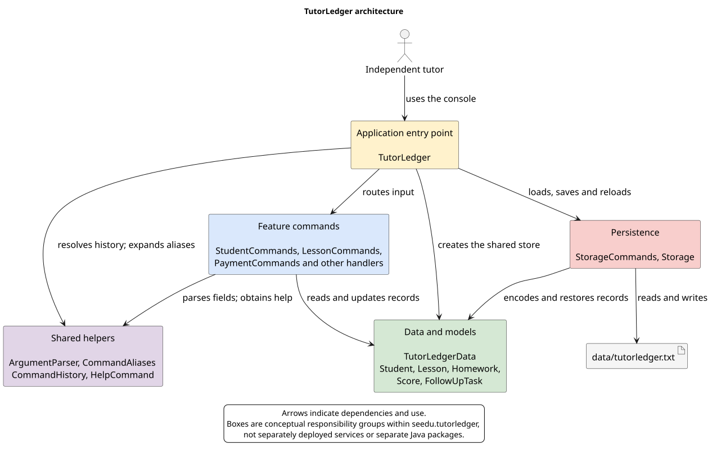

*Figure 1. Architecture overview. Arrows indicate dependencies and use, rather than chronological execution.*

| Responsibility | Main classes | Role |
| --- | --- | --- |
| Application entry point | `TutorLedger` | Creates the shared store and handlers, reads console input, routes commands and coordinates automatic saving. |
| Feature commands | `StudentCommands`, `LessonCommands`, `PaymentCommands`, `HomeworkCommands`, `ScoreCommands`, `TaskCommands`, `TopicCommands`, `LessonFilterCommand` | Validate feature-specific input, read or update records, and return display text. |
| Shared helpers | `ArgumentParser`, `CommandAliases`, `CommandHistory`, `HelpCommand` | Parse fields, expand shortcuts, retain session commands for confirmed replay, and provide help. |
| Data and models | `TutorLedgerData`, `Student`, `Lesson`, `Homework`, `Score`, `FollowUpTask` | Own record collections and permanent ID counters; validate values and represent records as immutable objects. |
| Persistence | `StorageCommands`, `Storage` | Load and reload the shared store, compare snapshots, and encode or decode `data/tutorledger.txt`. |

At startup, `TutorLedger` creates one `TutorLedgerData` and passes it to the handlers and persistence
coordinator. `StorageCommands.loadOnStartup()` restores that store before the input loop starts.
History requests are handled before alias expansion. A recalled command requires confirmation before
it enters ordinary dispatch; cancellation never reaches a handler. The loop expands aliases through
`CommandAliases` and retains the original command text in session history, then offers the line to each
handler in turn; the first whose `handles` returns true runs it.
Unclaimed input reaches `StudentCommands`, the last handler, which also handles help and unknown commands.

Before an ordinary feature command, the entry point records a storage snapshot. After the handler
returns, it calls `saveIfChanged`; persistence writes only when the records changed. Explicit `save`
and `reload` commands use the persistence path directly. Feature handlers do not save files themselves,
and the data model does not depend on persistence.

Sharing a store makes edits immediately visible to other commands without duplicating records. Keeping
file operations in persistence allows commands to operate on in-memory data during tests.

Every handler extends the abstract class `CommandHandler`. Its `handles(input)` says whether the handler
owns a line: by default, when the first word is one of its command words. `execute(input)` does the steps
every command shares. It splits off the command word, traces the command, calls the subclass's `run`, and
turns a rejected command into an `Error: ...` message. A subclass only maps its words to its methods in
`run`. The entry point keeps the handlers in a list, so adding a handler means adding it to that list.

*Alternative considered:* each handler repeating the split, check and error handling itself, with the
entry point choosing a handler in a chain of `if` statements. That was the first design. It needed no
shared class, but left eight copies of the same steps, which had to be kept in step by hand.

The more detailed class, sequence and activity diagrams below explain the selected implementation
decisions.

### Validation and updates

Command handlers parse input and report validation failures as `Error: ...` messages. Model constructors
and data-store methods validate values and relationships before records are inserted or replaced.
User-input checks use ordinary conditionals and exceptions, so they remain active when Java assertions
are disabled. Assertions check internal assumptions, such as preserving record identities and advancing
ID counters after successful insertion.

`RecordIds` validates numeric suffixes before a store collection is changed. Records and map keys keep
string IDs; supported record numbers are 1 through 2147483646. Validation calculates the successor
before insertion, so a rejected import leaves both the collection and its counter unchanged. All five
record types use the same rule. Counters can reach 2147483647 as an exhausted value; creation checks
capacity first, and a weekly schedule reserves capacity for its whole batch before inserting anything.
This prevents both integer overflow and partially applied imports or schedules.

Records are immutable: edits create validated copies, and the store replaces the original only after
the relevant checks pass. The automatic-save flow described above then persists the changed store.
The implementation sections below explain checks and persistence rules specific to each feature.

## Implementation

### Storage

The storage feature keeps every record in one
plain-text file, `data/tutorledger.txt`, so that data survives restarts and a tutor can fix or bulk-edit
records in a text editor.

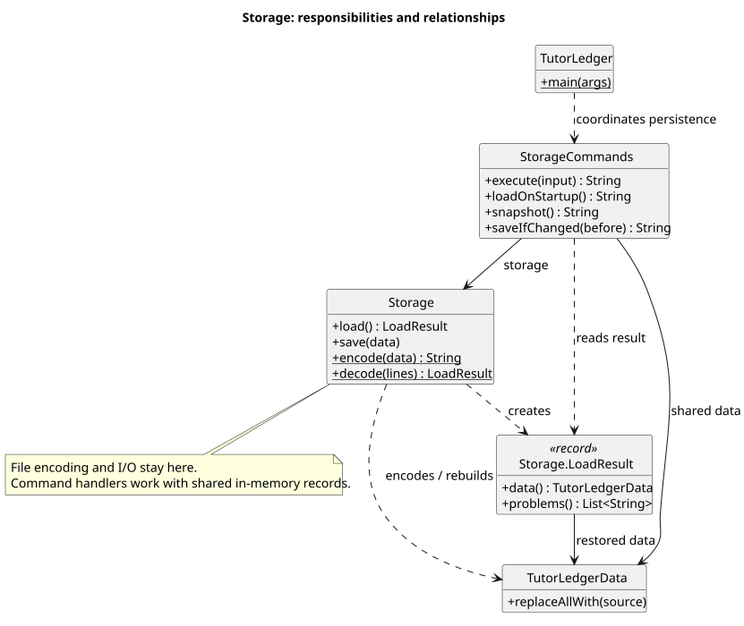

*Figure 2. The entry point coordinates persistence; StorageCommands shares the live store and delegates encoding and file I/O to Storage.*

* **`Storage`** knows the file format and does the file input/output. It never prints anything, so it can
  be tested on its own.
* **`StorageCommands`** runs `save` and `reload`, loads the file at startup and saves automatically. It turns
  file errors into messages for the user. Like the other command classes it extends `CommandHandler`, but
  its `shouldSaveAfterwards()` returns false, because `save` and `reload` manage the file themselves.
* **`TutorLedgerData`** gained `importLesson`, `importHomework`, `setNextLessonNumber`,
  `setNextHomeworkNumber` and `replaceAllWith` so that records can be restored with their saved IDs.

#### File format

Each record is one line of fields separated by a vertical bar, `|`, with a space on each side:

```
NEXT | S3 | L2 | H2 | A2 | T2
S | S1 | Amirah Binte Rahman | Sec 3 | 91234567 | E Math | A Math
L | L1 | S1 | 15-09-2026 | 1600 | A Math | 60 | present | paid | Quadratics \| discriminant |  | 60 | 60
H | H1 | S1 | 29-09-2026 | outstanding | Worksheet 4A
A | A1 | S1 | 07-09-2026 | 28 | 40 | WA1
T | T1 | pending | 16-10-2026 | S1 | Bring Worksheet 4B
```

* The `NEXT` line saves the ID counters. Without it, deleting the newest student and restarting would
  hand the deleted student's ID to the next new student, breaking the rule that IDs are never reused.
  Positive counter values through 2147483647 are supported, including ten-digit values. A malformed
  `NEXT` line is rejected as a whole; optional score/task counters in older files remain supported.
* A `|` or `\` inside a value is escaped as `\|` or `\\`, so notes and subjects can contain any text.
* Values are written in the same format the user types them (e.g. `DD-MM-YYYY`), so a hand-edited file
  uses the rules users already know.

*Alternatives considered:* JSON (via a library such as Jackson) handles nesting and escaping for us, but it
is harder for a tutor to edit by hand, and it needs a third-party library. CSV is similar to the chosen
format, but its quoting rules are less obvious to people editing it by hand.

#### Loading and validation

`Storage.decode` first reads students and the `NEXT` line, then processes rates, archive markers,
lessons, homework, scores and follow-up tasks. This permits linked records to appear before their student
line. Student-linked records must resolve to a valid student; follow-up tasks may also be unlinked.
Imports reuse model validation and reject malformed values, duplicate IDs and occupied lesson slots.
Command-specific restrictions, such as requiring restoration before scheduling for an archived student,
are separate from loading historical records.

Current lesson rows have thirteen fields, ending with `NOTES | CANCELLATION_REASON | MINUTES | AMOUNT_PAID`.
The loader also accepts older lesson layouts. Fees are loaded as saved and are not recomputed from
current rates. Rate and archive metadata use separate `R` and `ARCHIVED` lines so legacy subject fields
remain unambiguous.

A line that fails a check is skipped and reported as `Line N: reason`. Loading carries on with the
remaining lines, so one typo does not lose the whole file.

#### Automatic saving

Before each command, the main loop takes a `snapshot()` (the text the file would contain). After the
command, `saveIfChanged` compares a new snapshot with it and writes the file only if they differ.

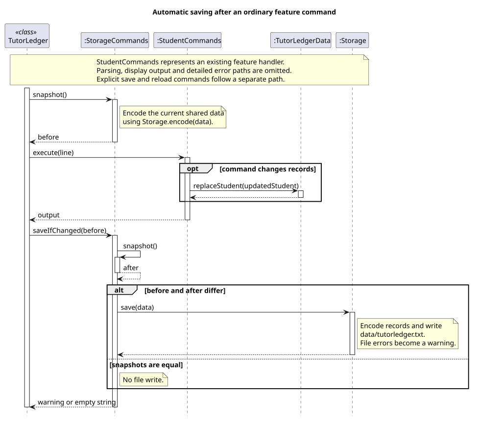

*Figure 3. StudentCommands is one representative feature handler. A changed snapshot triggers a save; unchanged records leave the file untouched.*

* Comparing snapshots means a command that teammates add later is saved automatically. Nobody has to
  remember to update a list of "commands that change data".
* Commands that only display data never write the file, so they cannot overwrite a tutor's hand edits
  before `reload`.
* `save` and `reload` skip the automatic save. In particular, `reload` must not save, or the lines it just
  skipped would be erased before the tutor could fix them.
* If the file exists but cannot be read at startup or on `reload` (for example, another program has it
  locked), `StorageCommands` turns automatic saving off until a later `reload` or `save` succeeds. Otherwise
  the first change would replace a file that may still hold every record with this session's few changes.
  The warning shown instead recommends `reload`, or `save FILE_PATH` to keep a separate copy, and says that a
  plain `save` would replace the records.
* The trade-off is encoding the data twice per ordinary command. The work grows with the stored
  records; this guide does not assume a measured response-time guarantee.

*Alternative considered:* saving after every command, whether or not it changed anything, is simpler. But a
read-only command such as `list` would then overwrite hand edits made while the app is open.

*Possible improvement:* write to a temporary file and then rename it over the data file. A temporary-file replacement can reduce
the risk of a partial write; an implementation would also need to handle filesystem and rename failures.

### Income summaries

`PaymentCommands` handles `income MM-YYYY` and `income YYYY`. Monthly summaries select non-cancelled
lessons with a positive `amountPaid`, group them by lesson date, and sum `Lesson.getAmountPaid()`.
Yearly summaries apply the same rule to each of the twelve months, including months with a zero total.
Partial payments contribute the amount actually received; an unpaid lesson contributes nothing.
A free lesson is settled but contributes no income. The reporting period uses the lesson date, not a
separate payment timestamp, because no transaction-date ledger is stored. Figure 4 shows
`income 10-2026`.

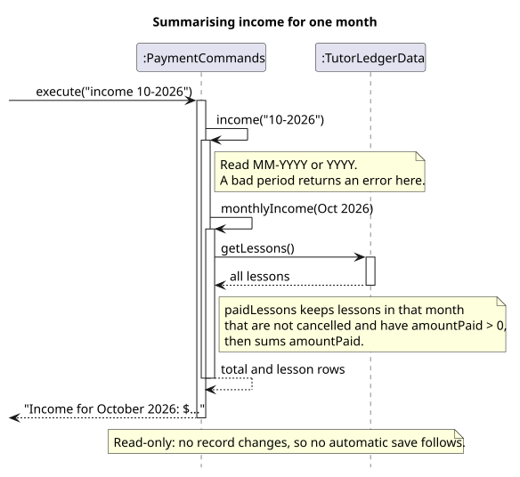

*Figure 4. Income is calculated from the stored lessons each time; nothing is changed or saved.*

The output is calculated from the current lesson collection without changing any records. Cancelled
lessons remain in the history but are excluded from income. Editing a fee preserves the amount already
received; the fee-edit rules below prevent an edit from manufacturing or discarding a payment.

### Homework

`HomeworkCommands` handles `assign`, `submit`, `homework`, and the homework forms of `edit` and `delete`.
Each homework item is an immutable `Homework` record owned by `TutorLedgerData`, linked to its student by
ID and given a permanent `H` ID. Figure 5 shows `assign S1 Worksheet 4A d/20-10-2026`.

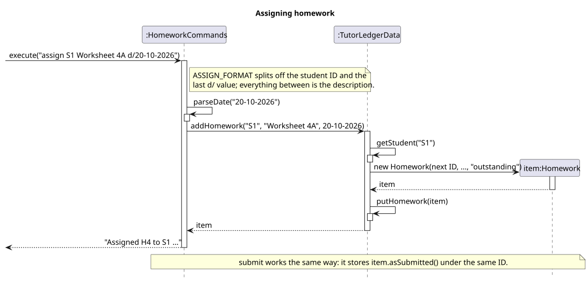

*Figure 5. The student is looked up before the homework item is created and stored.*

* The description is everything between the student ID and the last `d/`, so it may contain spaces, commas
  and even `d/`. Only the final `d/` value is read as the due date.
* `submit` stores `item.asSubmitted()` under the same ID rather than changing the stored object, in the same
  way as other record updates. `homework` lists items that are still outstanding, soonest due first, and
  marks those past their due date as overdue.
* *Alternative considered:* a mutable `setSubmitted()` method would avoid creating a copy, but every other
  record type is replaced rather than changed in place, and copies keep the automatic-save snapshot simple.

### Scores and progress

These features let a tutor record test results and review a
student at the end of a term.

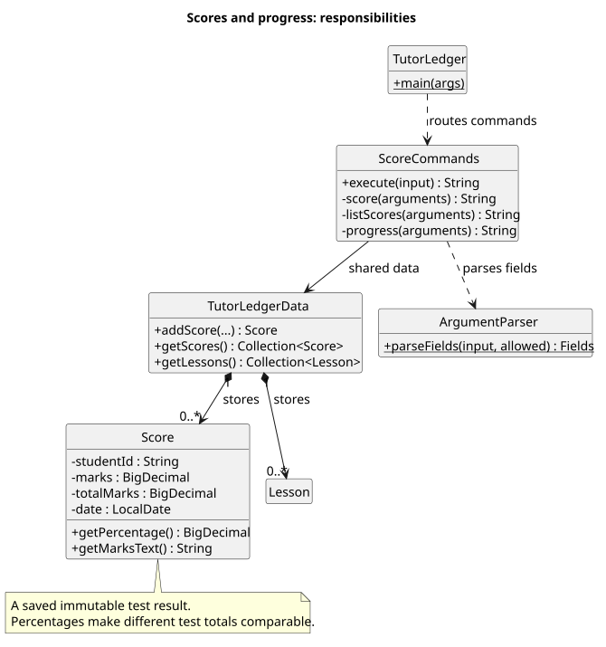

*Figure 6. ScoreCommands reads and updates scores through the shared data store.*

* **`Score`** is an immutable record of one test result, like `Lesson` and `Homework`. Its constructor
  checks every value, for example that the marks are not more than the total. A score therefore cannot
  exist in an invalid state, whether it was typed in or loaded from a hand-edited file.
* **`ScoreCommands`** extends `CommandHandler`, like the other command classes. The main
  loop routes `score`, `scores` and `progress` to it.
* **`TutorLedgerData`** stores scores in a map keyed by ID, with a counter that never decreases, as it does
  for lessons and homework. `deleteStudent` also removes the student's scores, and `Deletion` reports how
  many were removed.
* **`Storage`** saves each score as an `A` line. The score counter is a fifth, optional field on the `NEXT`
  line, so data files written before this feature still load.

#### Recording a score

The sequence diagram below shows `score S1 WA2 m/33/40`.

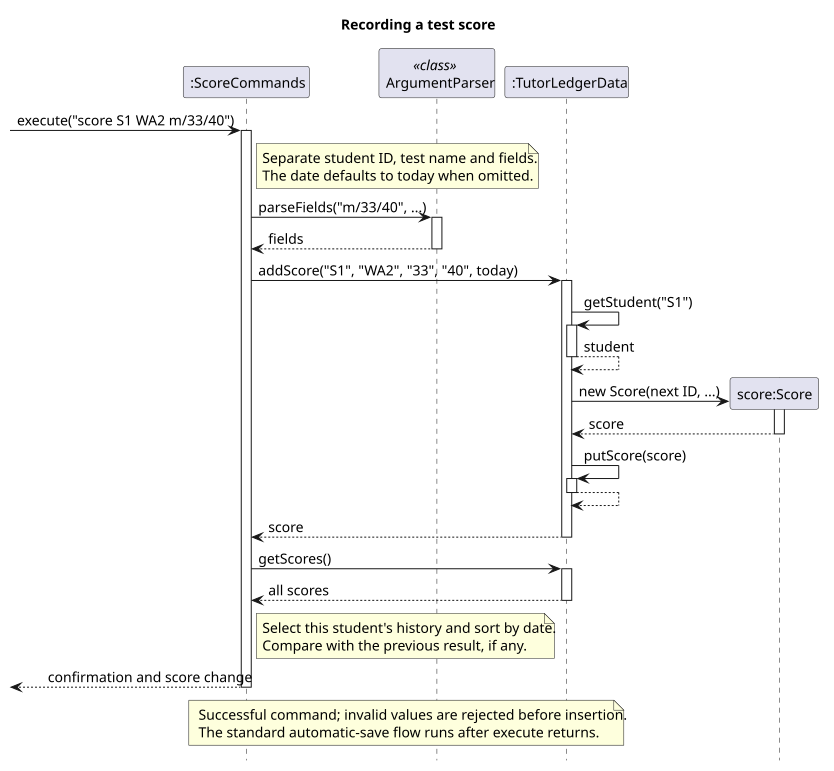

*Figure 7. A score is created and validated before insertion, then compared with previous results.*

1. The test name is everything before the first `m/` or `d/`, so it can contain spaces, like an `assign`
   description. The rest goes to the shared `ArgumentParser`, so `m/` and `d/` can be typed in any order.
2. `TutorLedgerData.addScore` looks up the student first, so a score can never belong to a missing student.
   It then creates the `Score`, which validates the values, and stores it under the next ID.
3. `ScoreCommands` sorts the student's scores by date and compares the new score with the one before it.
   The tutor sees at once whether the student did better or worse.

A rejected score is neither stored nor assigned a permanent ID.

**Design decisions**

* *Marks are `BigDecimal`, not `double`.* Half marks such as 17.5 are common, and `double` cannot store
  some decimals exactly. The data file would then show values like `17.499999`. Lesson fees use
  `BigDecimal` for the same reason.
* *Scores are compared as percentages.* Tests have different totals (40 marks for a class test, 100 for an
  exam), so raw marks cannot be compared. Percentages are rounded to 1 decimal place with `HALF_UP`.
* *The date defaults to today.* Tutors usually record a score on the day the script is returned.
  *Alternative considered:* making `d/` compulsory is stricter, but it adds typing for the most common case.

#### Summarising progress

`progress STUDENT_ID [from/DATE] [to/DATE]` gathers the student's lessons and scores in the period and
summarises them. Figure 8 shows the calls that `progress` makes, and Figure 9 shows how each lesson
is counted.

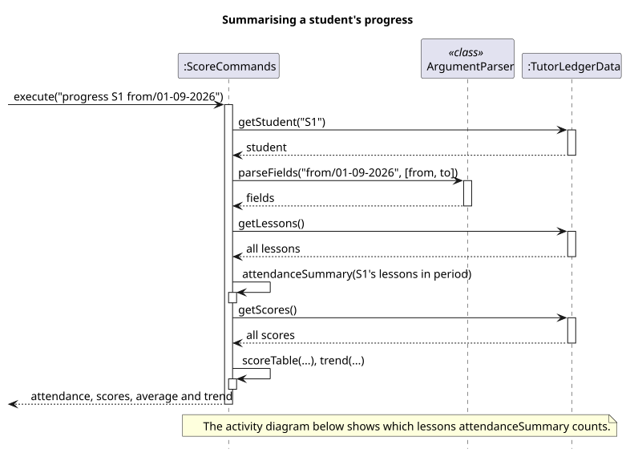

*Figure 8. Attendance and scores are read from the store; the summary is not saved.*

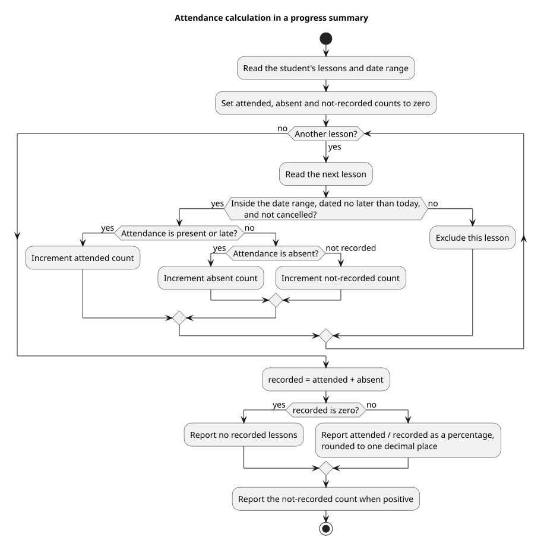

*Figure 9. Only recorded, non-cancelled lessons up to today contribute to the attendance rate.*

* Cancelled lessons are excluded before attendance is counted.
* Lessons after today are skipped because they cannot have attendance yet. Counting them as "not
  recorded" would wrongly suggest the tutor forgot to record them.
* Unrecorded past lessons are reported, but they are left out of the rate. Otherwise a tutor who has not
  yet recorded yesterday's lesson would see a lower rate than the student deserves.
* A late arrival counts as attending. The tutor still taught the lesson, and the separate `late` count
  keeps lateness visible.
* Without `from/`, the period starts at `LocalDate.MIN`, so all of the student's records are included.

`scores` and `progress` share the private helpers `scoreTable` and `trend`, so the score list looks the same
in both commands.

*Alternative considered:* storing term dates, so a tutor could type `progress S1 term/3`. Schools' term
dates differ, and a tutor would have to set them up first. `from/` and `to/` work for any period with no
setup.

*Possible improvements:* let `edit` and `delete` accept a `SCORE_ID`, so a mistyped score can be fixed
without editing the data file. Also show the average score by subject, once scores record a subject.

### Follow-up tasks

Between lessons, a tutor collects small jobs: bring a worksheet, return a marked script, print a calendar.
Follow-up tasks keep these reminders in TutorLedger, next to the lessons they belong to:

| Command | Purpose |
|---|---|
| `task [STUDENT_ID] DESCRIPTION [d/DUE_DATE]` | Log a reminder, optionally for one student and by a date |
| `tasks [STUDENT_ID]` | List pending reminders, soonest due first, with overdue ones marked |
| `done TASK_ID` | Tick a reminder off |

`next` also lists the student's pending reminders, so they are seen at the moment the tutor prepares for
the lesson.

#### Responsibilities and object relationships

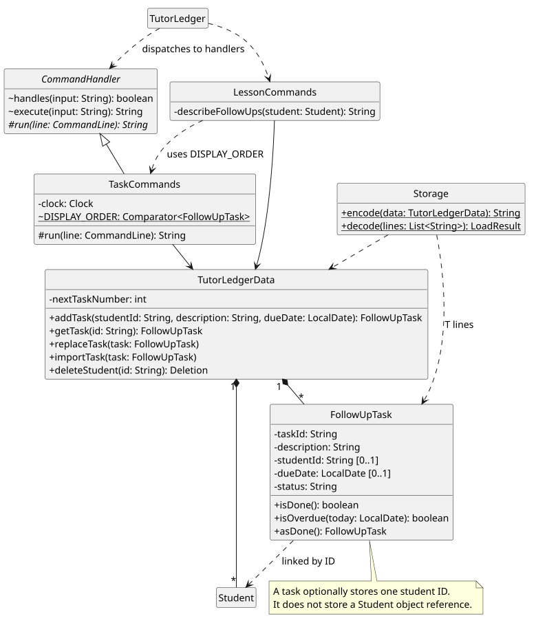

*Figure 10. The store owns follow-up tasks; each task may identify a student by ID.*

* **`FollowUpTask`** is an immutable record, like `Homework`. Its student and due date are optional, because
  some reminders (such as "Print term calendar") are not about one student or day. The getters return
  `Optional`, so callers cannot forget to handle a task that has neither.
* **`TaskCommands`** extends `CommandHandler`, like the other command classes. The main loop
  routes `task`, `tasks` and `done` to it.
* **`TutorLedgerData`** stores tasks in a map keyed by ID, with a counter that never decreases, as for every
  other record. A task links to a student by ID rather than holding the `Student` object. Student profiles
  are replaced whenever they are edited, so a stored object would go stale, but an ID always stays valid.
* **`LessonCommands.describeFollowUps`** adds a `Follow-ups:` line to `next`. It reuses
  `TaskCommands.DISPLAY_ORDER`, so reminders are sorted the same way in both commands.

#### Logging a task

The sequence diagram below shows `task S1 Bring Worksheet 4B d/16-10-2026`.

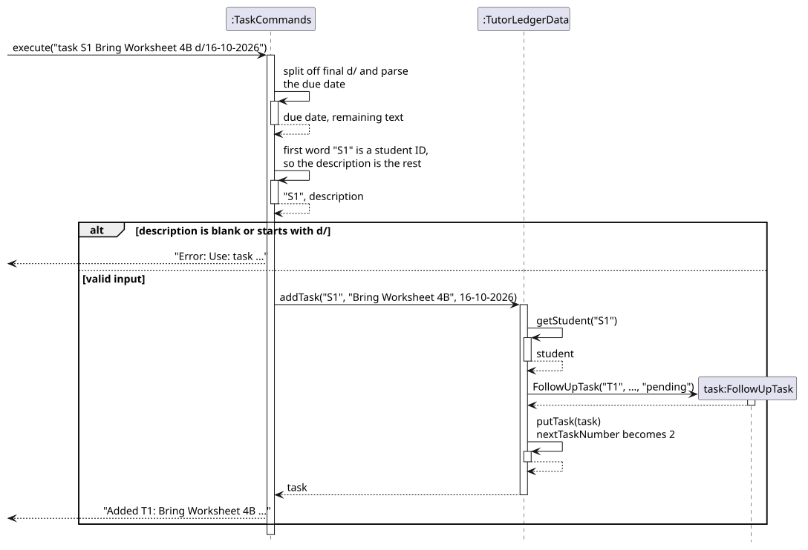

*Figure 11. A linked task resolves its student before the new reminder is stored.*

1. `addTask` finds the last standalone `d/` (case-insensitive) and parses everything after it as the due date,
   so trailing words after a date are an error rather than being silently ignored. Earlier `d/` text and words
   such as `and/or` stay in the description. A name connector such as `d/o` (as in "Priya d/o Raman") is
   skipped using `Student.isNameConnectorAt`, the same check `ArgumentParser` uses, so a description that
   mentions such a name is not mistaken for a due date.
2. If the first remaining word looks like a student ID (`S1`), the task is linked to that student and the
   rest is the description. Otherwise the whole text is the description.
3. `TutorLedgerData.addTask` looks the student up first. A task can therefore never point to a missing
   student. It then creates the task with the next `T` ID.

`done TASK_ID` works the same way as `submit` for homework. `FollowUpTask.asDone()` returns a copy with the
new status, and `replaceTask` stores it under the same ID.

#### Design considerations

* *Student ID as an optional first word, rather than a prefix such as `for/S1`.* Most other commands put
  the student ID first (`assign S1 ...`, `score S1 ...`), so the tutor does not need to learn another
  prefix. A description that happens to start with a word like `S1` would be read as a student ID. This
  is unlikely, and the confirmation line (`for S1 ...`) makes it obvious.
* *Mark done, rather than delete.* A done task stays in the data file, so the tutor can still see in the file
  what was done. `tasks` and `next` simply leave done tasks out. *Alternative considered:* deleting the
  task on `done` keeps the file smaller, but loses the record.
* *Show reminders in `next`.* The story's goal is to avoid forgetting things "between lessons". A separate
  list is easy to forget to check, but `next` is already what the tutor runs before a lesson. The line only
  appears when there are pending reminders, so the usual `next` output is unchanged.
* *Deleting a student deletes their tasks.* A reminder about a student who is no longer taught is not
  useful. Tasks not linked to anyone are kept. Because the tasks are removed too, a student with follow-up
  tasks gets the deletion warning (see *Student deletion warnings*), so reminders are never lost silently.

#### Persistence and verification

* `Storage` saves each task as a `T` line with six fields. A missing due date or student is an empty field.
  The task counter is an optional sixth field on the `NEXT` line, so data files saved before this
  feature still load.
* `TaskCommandsTest` and `StorageTest` cover each command, the `next` integration, cascade deletion, and
  loading old and hand-edited files.

*Possible improvements:* let `edit` change a task's description or date, and accept a time
(e.g. `d/16-10-2026 t/1500`) for reminders that must be done before a particular lesson.

### Lesson scheduling and records

A tutor's week revolves around lessons, so these commands let them plan lessons, record what happened, and
change plans when real life gets in the way:

| Command | Purpose |
|---|---|
| `schedule STUDENT_ID d/DATE t/TIME s/SUBJECT [f/FEE] [dur/MINUTES] [w/WEEKS]` | Plan one lesson, or the same slot for 2–52 weeks |
| `log STUDENT_ID d/DATE t/TIME s/SUBJECT f/FEE a/ATTENDANCE [note/NOTES]` | Add a lesson that already took place, with its outcome |
| `lessons [week]` | List today's or this week's lessons, earliest first |
| `next [STUDENT_ID]` | Summarise the next lesson and what to prepare for it |
| `record LESSON_ID a/ATTENDANCE [note/NOTES]` | Record attendance and notes for a lesson that has taken place |
| `edit LESSON_ID ...` / `delete LESSON_ID` | Correct any detail of a lesson, or remove one entered by mistake |
| `reschedule LESSON_ID [d/DATE] [t/TIME]` | Move a lesson that has not taken place yet |
| `cancel LESSON_ID r/REASON` | Call off a lesson but keep it, with the reason, in the history |
| `uncancel LESSON_ID` | Undo a cancellation made by mistake |

#### Responsibilities and object relationships

`LessonCommands` parses and runs every lesson command. Like the other command classes, it extends
`CommandHandler`: the main loop asks `handles(line)` whether the line is a lesson command, then passes the
line to `execute`, which returns the text to display. `edit` and `delete` are also student commands, so
`LessonCommands` overrides `handles` to claim them only when the ID after the command word starts with `L`. For
example, `edit L3 t/1700` is routed here, while `edit S1 p/91234567` is left for `StudentCommands`.

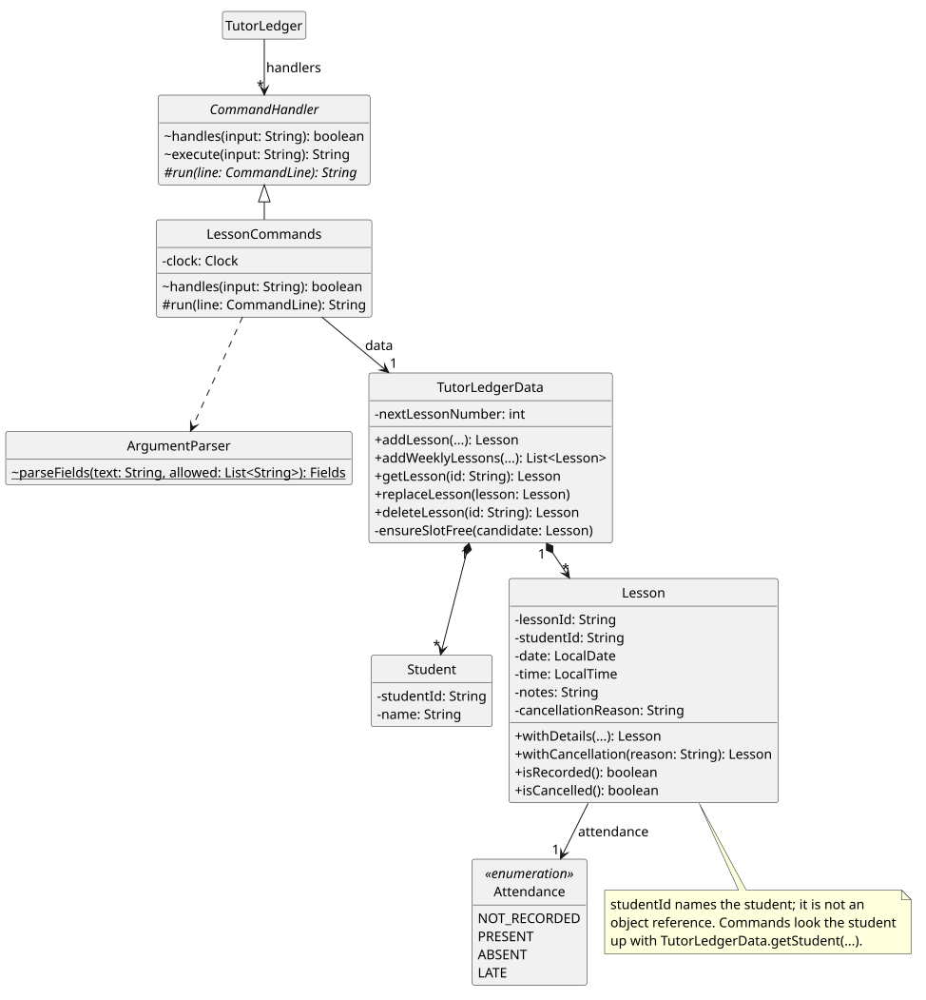

*Figure 12. `LessonCommands` changes lessons only through `TutorLedgerData`, which owns every `Lesson`.*

* **`TutorLedgerData`** is the only class that stores lessons. It gives each new lesson the next ID (`L1`,
  `L2`, ...) and checks that no two lessons are taught at the same time (`ensureSlotFree`). Two lessons
  clash if their intervals, from start time to start time plus duration, share a minute. It never
  reuses an ID, even after a lesson is deleted, so an ID in an old note or message never points at a
  different lesson.
* **`Lesson`** is immutable: a change produces a new copy through `withDetails` or `withCancellation`, and
  `TutorLedgerData.replaceLesson` swaps the copy in. Attendance is a separate enumeration, so a cancelled
  lesson (`cancellationReason` is set) is never confused with one the student missed (`ABSENT`).
* **`ArgumentParser`** splits prefixed values such as `d/01-12-2026 s/A Math`. It was extracted from
  `StudentCommands` so that every command reads a prefix the same way. The values may be in any order,
  values may contain spaces, and a repeated or unknown prefix is rejected. A command can name some of its
  prefixes as free text (`note/`, the `r/` of `cancel`, and homework's `desc/`). Inside such a value, an
  unknown word ending in `/`, such as `and/or`, is kept as text, while the command's own prefixes still
  start new values.

Fees and durations are omitted from Figure 12; see [Default hourly rates](#default-hourly-rates)
for how a lesson's fee is chosen.

#### Scheduling a weekly slot

Most students have one regular weekly slot, so `schedule ... w/WEEKS` adds that many lessons in one
command. Figure 13 shows `schedule S1 d/01-12-2026 t/1600 s/A Math f/60 w/3`. Every lesson command begins by
splitting its arguments in the same way, so that step is drawn once, in Figure 14, and referred to with a
`ref` frame.

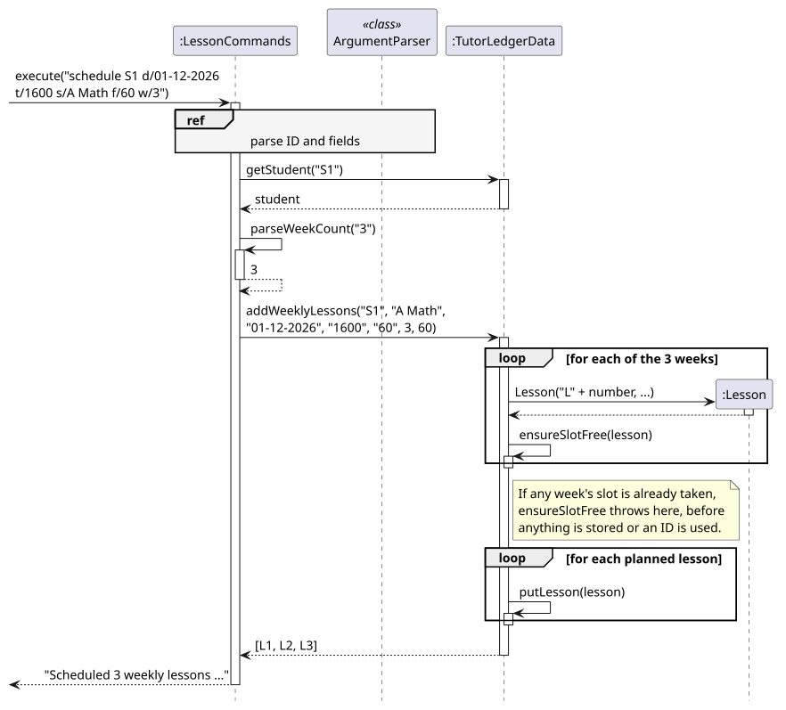

*Figure 13. Every week is checked before any lesson is stored.*

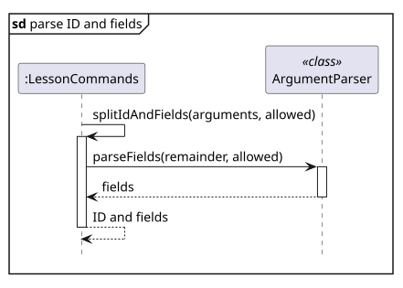

*Figure 14. The `parse ID and fields` fragment used by Figures 13 and 16.*

1. `LessonCommands` looks up the student and checks that they take the subject. It uses the student's own
   spelling of the subject, so `a math` and `A Math` are not stored as two subjects.
2. `TutorLedgerData.addWeeklyLessons` builds one `Lesson` per week, numbering them from the next lesson ID,
   and checks each slot as it goes.
3. Only after every slot passes does it store the lessons. If week 3 clashes with an existing lesson, the
   tutor sees `Error: <ID> already starts at that date and time.` (or, for a partial overlap,
   `Error: That time overlaps <ID> (...)`) and no lesson is added. The counter only
   moves when lessons are stored, so a rejected command never skips an ID.

Figure 15 shows the objects after this command and a later `cancel L2 r/Student sick`. Each week is an
ordinary, separate lesson, so `L2` could be cancelled without affecting `L1` or `L3`.

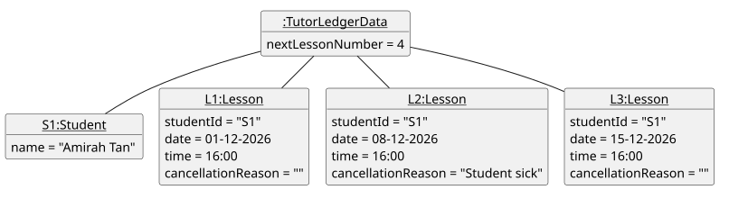

*Figure 15. After `schedule ... w/3` and `cancel L2 r/Student sick`. The counter has moved past `L3`.*

#### Changing a lesson: record, edit, reschedule and cancel

These four commands share one pattern: get the lesson, make a changed copy, check it, then call
`replaceLesson`. Figure 16 shows `reschedule L3 d/16-12-2026`.

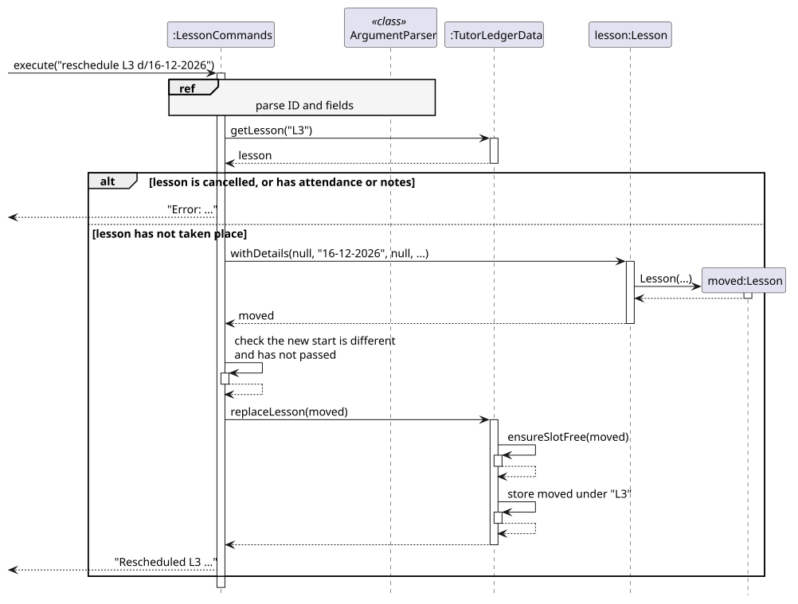

*Figure 16. The original lesson stays in the store until its validated replacement is stored.*

* `replaceLesson` checks the slot only when the time the lesson takes up has changed: a new date or time, a
  new duration, or an undone cancellation. Recording attendance on a busy day is never blocked by a clash
  check.
* If any check fails, nothing has been replaced, so a rejected command never leaves a half-changed lesson.
  The store replaces its reference only after validation. The handler may still read the original
  object when displaying the old slot; map replacement does not explicitly destroy a Java object.
* `edit` and `reschedule` both change the slot, but they serve different purposes. `edit` corrects a
  record, so it can change any lesson, including a past one. `reschedule` describes a real-life change of
  plan, so it rejects a lesson that has already taken place (it has attendance or notes), a cancelled lesson,
  an unchanged slot, and a time that has already passed.
* `record` and `log` only accept lessons dated today or earlier, because a lesson that has not happened has
  no attendance yet. `edit` enforces the same rule when it sets attendance or notes.
* `cancel` keeps the lesson with its reason. A cancelled lesson frees its slot, is left out of `owed` and
  `unpaid`, and still appears in `lessons` marked `(cancelled: REASON)`. Any positive amount received,
  including a partial payment, triggers a reminder to refund or carry over that amount. No refund is
  recorded automatically. `uncancel` reverses this with `Lesson.withoutCancellation`. Because the lesson
  takes its slot back, `replaceLesson` checks it for clashes.
* `edit` accepts `a/none`, which sets the attendance back to `NOT_RECORDED`, so a lesson recorded by mistake
  can be corrected or cancelled. `record` and `log` reject `none`, since they exist to record an outcome.

#### Preparing for the next lesson

`next [STUDENT_ID]` gathers everything a tutor checks just before a lesson. Figure 17 shows the calls it
makes, and Figure 18 shows how the lesson is chosen.

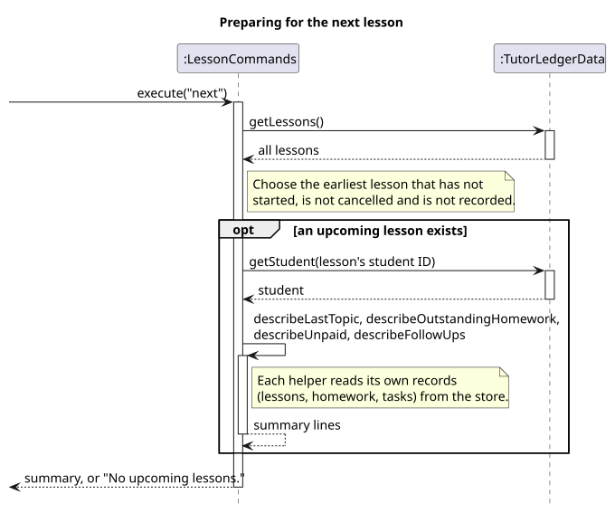

*Figure 17. The summary is assembled from existing records each time `next` runs.*

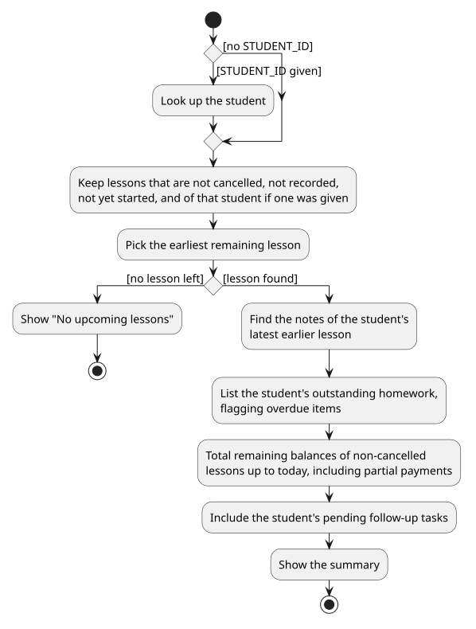

*Figure 18. Only lessons that can still take place are considered.*

The summary is built from existing records each time; nothing extra is stored. "Unpaid" totals the
remaining balances of non-cancelled lessons up to today, including partially paid lessons, using the same
balance rule as `owed`. Pending follow-up tasks for the selected student appear when there are any.

#### Design considerations

**Aspect: How a lesson is changed**

* **Alternative 1 (current choice):** `Lesson` is immutable; each change creates a copy that
  `TutorLedgerData.replaceLesson` swaps in.
  * Pros: a failed check leaves the stored lesson untouched. Every change goes through one method, so the
    slot check cannot be skipped by accident.
  * Cons: each change creates a new object, and copy methods must carry over every field (assertions in
    `withDetails` check this).
* **Alternative 2:** give `Lesson` setters and change it in place.
  * Pros: simpler to write, and no copying.
  * Cons: a command that fails half-way leaves a half-changed lesson. Any code holding the lesson could
    move it into an occupied slot without the store noticing.

**Aspect: How a weekly slot is stored**

* **Alternative 1 (current choice):** expand `w/WEEKS` into separate lessons when scheduling.
  * Pros: each week can be recorded, rescheduled, cancelled or paid for on its own. The storage format and
    every other command work unchanged.
  * Cons: a slot is limited to 52 weeks, and changing the time of the whole slot means changing each lesson.
* **Alternative 2:** store a recurring rule and generate lessons when they are needed.
  * Pros: no end date, and one change moves every future week.
  * Cons: every exception (one week moved or cancelled) must be stored against the rule. Every command
    that reads lessons, including payments and storage, would need to understand rules.

**Aspect: How a called-off lesson is handled**

* **Alternative 1 (current choice):** `cancel` keeps the lesson with a reason.
  * Pros: the history shows why a lesson did not happen, which matters when a parent asks about a payment.
  * Cons: commands that list, count or charge lessons must remember to skip cancelled ones.
* **Alternative 2:** delete the lesson.
  * Pros: no special cases elsewhere.
  * Cons: the record of a lesson that was planned (and perhaps paid for) disappears. `delete` remains
    available for lessons entered by mistake.

#### Verification

`LessonCommandsTest` covers each command's normal use and its rejections, and uses a fixed `Clock` so tests
about "today" and "the past" do not depend on the real date. `TutorLedgerDataTest` covers ID allocation,
slot conflicts and the all-or-nothing weekly scheduling.

### Default hourly rates

An independent tutor often charges the same student the same hourly rate for many lessons. Requiring
`f/60` every time repeats information and makes it easy to enter an inconsistent fee. This enhancement
lets the tutor store that rate on the student and schedule a lesson using its duration. For example,
after `edit S1 r/60`, `schedule S1 d/20-10-2026 t/1600 s/E Math dur/90` creates a lesson costing
$90.00. Omitting `dur/` means 60 minutes. An explicit `f/25` instead charges $25 for the whole lesson.

#### Responsibilities and object relationships

The feature extends the existing command, model and storage components. `StudentCommands` parses `r/`
on `add` and `edit`; `LessonCommands` parses optional `dur/` and `f/` on `schedule`. Both use
`ArgumentParser`, so prefixes keep their existing case-insensitive, order-independent behaviour.
`TutorLedgerData` chooses the total fee when creating a lesson. This puts the business rule at the
shared data boundary rather than only in a particular command handler.

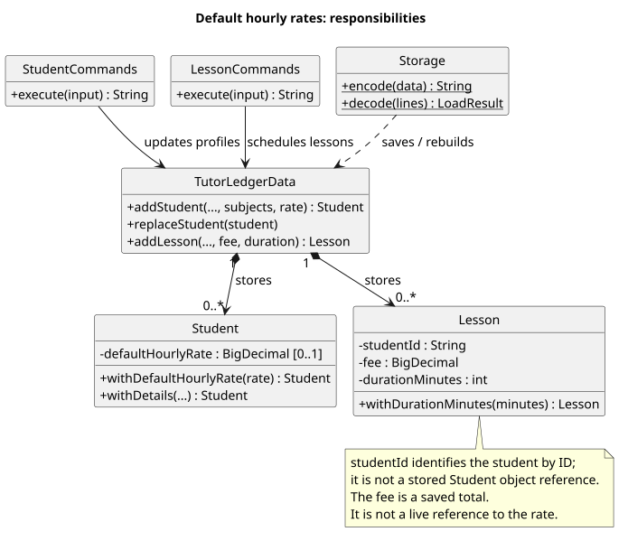

*Figure 19. The store owns student and lesson records; a lesson identifies its student by permanent ID.*

`Student` stores an optional `BigDecimal` rate. Its getter returns `Optional<BigDecimal>` so callers
must distinguish an unset rate from a valid rate of zero. A missing rate means that scheduling needs an
explicit fee; zero means that the lesson is free. Existing constructors still create students without
a rate. Existing `withDetails` operations preserve the rate, including subject changes.

`Lesson` stores both `durationMinutes` and its total `fee`. These are immutable values. Existing lesson
constructors default to 60 minutes, while the new overload accepts a validated duration. Copies created
for attendance, notes, payment status and other edits retain the duration unless it is explicitly edited.
This preserves existing callers without requiring changes to unrelated feature handlers.

#### Setting and clearing a rate

`add ... r/60` creates the entire profile, including subjects and rate, before the data store inserts
anything. Invalid rates therefore cannot leave a partially created student or consume an ID.
`edit S1 r/65` creates a replacement profile, validates it, then replaces the existing map entry.
The original profile remains available until all validation succeeds.

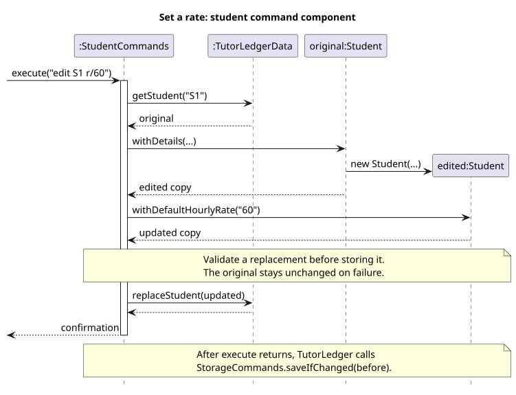

*Figure 20. A rate edit replaces a validated student and uses the existing automatic-save path.*

Omitting `r/` during an edit preserves the current rate. A bare `edit S1 r/` deliberately clears it,
matching the existing convention for clearing subjects with `s/`. A bare `r/` on `add` is rejected:
there is no existing rate to clear, so omission already expresses that intent. Repeated `r/` prefixes
are rejected rather than choosing a value silently. `view S1` reports either the dollar rate per hour
or `Default hourly rate: not set`.

#### Scheduling and keeping charges stable

The new `addLesson` overload accepts duration and an optional explicit fee. An explicit fee has priority
and represents the entire lesson charge, regardless of duration. Otherwise, the method obtains the
student's default rate. If neither source is available, it returns an error explaining both remedies:
set the student's rate or supply `f/FEE`.

Single and weekly scheduling share `resolveLessonFee`, so `schedule ... dur/90 w/3` gives each of the
three lessons the same fixed duration-based fee. Weekly scheduling still validates every slot before
inserting any lessons. A conflict in a later week therefore leaves records and ID counters unchanged.

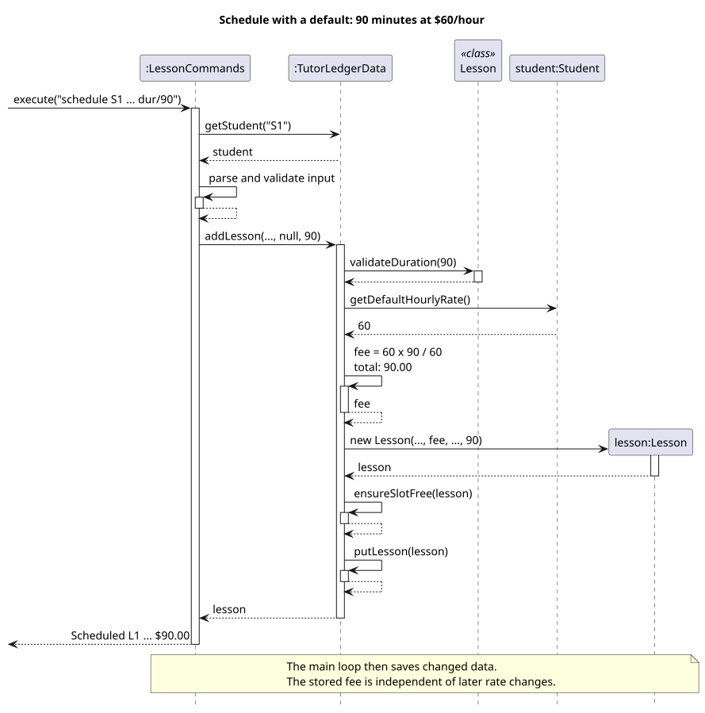

*Figure 21. Calculation happens before insertion; the result is stored as the lesson's fixed charge.*

The calculation is `hourly rate × duration in minutes ÷ 60`. All money uses `BigDecimal`; conversion to
`double` would introduce binary floating-point approximation. Division rounds once to two decimal
places using `HALF_UP`. For example, $60.01/hour for 30 minutes produces $30.005 before rounding and
$30.01 afterwards. Multiplication is performed before division to avoid rounding an hourly rate down
to a per-minute rate too early.

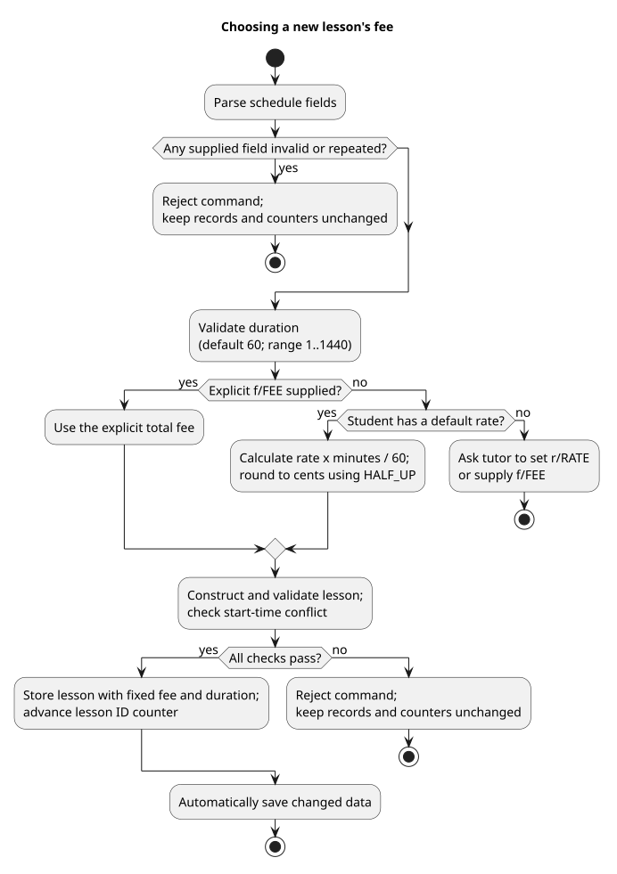

*Figure 22. Invalid explicit values are rejected; they do not trigger a fallback to the default rate.*

Changing the student's rate affects newly scheduled lessons only. Previously scheduled lessons,
including future appointments, keep their saved fee. Editing a lesson's duration also keeps its fee;
the tutor must use `edit L1 f/AMOUNT` to change the charge. This protects negotiated prices and prevents
an administrative edit from changing payment history. Fee statements read `Lesson.getFee()` for the
saved charge; income reads `getAmountPaid()`, while outstanding-balance summaries read `getAmountOwed()`.

An explicit fee edit also preserves the amount received. Raising the fee of a paid lesson creates a
remaining balance; reducing it exactly to the amount received settles the lesson. A fee below the amount
already paid is rejected before any detail is replaced. Constructors and copy operations derive status
consistently: a zero-fee lesson is already paid, with zero income.

#### Rate validation and storage

Rates accept non-negative decimal dollar amounts with at most two fractional digits. Durations accept
whole minutes from 1 to 1440. These rules also apply when loading a hand-edited file.

An optional `R | S1 | 60` record stores a student's rate separately from their subject fields. A missing
record means no rate is set. Invalid or orphaned rate records are reported by line number without
discarding the student's profile or history; a duplicate cannot replace the first valid rate.

Lesson rows store duration and amount paid alongside the saved fee and cancellation reason, as described
in [Storage](#storage). The loader recognises older layouts without recalculating saved fees. Duration
defaults to 60 minutes when absent. For the supported legacy layout ending in `NOTES | MINUTES`, the
file header identifies the final value as duration; otherwise a numeric cancellation reason remains
a reason. Snapshot comparison includes rate and duration changes automatically.

#### Alternatives, limits and verification

A separate `rate` command was considered. Extending `add` and `edit` uses familiar commands and supports
entering a complete student in one line. Storing only the rate on lessons and calculating fees whenever
displayed was also considered. Saving the chosen total instead keeps historical amounts stable.
Per-subject rates, effective-date rate histories and automatic recalculation are possible future
extensions; they would need explicit rules for existing and paid lessons.

Duration supports billing and display, and is also used by conflict checking: a new or changed lesson may not
overlap another lesson's interval. Data files are an exception. `importLesson` still rejects only an
identical start, because files saved before overlap checking may hold overlapping lessons, and rejecting
those lines would drop them from the tutor's records.

`DefaultHourlyRateTest` exercises command validation, decimal rounding, overrides, rate clearing,
immutable copies, payment totals, legacy files, malformed records and save/restart behaviour. The manual
scenario below provides a reproducible acceptance check. UML sources and rendering instructions are
kept in [diagrams/README.md](diagrams/README.md); rendered SVGs display on GitHub Pages without a client-side
diagram renderer.

### Fee statements

`fee_statement STUDENT_ID` is handled by `PaymentCommands`. It resolves the student, reads the shared
lesson collection, and builds the statement when requested; no separate statement record is stored.
The command includes every stored lesson for that student, whether paid, partially paid or unpaid and whether in the
past or future. Rows are ordered by date, start time, then lesson ID, and display the saved fee and
payment status alongside the lesson ID, date and subject. Partial-payment rows also show the amount received. A missing or extra argument and an unknown
student produce an error; a valid student with no lessons gets an explicit empty-history message.

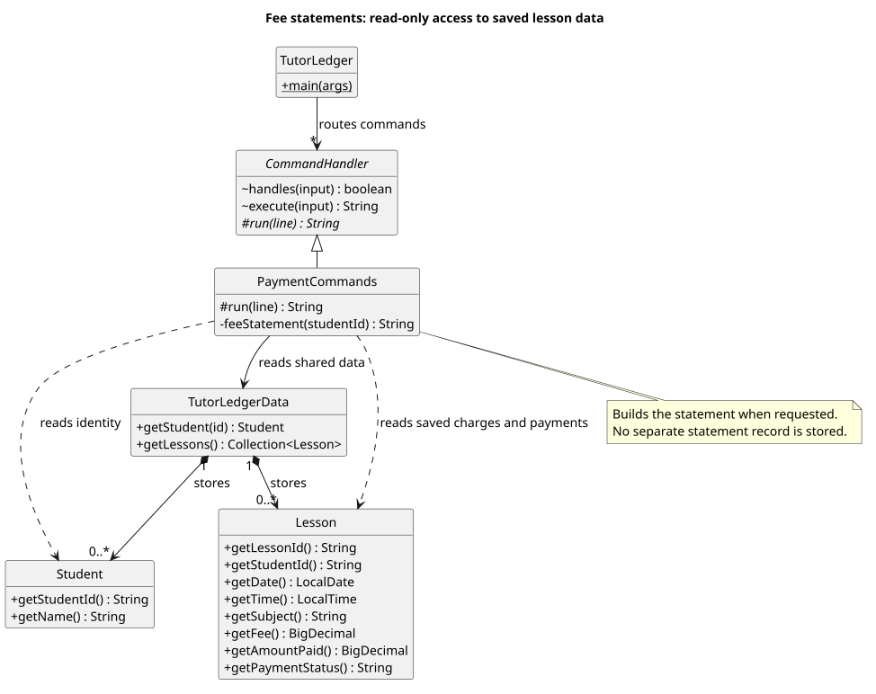

*Figure 23. The statement is assembled from the selected student and their stored lessons; it does not
introduce a new domain object.*

The command validates that exactly one student ID was supplied before looking up the student. It then
filters lessons by that student's ID and sorts them before formatting each row. This is deliberately
different from `unpaid` and `owed`, which consider remaining balances on non-cancelled lessons dated today or earlier.
Fees and payment statuses come from each `Lesson`, so the statement does not recalculate charges or
change payment state.

#### Routing and persistence checks

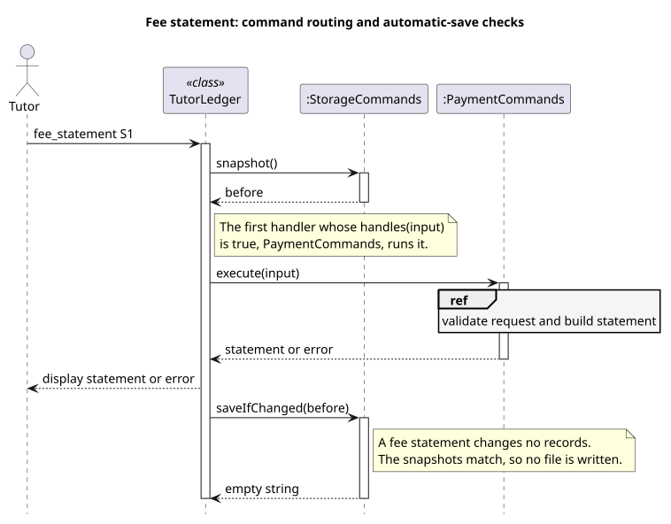

*Figure 24. The command handler is selected before execution. A snapshot is taken before the
request, and the usual save check runs after its result is displayed. The matching snapshots prevent a
file write. The `ref` frame expands into the request-validation fragment below.*

#### Request and validation

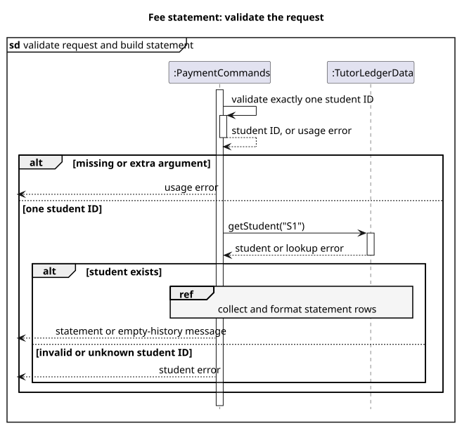

*Figure 25. The `ref` frame delegates the row-building detail to the fragment below, keeping
argument errors and student lookup separate from formatting.*

#### Collecting and formatting rows

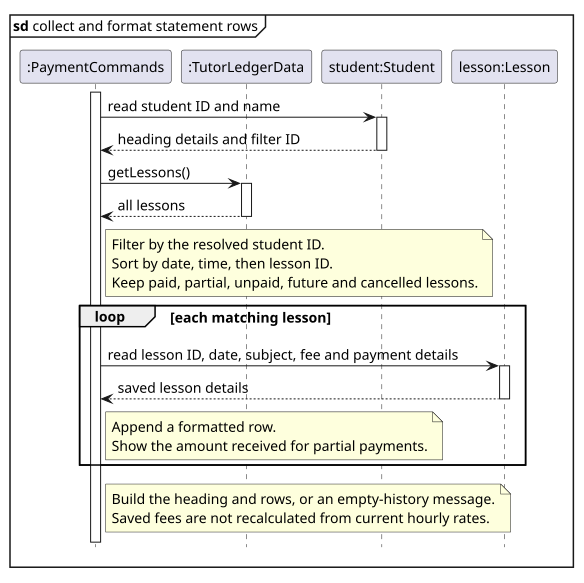

*Figure 26. Referenced fragment: collect and format statement rows. The request diagram resumes after these rows
have been assembled; this fragment reads existing records without changing them.*

#### Interaction with payment and lesson features

The statement reads each lesson's saved total fee and payment status. It does not consult the student's
current hourly rate or recalculate a fee, so changing a rate affects future scheduling but cannot rewrite
the amounts shown for existing lessons. Recording attendance and rescheduling preserve payments.
Editing the fee preserves the amount received but may change the derived payment status: a larger charge
can turn a paid lesson into a partially paid one; reducing the charge to the amount received settles it.
An edit below the amount received is rejected. Free lessons are always settled and add no income.

`mark LESSON_ID paid` and `mark LESSON_ID unpaid` update payment status on a replacement `Lesson` in
`TutorLedgerData`. The next fee statement displays that status. By contrast, `unpaid` and `owed` are
outstanding-balance views: they include non-cancelled lessons dated today or earlier with a
remaining balance, including partial payments, and report the amount still owed.
`fee_statement` intentionally shows the full stored history, including paid, future and cancelled
lessons. Cancelled statement rows append `[cancelled: REASON; not chargeable]`, preserving their saved
fee and payment amounts without presenting them as ordinary charges. The lesson filter excludes cancelled
records whenever `pay/` is specified. Without `pay/`, it retains labelled cancellation rows but excludes
their fees from the explicitly labelled total. These views never modify the saved records.

`pay STUDENT_ID AMOUNT LESSON_ID [LESSON_ID...]` separates amount parsing, lesson validation, allocation and
confirmation formatting into focused steps. Before changing any lesson, it checks that the amount is positive
and has at most two decimal places, that every selected lesson belongs to the student and is neither cancelled
nor already paid, that no lesson ID is repeated, and that the amount does not exceed the combined outstanding
balance. It then applies the payment to lessons in the order supplied, allowing a partial payment on the last
lesson reached. Invalid requests therefore do not update any of the selected lessons. Figure 27 shows
`pay S1 90 L1 L2`.

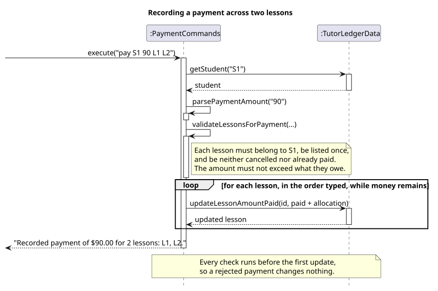

*Figure 27. All checks finish before the first lesson is updated.*

#### Stable output

`getLessons()` returns a copy of the collection. Sorting the selected lessons into a new list leaves
the stored order unchanged; the lesson ID breaks ties when dates and start times match.
Money is formatted directly from `BigDecimal` to two decimal places. Dates use an English weekday
formatter, keeping the output consistent across machine locales. After restart, the statement reads
the same saved fees and payment amounts through the shared storage flow.

#### Alternatives, limits and verification

Generating a statement from the live lesson collection avoids a second payment-history store that could
drift out of sync with lesson edits, deletions or reloads. It also means the statement reflects the
current stored lesson details rather than preserving a separate point-in-time document. The feature
formats output for the terminal; exporting or printing a statement would be a separate capability.

`PaymentCommandsTest` checks that statements include only the selected student's lessons, include both
paid and unpaid fees in date order, and report empty histories and invalid student arguments. The same
suite checks payment-status updates that the statement reads, as well as the intentionally narrower
date and cancellation filters used by `unpaid` and `owed`.

### Attention flags

A tutor with many students has limited preparation time. Attention flags (US14) let the tutor mark the
students who need more of it, with a short reason, such as a weak test or an exam coming up:

| Command | Purpose |
|---|---|
| `flag STUDENT_ID [REASON]` | Flag a student, or replace the reason of an existing flag |
| `unflag STUDENT_ID` | Remove the flag |
| `flagged` | List flagged students and their reasons, active students first, each group in ID order |

The flag is then shown wherever the tutor already looks at the student: a `[flagged]` marker in `list`, a
`Flagged:` line in `view`, and a `Flagged:` line in `next`, which `LessonCommands.describeFlag` adds just
below the student's name.

#### Flagging a student

The sequence diagram below shows `flag S1 Weak at algebra`.

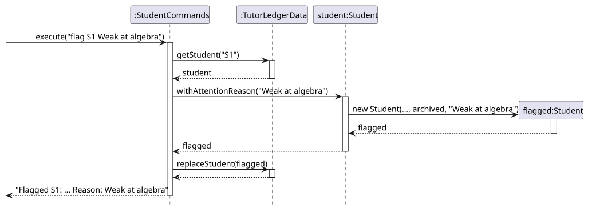

*Figure 28. A flag is set by replacing the student with a flagged copy, the same way as archiving.*

1. `StudentCommands` splits the arguments at the first space. The first word must be a student ID; the rest,
   if any, is the reason.
2. `TutorLedgerData.getStudent` finds the student, or throws if there is none, so a flag can never point to a
   missing student.
3. `Student.withAttentionReason` returns a copy with the reason set. The copy keeps every other detail,
   including the rate and archive state. `replaceStudent` stores it under the same ID.

`unflag` works the same way with `withAttentionReason(null)`. After either command, the main loop's automatic
save (Figure 3) sees the changed snapshot and saves the file.

#### Design considerations

* *A field on `Student`, rather than a separate list of flagged IDs.* `Student` already holds the archive
  state in the same way, so the flag follows an existing pattern. Because the flag is part of the student,
  it is deleted with the student and needs no cascade logic. *Alternative considered:* a separate map in
  `TutorLedgerData`, like follow-up tasks. This would leave `Student` unchanged, but every command that
  shows a student would have to look the flag up separately, and deletion would need another cascade.
* *One nullable field for both state and reason.* `null` means not flagged, and an empty string means
  flagged without a reason. This avoids a separate `boolean` that could disagree with the reason.
  `isFlagged()` and the `Optional` returned by `getAttentionReason()` keep the null away from callers.
* *Reason as free text after the ID, rather than a prefix such as `r/`.* `r/` already means the hourly rate in
  `add` and `edit`. Free text matches `task`, where the description also follows the student ID.
* *Show the flag in `next`.* The story's scenario is preparing before a lesson. `next` is the command the
  tutor already runs then, so the reminder appears without an extra step. The line is left out for students
  who are not flagged, so the usual output is unchanged.

#### Persistence and verification

* `Storage` saves a flag as a separate `FLAG | STUDENT_ID | REASON` line, like `ARCHIVED`. Older data files
  have no `FLAG` lines, so they still load with no student flagged. On loading, `FLAG | S1` without a
  reason is also accepted, and duplicate flags or flags for unknown students are reported by line number.
* `StudentFlagTest` covers each command, the `list`, `view` and `next` output, and that edit, archive and
  restore keep the flag. `StorageTest` covers saving and loading flags, including reasons that contain `|`.

*Possible improvements:* sort `flagged` by the date of each student's next lesson, so the most urgent
preparation comes first, and let `list` show only flagged students.

### Covered topics and topic search

A tutor needs to know what was already taught, both to one student (US12) and across all students (US22),
for example to reuse a worksheet with everyone who has done vectors. `TopicCommands` answers both from the
lesson notes the tutor already writes with `log`, `record` and `edit`:

| Command | Purpose |
|---|---|
| `topics STUDENT_ID [s/SUBJECT] [k/KEYWORD]` | List what was covered with one student, optionally narrowed by subject and topic |
| `topics k/KEYWORD [s/SUBJECT]` | Find every lesson that covered a topic, with any student |

The command only reads lessons. It stores nothing of its own, so the main loop's snapshot is unchanged and
no automatic save happens.

#### Searching by topic

The sequence diagram below shows `topics k/vectors`.

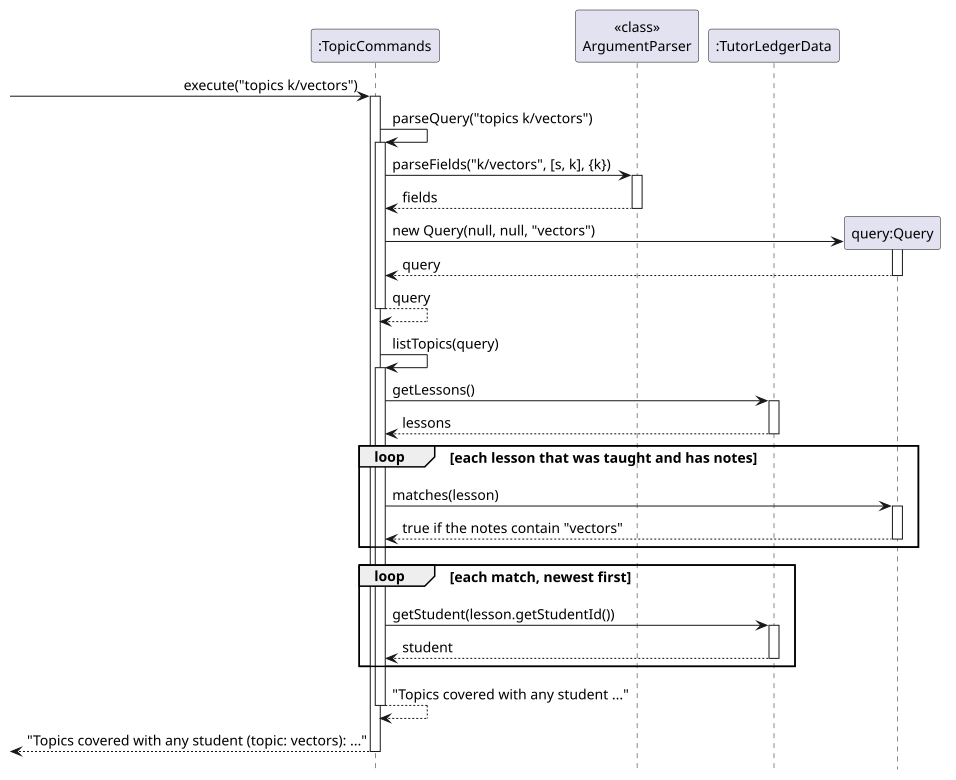

*Figure 29. A topic search filters the stored lessons through one `Query`; nothing is changed or saved.*

1. `parseQuery` reads an optional student ID, as `filter` does. A first word without a slash is the ID, and
   `TutorLedgerData.getStudent` rejects an unknown one. The rest goes to `ArgumentParser.parseFields` with
   `s` and `k` allowed and `k` marked as free text.
2. If neither a student ID nor `k/` is given, `parseQuery` throws, and the usage message is shown.
3. The prefixed values become a private `Query` record. A null field means that filter was not given.
4. `listTopics` keeps the lessons that were actually taught: dated today or earlier, attendance `present`
   or `late`, not cancelled, and with notes. It then asks `Query.matches` for each one and sorts the
   matches newest first, with the lesson ID breaking ties.
5. Without a student ID, each row also shows whose lesson it was, so the output reads on its own.
   `Query.describe` builds the heading, such as `any student (topic: vectors)`.

#### Design considerations

* *Notes as the topic tag, rather than a separate tag field.* The notes already describe what was covered,
  and `next` already shows them as the last topic. *Alternative considered:* a `tag/` field on `Lesson`.
  It would give exact tags, but it needs a new column in the data file and changes to `log`, `record` and
  `edit`, and the tutor would type the topic twice.
* *Matching part of the notes, ignoring case.* `k/vectors` finds `Vectors`, `Revision of vectors` and
  `Vectors and forces`. `String.contains` treats symbols as plain text, so `k/(a+b)^2` works.
  *Alternative considered:* matching whole words only. It would skip `vector` inside `vectors`, which a
  tutor would expect to match.
* *`k/` is free text, like `note/`.* A topic such as `and/or logic` is searched for as typed. A prefix
  that `topics` accepts, `s/`, still starts a new value.
* *A student ID or `k/` must be given.* A bare `topics` would print every note ever written, which is
  not a topic search. `filter` already lists every lesson.
* *One command rather than a new `find` command.* Both stories ask what was covered, so they share the
  same lesson rules, sorting and output.

#### Verification

* `TopicCommandsTest` covers the search across students and with a student and subject. It also covers
  matching that ignores case and treats symbols as plain text, and which lessons count: dated today,
  late, archived students. Ties keep lesson-ID order. It checks searches after a save and restart, that
  a search never saves over a hand-edited file, and each invalid input.
* `EndToEndTest` runs `topics k/...` through the real command loop. It checks that the search still works
  after a restart without rewriting the data file, and that invalid `topics` input leaves the file
  unchanged.

*Possible improvements:* allow several keywords, such as `k/vectors k/forces`, and show how many lessons
each student had on the topic.

### Command history and confirmed replay

History lets a tutor re-run a query after updating records, without retyping a long student/date/filter
combination. It retains command text, not results: replay reads the current records. `history` lists
stable one-based numbers, and `repeat NUMBER` selects one and requests confirmation.

`CommandHistory` owns a session-local list of ordinary command strings. It validates selection numbers
and formats the list, but has no reference to `TutorLedgerData` or `Storage`. `TutorLedger.selectCommand`
handles history controls and uses `isRepeatConfirmed` to read replies. Only a confirmed selection returns
to the existing command loop. Rejected requests and cancellations return without dispatch or saving.

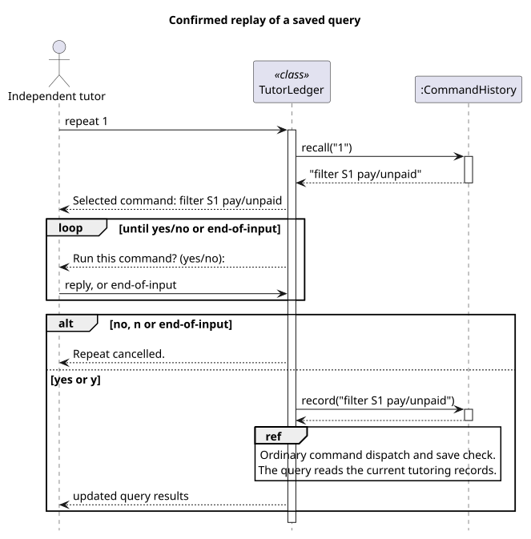

*Figure 30. A valid history selection is displayed before confirmation; only yes reaches ordinary execution.*

#### Recording and execution rules

* Ordinary commands retain their original text with surrounding whitespace removed, even when an alias
  is expanded for execution. They are recorded before dispatch. Failed commands remain visible too,
  so history reflects what the user attempted.
* History controls, blank input, `exit` and confirmation replies are excluded. A repeated command is
  recorded as the underlying ordinary command, not `repeat NUMBER`, so repeated selections cannot recurse.
* Confirmation accepts yes/y and no/n without regard to case. Invalid replies only repeat the prompt;
  they are never dispatched. End-of-input cancels rather than throwing from `Scanner.nextLine`.
* A confirmed selection uses the same current-state validation, explicit storage-command path and
  snapshot-based automatic save as freshly typed input. It does not bypass deletion confirmation,
  scheduling conflicts or payment limits, and execution is not duplicated in a second dispatcher.
* History survives `reload` but is recreated for each invocation of the application loop. Since history
  is outside the saved model, listing or selecting it cannot make a storage snapshot dirty.

#### Design considerations and verification

* *Session history instead of persistent history:* no new data format, migration or history file is needed.
  The cost is losing command recall after a restart; tutoring records still persist normally.
* *Confirmation instead of immediate replay:* queries are convenient to repeat, but an update may have
  different effects on current records. Showing the complete command lets the tutor cancel before any
  handler runs. Input is not prefilled or editable; terminal editing would require a separate UI change.
* *One replay path:* both a fresh command and a confirmed selection enter the original command loop, so
  future commands receive the same validation and saving behaviour automatically.

`CommandHistoryTest` covers numbering, retained text, excluded controls and selection errors including
integer overflow. `CommandHistoryIntegrationTest` runs real sessions against temporary files: a query
after a payment, aliases, both confirmation outcomes, invalid replies, end-of-input, current-state
rejections, explicit save/reload, read-only preservation of hand edits, and history clearing on restart.

## Appendix A: Product scope

### Target user profile

Independent tutors teaching primary-school, secondary-school and junior-college students, who are
comfortable entering commands in a terminal and need to manage their own tutoring records locally.

### Value proposition

TutorLedger keeps student profiles, lesson schedules, homework, scores, payments and follow-up tasks
together. Default rates reduce repeated entry, historical records support lesson preparation, and
explicit deletion confirmation helps prevent accidental loss. The application records payments; it
does not process money, deliver online lessons, or send messages to students and parents.

## Appendix B: User stories

|Version| As a ... | I want to ... | So that I can ...|
|--------|----------|---------------|------------------|
|v1.0|new user|see usage instructions|refer to them when I forget how to use the application|
|v1.0|independent tutor|schedule a lesson for a student on a given date and time|have one place that holds my whole teaching schedule|
|v1.0|independent tutor|list today's and this week's lessons in chronological order|know who I am teaching next and when|
|v1.0|independent tutor|record attendance and notes for a lesson|track who has been coming and what we covered|
|v1.0|independent tutor|edit or delete a lesson|correct mistakes without re-entering the record|
|v1.0|independent tutor|assign homework to a student with a due date|keep track of what each student has to hand in|
|v1.0|independent tutor|mark homework as submitted|see at a glance what is still outstanding|
|v1.0|independent tutor|list outstanding homework, soonest due first|chase overdue work before the next lesson|
|v1.0|independent tutor|mark a lesson as paid or unpaid|know which lessons have been paid for|
|v1.0|independent tutor|see which lessons are unpaid and how much each student owes|know whom to ask for payment|
|v1.0|independent tutor|have my records saved automatically and reloaded on start-up|never lose my records when I close the app|
|v2.0|independent tutor|add a recurring weekly slot for a student|avoid entering the same lesson week after week|
|v2.0|busy tutor|see one summary of my next lesson|prepare in a single glance between lessons|
|v2.0|forgetful tutor|add a lesson record for a past date after the fact|keep my records accurate even when I forget on the day|
|v2.0|independent tutor|reschedule a lesson to a new date and time|keep my schedule matching what is actually happening|
|v2.0|independent tutor|cancel a lesson and give a reason|tell cancellations apart from student absences|
|v2.0|independent tutor|set a default hourly rate for each student|avoid re-entering the fee for every lesson|
|v2.0|independent tutor|add and edit primary-school, secondary-school and junior-college students|keep all my students in one place|
|v2.0|careless tutor|be warned before deleting a student who has lesson history|avoid losing months of records by accident|
|v2.0|independent tutor|record a score for a test or assessment|see whether the student is improving|
|v2.0|independent tutor|log a follow-up task for myself, such as bringing a worksheet|not forget it between lessons|
|v2.0|independent tutor|record a payment that covers several lessons|settle a family's bill in one step|
|v2.0|independent tutor|see a fee statement for one student|answer a parent's questions about past charges|
|v2.0|independent tutor|see my income for a month or a year|keep track of my earnings|
|v2.0|independent tutor|filter lessons by student, date range and payment status|find the lessons I am looking for quickly|
|v2.0|expert user|type short aliases for common commands|enter commands faster|
|v2.0b|independent tutor|archive a student who has stopped lessons|keep my active list uncluttered while preserving history|
|v2.0b|independent tutor|list the topics already covered with a student|avoid repeating material we have finished|
|v2.1|independent tutor|tag a lesson with the topic taught|later find every lesson that covered that topic|
|v2.0b|independent tutor|see a summary of a student's attendance and scores over the term|review their progress at the end of the term|
|v2.1|independent tutor|flag a student as needing extra attention|decide where to spend my limited prep time|
|v2.1|expert user|recall and re-run a previous command|repeat a query after updating records without retyping its filters|

## Appendix C: Non-functional requirements

* **Runtime and interaction:** the application is built for Java 25 and is operated through a terminal.
  Its commands do not depend on a graphical interface or a network service.
* **Offline operation:** commands use the locally stored student, lesson, homework, score and task
  records. Managing records does not require an internet connection.
* **Persistence and portability:** records are stored in the human-readable
  `data/tutorledger.txt` file and restored when the application starts. A working directory must permit
  file writes for automatic saves and backups; save failures are reported rather than silently ignored.
* **Data recoverability:** the file can be inspected or edited with a text editor, and `reload` can read
  those edits. Invalid lines are reported with their line numbers while valid records continue to load.
  Users should back up data before manual edits or destructive operations.
* **Data integrity:** input and model constraints are checked before a record is inserted or replaced.
  A rejected command must not leave a partial update or consume an ID. Weekly scheduling validates every
  lesson slot before adding any of them, and IDs are not reused after deletion.
* **Financial accuracy:** money is represented with decimal arithmetic rather than binary floating point.
  Calculated lesson charges are rounded to two decimal places using `HALF_UP`; once saved, a lesson's fee
  does not change just because its student's default rate changes.
* **Reliable validation:** user-input validation remains active even when Java assertions are disabled.
  Rejected input is reported clearly and is not accepted as a record.
* **Repeatable verification:** automated tests cover command validation, persistence and date-sensitive
  behaviour. Tests that depend on the current date use a fixed clock so their results are reproducible.

## Appendix D: Glossary

| Term | Meaning |
| --- | --- |
| Active student | A student profile that has not been archived and appears in the default active-student list. |
| Archived student | A retained profile hidden from the default active list. Restore it before scheduling new lessons; its historical records remain available. |
| Attendance | The recorded outcome of a lesson, such as present, late or absent. `none` clears the outcome and returns it to not recorded. |
| Amount paid | The money received and allocated to a lesson. It can be less than the saved fee when a lesson is partially paid. |
| Cancelled lesson | A lesson retained with a cancellation reason. It frees its time slot and is excluded from `owed`, `unpaid` and income totals; any amount already received is not automatically refunded. |
| Command history | The session-local numbered list of ordinary commands. A selection executes only after confirmation and is revalidated against current records. |
| Covered topic | The notes of a lesson that was taught: dated today or earlier, attended, not cancelled and with notes. `topics` lists them for one student or searches them by keyword across all students. |
| Default hourly rate | An optional per-student rate used to calculate the charge for a new lesson when no explicit total fee is supplied. Changing the rate does not recalculate existing lessons. |
| Fee statement | A read-only view of one student's saved lessons, fees and payment statuses, including past and future lessons. It is assembled from lesson records rather than stored separately. |
| Follow-up task | A pending or completed reminder, optionally linked to a student and a due date. Completing it keeps the task in the records but removes it from pending-task lists. |
| Homework item | A student's assignment with a description, due date and outstanding or submitted status. Submitting it changes its status rather than deleting it. |
| Lesson fee | The saved total charge for one lesson. An explicit fee applies to the whole lesson; otherwise, the default hourly rate is multiplied by the duration and rounded to two decimal places. |
| Outstanding balance | The saved lesson fee minus the amount paid. The `owed` and `unpaid` summaries apply their documented date and cancellation filters to this balance. |
| Progress summary | A per-student view that combines recorded lesson attendance and assessment scores, optionally limited to a date range. |
| Score | A student's assessment result, recorded as marks earned, total possible marks, a title and an optional date. The percentage is derived from the marks. |
| Snapshot | The encoded records used before and after a command to detect whether stored data changed and an automatic save is needed. |
| Weekly schedule | A command that creates separate lesson records for successive weeks. Each lesson can later be edited or cancelled independently; the set is not a recurring record. |

## Appendix E: Instructions for manual testing

Start each scenario in a separate test working directory. **Before launching**, create a `data` directory
and an empty file named `tutorledger.txt` inside it. Use Java 25 with assertions enabled:
`java -ea -jar /absolute/path/to/tutorledger.jar`. The existing empty `data/tutorledger.txt` loads no
records, so the first student is S1 and the first lesson is L1. A missing file instead creates sample
records and consumes IDs. Only the first-launch sample-data tests below should begin with a missing file.
Use dates before today for logged attendance and dates after today for upcoming lessons. The fixed
examples below target the October 2026 release; adapt both input dates and expected dates when testing
later. Back up any real data before testing deletion, reload or hand-edited files.

### Student book and command help

1. Run `add n/Alice Tan l/Pri5 p/91234567 s/Math r/60`. Expected: S1, canonical level `Pri 5`,
   subject Math and a $60.00/hour rate.
2. Run `subject S1 s/Physics`, `list alice` and `view S1`. Expected: one matching active profile;
   the view includes both subjects and the saved rate.
3. Run `edit S1 p/82345678`, then `edit S1 l/JC3`. Expected: the phone edit succeeds and the invalid
   level is rejected without changing the profile. `help` and `help extra` both show command help.
4. Exit and restart. Expected: the phone and subjects remain. The archive and deletion scenarios below
   cover their additional state changes.

### Homework

1. Add S1, then run `assign S1 Worksheet d/01-12-2026`. Expected: H1 is created and appears in `homework S1`.
2. Run `submit H1`, then `homework S1`. Expected: H1 is no longer outstanding. Repeating `submit H1`
   reports that it is already submitted without adding a record.
3. Exit and restart. Expected: H1 remains submitted; `view S1` does not list it as outstanding homework.
4. Run `edit H1 status/outstanding d/02-12-2026 desc/Worksheet and/or notes`. Expected: H1 is outstanding
   again, due 02-12-2026, and its description keeps `and/or`.
5. Run `delete H1`, then `assign S1 Essay d/03-12-2026`. Expected: H1 is gone, and the new item is H2,
   because IDs are never reused.

### Payments and fee-edit boundaries

1. Add `add n/Alice Tan l/Pri5 p/91234567 s/Math`, then log lessons:
   `log S1 d/01-09-2026 t/1600 s/Math f/60 a/present` and
   `log S1 d/02-09-2026 t/1600 s/Math f/55 a/present`.
2. Run `pay S1 80 L1 L2`. Expected: L1 is paid and L2 has $20.00 paid with $35.00 remaining.
   `unpaid S1`, `owed` and `filter S1 pay/unpaid` include L2. `income 09-2026` totals $80.00.
3. Run `edit L1 f/80`. Expected: L1 retains $60.00 paid and now owes $20.00; income remains $80.00.
   Run `edit L2 f/10`. Expected: an error and no loss of its $20.00 payment.
4. Log `log S1 d/03-09-2026 t/1600 s/Math f/0 a/present`. Expected: L3 is settled without a crash
   or an increase in income. `mark L2 paid` settles its balance; `mark L2 unpaid` resets its payment.
5. Schedule `schedule S1 d/01-12-2026 t/1600 s/Math f/60`, run `pay S1 20 L4`, then
   `cancel L4 r/Unavailable`. Expected: a reminder to refund or carry over $20.00, with the payment retained.
6. Exit and restart. Expected: the latest allocations, free-lesson status, edited fees and cancellation
   remain in `fee_statement S1`. Partial payments and cancelled lessons follow the same reporting rules.

### Follow-up tasks

1. Logging tasks
   1. Add a student (S1). Run `task S1 Bring Worksheet 4B d/16-10-2026`.
      Expected: `Added T1: Bring Worksheet 4B` and `for S1 ..., by Fri 16-10-2026`.
   1. Run `task Print term calendar`. Expected: `Added T2: Print term calendar` with no second line.
   1. Run `task S1 Bring notes d/31-02-2026`. Expected: an error, and `tasks` still lists 2 tasks.
1. Listing and finishing tasks
   1. Run `task S1 Return script d/01-01-2020`, then `tasks`. Expected: T3 is first and marked `OVERDUE`; T2
      (no date) is last.
   1. Run `done T3`, then `done T3` again. Expected: the second gives `Error: T3 is already done.`
1. Reminders in `next`
   1. Schedule a future lesson for S1, then run `next`. Expected: a final line `Follow-ups: T1 Bring Worksheet 4B
      (by ...)`.
1. Names with `d/o`
   1. Run `task Call Priya d/o Raman's mother`. Expected: `Added T4: Call Priya d/o Raman's mother` with no
      due date, because `d/o` is part of the name, not a date.
1. Saving and deleting
   1. Restart TutorLedger. Expected: `tasks` shows the same tasks.
   1. Run `delete S1 confirm`. Expected: `Also deleted 2 follow-up tasks.` (T1 and T3); T2 and T4 (not linked)
      are kept.

### Lessons

Use a separate working directory with an existing empty `data/tutorledger.txt` and Java 25 with `-ea`.
The steps assume today is before 01-12-2026.

1. Run `add n/Amirah Tan l/Sec 3 p/91234567 s/A Math`, then
   `schedule S1 d/01-12-2026 t/1600 s/A Math f/60 w/3`.
   Expected: L1 to L3, every Tuesday at 1600 from 01-12-2026 to 15-12-2026.
2. Run `schedule S1 d/15-12-2026 t/1600 s/A Math f/60`. Expected: `Error: L3 already starts at that date
   and time.` Run `schedule S1 d/22-12-2026 t/1600 s/A Math f/60 w/2`. Expected: L4 and L5, with no ID
   skipped by the rejected command.
3. Run `reschedule L3 d/16-12-2026`, then `cancel L2 r/Student sick`. Expected: L3 moves to Wednesday, and
   L2 is cancelled with its reason. `schedule S1 d/08-12-2026 t/1600 s/A Math f/60` now succeeds, because a
   cancelled lesson frees its slot.
4. Try `reschedule L2 t/1700`, `record L1 a/present` and `cancel L1 r/`. Expected: each is rejected with
   an error, because L2 is cancelled, L1 has not happened yet and the reason is blank.
5. Run `log S1 d/20-10-2026 t/1600 s/A Math f/60 a/present note/Quadratic inequalities`, then `next S1`.
   Expected: the next lesson is L1, its last topic is `Quadratic inequalities`, and one $60.00 lesson is
   unpaid.
6. Run `edit L1 t/1530`, `delete L5` and `lessons week`. Expected: L1 now starts at 1530 and L5 is gone.
   `lessons` lists only lessons in the current week, so it may show none.
7. Exit, restart and run `next S1`. Expected: the same summary as in step 5, showing L1 at 1530.
8. Run `uncancel L2`. Expected: `Error: L6 already starts at that date and time. Reschedule or delete that
   lesson first.` Run `delete L6`, then `uncancel L2`. Expected: L2 is no longer cancelled.
9. Run `schedule S1 d/01-12-2026 t/1600 s/A Math f/60`. Expected:
   `Error: That time overlaps L1 (01-12-2026 1530, 60 min).` The same command with `t/1630` succeeds,
   because L1 ends at 1630.
10. Run `record L7 a/absent note/Speed in km/h and/or m/s`, then `edit L7 a/none`. Expected: the notes keep
    `km/h` and `and/or`, and `view S1` shows L7 as not recorded.

### Student deletion warnings

Use a separate working directory with an existing empty `data/tutorledger.txt`. Run the packaged application
with Java 25 and `-ea`.

1. Run `add n/Alice Tan l/Pri5 p/91234567 s/Math r/60` and
   `add n/Bob Tan l/JC2 p/81234567 s/Math`.
   Schedule `schedule S1 d/01-12-2026 t/1600 s/Math`, assign
   `assign S1 Worksheet d/02-12-2026` and record `score S1 WA1 m/8/10 d/15-09-2026`.
2. Run `delete s1`. Expected: a warning identifies Alice, lists one lesson, one homework item and one
   score, and instructs `delete S1 confirm`. No records are deleted. Run `view S1` and `scores S1`
   to check that the records remain. Repeat `delete S1`; it must warn again.
3. Run `delete S1 yes` and `delete S1 confirm extra`. Expected: usage errors without deletion.
   Run `help`; it must list the optional `confirm` token and explain the warning.
4. Cancel the lesson with `cancel L1 r/Student away`, then run `delete S1`. Expected: the cancelled
   lesson still triggers the warning. Exit without confirming, restart and run `view S1` and
   `delete S1` again. All records remain and the warning appears again.
5. Run `delete S1 confirm`. Expected: Alice and her linked lesson, homework and score are deleted.
   Bob remains. Restart; Alice's records must remain absent. Add another student; its ID must be S3.
6. Run `delete S2`. Expected: immediate deletion because Bob has no linked records. Add a student with
   only homework, only a score or only a follow-up task, and run `delete` on them. Expected: a warning
   each time. A single `delete LESSON_ID` remains immediate.
7. Repeat the warning and malformed-confirmation checks with Java's `-da` option. Expected: the same
   protection and error messages; input validation does not depend on assertions.

### Archiving students

Use a separate working directory with an existing empty `data/tutorledger.txt` and Java 25 with `-ea`.

1. Add `add n/Alice Tan l/Pri5 p/91234567 s/Math r/60` and
   `add n/Bob Tan l/JC2 p/81234567 s/Math r/70`.
2. Run `log S1 d/15-09-2026 t/1600 s/Math f/60 a/present note/Vectors`,
   `schedule S1 d/01-12-2026 t/1600 s/Math`, `assign S1 Worksheet d/02-12-2026` and
   `score S1 WA1 m/8/10 d/15-09-2026`.
3. Run `archive S1`, then `list`. Expected: only Bob is listed. `list status/archived` finds Alice;
   `list tan status/all` finds both in ID order, with Alice marked `[archived]`.
4. Run `view S1`, `scores S1`, `owed` and `next S1`. Expected: Alice's original details, historical
   records, unpaid balance and future lesson remain available. Archiving has not cancelled L2.
5. Try `schedule S1 d/02-12-2026 t/1600 s/Math w/2`. Expected: a restore instruction and no new lessons.
   Repeating `archive S1` reports that the student is already archived.
6. Restart and run `list status/archived` and `view S1`. Expected: archive status, rate and history persist.
   Run `restore S1`, then repeat the rejected schedule. Expected: L3 and L4 are created, with no skipped IDs.
7. Try `list status/other`, `archive S99` and `restore S1 extra`. Expected: errors without data changes.
   Repeat the scheduling guard with `-da`; protection must remain enabled without assertions.

### Covered topics

Use a separate working directory with an existing empty `data/tutorledger.txt` and Java 25 with `-ea`.

1. Run `add n/Alice Tan l/Pri5 p/91234567 s/Math s/Physics r/60` and
   `add n/Bob Tan l/JC2 p/81234567 s/Math r/70`.
2. Run `log S1 d/15-09-2026 t/1600 s/Math f/60 a/present note/Vectors`,
   `log S1 d/16-09-2026 t/1600 s/Physics f/60 a/late note/Forces` and
   `log S1 d/17-09-2026 t/1600 s/Math f/60 a/absent note/Not covered`.
3. Run `topics s1`. Expected: L2 and L1, newest first, with dates, subjects and full notes. The absent
   lesson is excluded. `topics S1 s/mAtH` lists only L1; `topics S2` reports no topics recorded.
4. Run `edit S1 s/Physics`, then `topics S1 s/Math`. Expected: L1 is still found despite the subject
   being removed from the profile. `edit L1 note/` removes L1 from the topics list.
5. Try `topics`, `topics S99`, `topics S1 s/` and `topics S1 s/Math s/Physics`.
   Expected: errors without changing any records or consuming IDs. `help` lists the new command.
6. Run `edit L1 note/Vectors` to restore L1's notes and
   `log S2 d/18-09-2026 t/1600 s/Math f/70 a/present note/Vectors revision`, then `topics k/VECTORS`.
   Expected: L4 (S2 Bob Tan) and L1 (S1 Alice Tan), newest first, each showing its student.
   `topics S1 k/vectors` lists only L1, `topics k/vectors s/Physics` reports no topics recorded, and
   `topics k/forces` finds L2.
7. Try `topics k/`, `topics k/a k/b` and `topics s/Math`. Expected: errors without changing any records.
8. Exit and restart; `topics S1` should still show Forces. Run with `-da` and repeat the invalid-input
   checks; validation must remain active without assertions.

### School levels

Use a separate working directory with an existing empty `data/tutorledger.txt`. Run the packaged application
with Java 25 and `-ea`.

1. Run `add n/Alice Tan l/pRi6 p/91234567 s/Math r/40` and
   `add n/Bob Tan l/JC2 p/81234567`. Expected: S1 is `Pri 6` and S2 is `JC 2`.
2. Run `edit S1 l/jc1`, then `edit S1 l/sec1`. Expected: each stage change succeeds and `view S1`
   finally shows `Sec 1`, subject `Math` and the same $40.00/hour rate.
3. Run `edit S1 l/JC3 r/99`. Expected: an error lists all three supported ranges; S1 remains `Sec 1`
   with the $40.00/hour rate.
4. Try `add n/Carol Tan l/Pri7 p/87654321`, then
   `add n/Carol Tan l/Pri1 p/87654321`. Expected: the first command fails; the second creates S3,
   demonstrating that the rejected command consumed no ID.
5. Run `help`. Expected: the `LEVELS` section lists all ranges and examples such as `l/Pri5` and `l/JC1`.
6. Exit and restart, then run `list`. Expected: S1 is `Sec 1`, S2 is `JC 2` and S3 is `Pri 1`, without
   any skipped-line warning. `view S1` still shows its subjects and default rate.

### Default hourly rates

Use a separate working directory with an existing empty `data/tutorledger.txt`. Run the packaged application
with Java 25 and `-ea`.

1. Add a student: `add n/Amirah l/Sec 3 p/91234567 s/E Math r/60`.
   Expected: S1 is created with `Default hourly rate: $60.00/hour`.
2. Run `schedule S1 d/20-10-2026 t/1600 s/E Math dur/90`.
   Expected: L1 is scheduled for 90 minutes with a total fee of $90.00.
3. Run `edit S1 r/100`, then `view S1`.
   Expected: the new rate is $100.00/hour; L1 still costs $90.00.
4. Run `edit L1 dur/30`, then `view S1`.
   Expected: L1 is 30 minutes long and still costs $90.00. `edit L1 f/50` explicitly changes it to $50.00.
5. Run `schedule S1 d/21-10-2026 t/1600 s/E Math f/25 dur/90`.
   Expected: L2 costs $25.00 in total, overriding the rate.
6. Run `edit S1 r/`, then try `schedule S1 d/22-10-2026 t/1600 s/E Math`.
   Expected: an error asks for a default rate or explicit fee; no lesson or ID is consumed.
7. Try `edit S1 r/-1` and `edit L1 dur/0 f/999`.
   Expected: both are rejected; S1's rate stays unset and L1's fee stays $50.00.
8. Exit and restart. Run `view S1`.
   Expected: both lessons retain their durations and fees, and the default rate remains unset.

### Fee statements

1. Create two students and schedule or log several lessons for one of them on different dates and times,
   including a future lesson. Mark at least one lesson as paid, and add a lesson for the other student.
   Add a third student, S3, without lessons for the empty-history check.
2. Run `fee_statement S1`. Expected: all of S1's lessons appear in date/time order, including the paid
   lesson, with each saved fee and current payment status; the other student's lesson is absent.
3. Run `fee_statement S3` for the student with no lessons. Expected: an empty-history message.
4. Try `fee_statement`, `fee_statement S99`, and `fee_statement S1 extra`. Expected: usage errors for
   missing/extra arguments and a student-not-found error for S99.
5. Run `mark L1 paid`, then `fee_statement S1`. Expected: L1 now shows as paid. Exit and restart TutorLedger,
   then run the statement again; the paid status and saved fee should be unchanged.
6. In a separate empty data file, add Alice with Math, schedule a $60 lesson dated `01-01-2020`, allocate
   $25 with `pay`, and cancel it with reason `Sick`. Expected: `filter S1 pay/unpaid` has no matches,
   while `filter S1` and `fee_statement S1` label the retained row `[cancelled: Sick; not chargeable]`.
   The filter total excludes the $60 fee; the statement preserves the $25 payment. Restart and repeat:
   the labels and amounts remain. Uncancel the lesson: it reappears in the partial/unpaid filters.

### Saving and loading data

To check ID rejection, use a separate test folder with an existing `data/tutorledger.txt` containing
`S | S1 | Bob Tan | Pri6 | 98765432` and `S | S2147483648 | Alice Tan | Pri5 | 91234567` on separate lines.
Start the application: only Bob loads, and Alice's row is reported with a supported-range error.
`list` must work, `view S2147483648` must report an unknown student, and `save` must omit Alice's row.
Restart: there is no skipped-row warning. For counter exhaustion, set a test file's student `NEXT`
counter to `S2147483647`: existing students remain readable, while `add` reports that no more S IDs
are available and leaves the file unchanged. The same range/capacity checks apply to L, H, A and T.

1. Automatic save and restart
   1. For this first-launch test only, start TutorLedger in a separate folder with no `data/tutorledger.txt`.
      Expected: a small set of synthetic sample records is loaded and saved automatically.
   1. Try `list`, `lessons week`, `next`, `homework S1`, `scores S1` and `tasks S1` before entering real records.
      Expected: `lessons week` shows at least one sample lesson on any day of the week, and `next` shows L2,
      which is tomorrow.
   1. Run `add n/Carol Tan l/Pri 5 p/87654321`, then `exit`.
   1. Start TutorLedger again. Expected: the sample records and Carol's record are loaded from the data file.
1. Deleted IDs are not reused
   1. Start a separate session with an existing empty `data/tutorledger.txt`, as described at the start of
      Appendix E. Add two students (S1, S2), `delete S2`, then restart TutorLedger.
   1. Add another student. Expected: it is given the ID S3, not S2.
1. Hand-editing and `reload`
   1. Use the sample-data folder from the automatic-save test, which contains students and lessons.
      Start TutorLedger in that folder.
   1. Open `data/tutorledger.txt` and change a student's phone number, then run `reload`.
      Expected: `view` shows the new number.
   1. Change a lesson's date to `31-02-2026`, then run `reload`.
      Expected: that line is reported as skipped with its line number; all other records load.
   1. To test restarting with an empty file, exit TutorLedger and empty `data/tutorledger.txt` without deleting
      the file, then start TutorLedger again. Expected: an empty data set is loaded and sample records are not recreated.
      Deleting the file instead causes the first-launch sample records to be created again.
   1. While TutorLedger is running, move `data/tutorledger.txt` elsewhere, then run `reload`.
      Expected: `No data file found at data/tutorledger.txt.` and the current records are unchanged.
1. Backups
   1. Run `save backups/test.txt`. Expected: the file and the `backups` folder are created.

### Scores and progress

1. Recording scores
   1. Add a student (S1). Run `score S1 WA1 m/28/40 d/07-09-2026`. Expected: `Recorded A1 ...` with 70.0%.
   1. Run `score S1 Mid-year exam m/55/100 d/21-09-2026`. Expected: `Down 15.0 points from WA1 (70.0%)`.
   1. Run `score S1 WA2 m/45/40`. Expected: an error, and `scores S1` still lists 2 scores.
1. Listing scores
   1. Run `scores S1`. Expected: scores oldest first, a `-15.0` change on the second row, and a trend line.
1. Progress summary
   1. Schedule three past lessons for S1 and `record` them as `present`, `late` and `absent`.
   1. Run `progress S1`. Expected: `attended 2 of 3 recorded lessons (66.7%)` and both scores with their
      average.
   1. Run `progress S1 from/15-09-2026`. Expected: only lessons and scores from 15-09-2026 onwards.
1. Saving and deleting
   1. Restart TutorLedger. Expected: `scores S1` shows the same scores.
   1. Run `delete S1`. Expected: a warning appears because S1 has linked records, and the scores remain;
      run `delete S1 confirm` to complete the deletion. The success output says the scores were deleted too.

### Income summaries

1. Create or log several lessons in different months, mark some paid and leave others unpaid. Include a
   cancelled lesson marked paid.
2. Run `income 09-2026`. Expected: the total and payment details include positive amounts received for non-cancelled lessons
   dated in September 2026.
3. Run `income 2026`. Expected: all 12 months appear with their monthly totals and payment details; months
   without received payments show `$0.00`.
4. Try `income 13-2026`, `income 0000`, and `income 2026 extra`. Expected: each input is rejected with a
   usage or date-range error.

### Attention flags

1. Add `add n/Alice Tan l/Pri5 p/91234567 s/Math r/60` and `add n/Bob Tan l/JC2 p/81234567`, then
   `schedule S1 d/01-12-2026 t/1600 s/Math`.
2. Run `flag S1 Weak at fractions`. Expected: a confirmation with the reason. `list` shows `[flagged]` only
   for Alice, `view S1` shows `Flagged: Weak at fractions`, and `next` shows the same line under her name.
3. Run `flag S1 Exam on Fri`. Expected: `Updated flag on S1`, with the new reason. Run `flag S2`. Expected:
   `Reason: (no reason given)`.
4. Run `archive S1`, then `flagged`. Expected: Bob first, then Alice marked `[archived]`.
5. Restart TutorLedger and run `flagged`. Expected: the same two students and reasons.
6. Run `unflag S2` twice. Expected: the flag is removed, then `S2 Bob Tan is not flagged.`
7. Try `flag`, `flag Alice`, `flag S9` and `flagged S1`. Expected: an error for each, with no changes.

### Command history and confirmation

1. In a separate working directory with an existing empty `data/tutorledger.txt`, start TutorLedger,
   add `add n/Alice Tan l/Pri5 p/91234567 s/Math`, then
   `log S1 d/06-10-2020 t/1600 s/Math f/40 a/present`. Exit and restart, leaving saved S1 and L1.
   `history` now reports `No commands in history.`
2. Run `filter S1 from/01-01-2020 to/31-12-2020 pay/unpaid`, then `mark L1 paid`.
   `history` lists the query as 1 and the payment update as 2.
3. Run `repeat 1`. Expected: the full query and confirmation prompt, with no query results yet.
   Enter `no`. Expected: `Repeat cancelled.` and history still has two entries.
4. Select `repeat 1` again. Enter `maybe`, then `YES`. Expected: the invalid reply asks for yes or no;
   the confirmed query runs once, now listing zero unpaid lessons. History entry 3 contains the query.
5. Try `repeat`, `repeat 0`, `repeat 999999999999999999999`, `repeat 99` and `history extra`.
   Expected: errors with no record or history changes. Run `delete S1`, then repeat that warning command
   and confirm yes. Expected: the ordinary deletion warning again; the student has not been deleted.
6. Run `reload`, then `history`. Expected: this session's entries remain. Exit and restart: history is
   empty, while S1 and its paid lesson remain. Closing input at a replay confirmation cancels safely.
