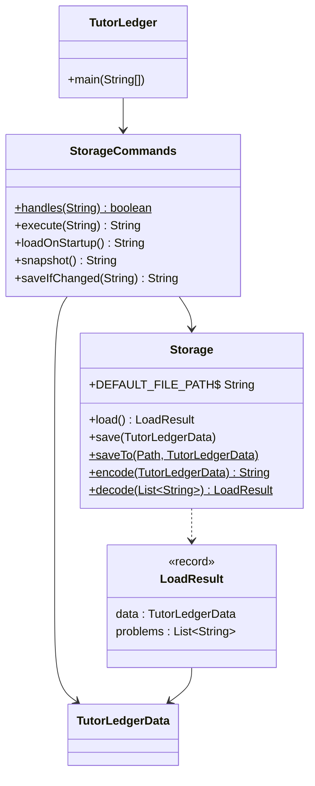
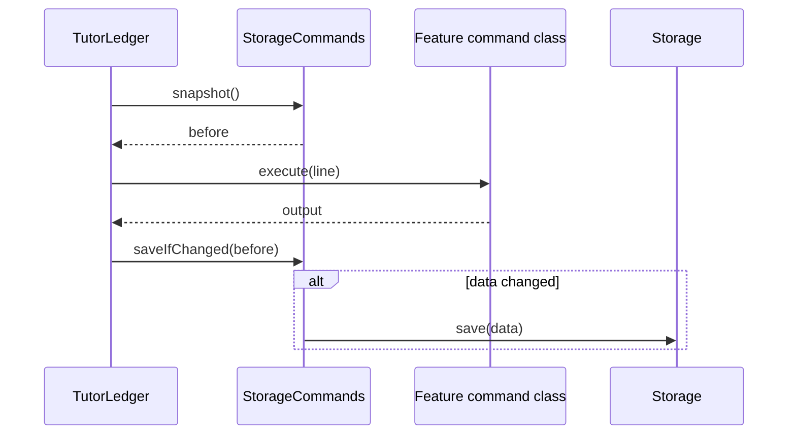
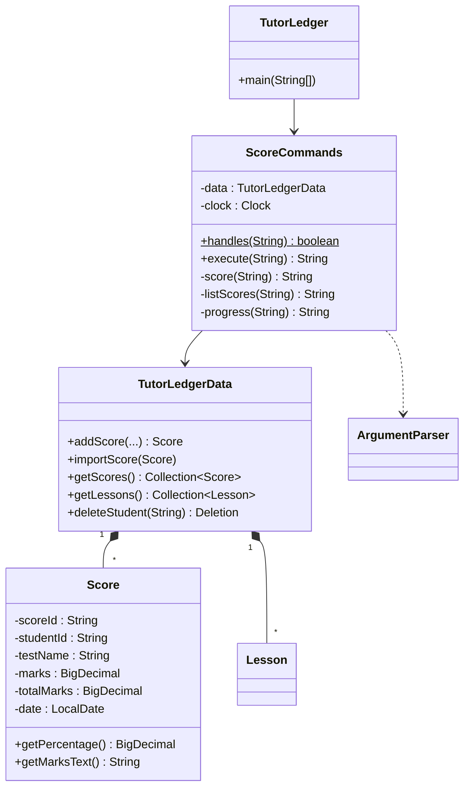
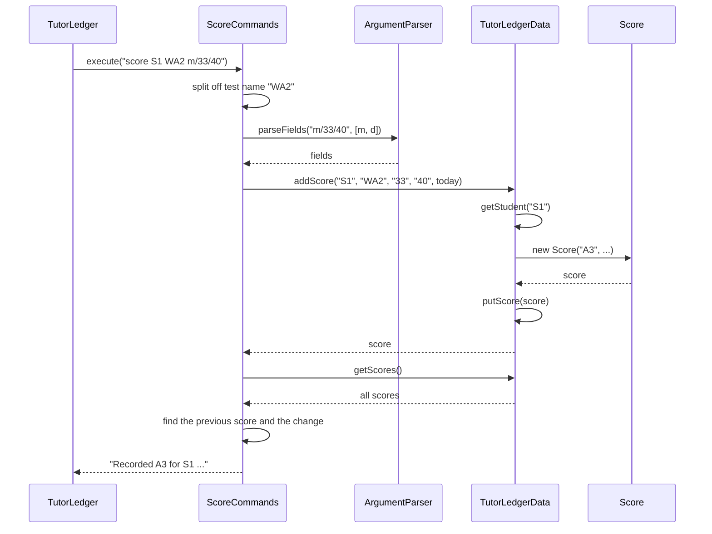

# Developer Guide

## Acknowledgements

{list here sources of all reused/adapted ideas, code, documentation, and third-party libraries -- include links to the original source as well}

## Design & implementation

{Describe the design and implementation of the product. Use UML diagrams and short code snippets where applicable.}

### Storage

The storage feature (F5.1 automatic save, F5.2 human-editable data file) keeps every record in one
plain-text file, `data/tutorledger.txt`, so that data survives restarts and a tutor can fix or bulk-edit
records in a text editor.



* **`Storage`** knows the file format and does the file input/output. It never prints anything, so it can
  be tested on its own.
* **`StorageCommands`** runs `save` and `reload`, loads the file at startup and saves automatically. It turns
  file errors into messages for the user, following the same `handles`/`execute` pattern as the other
  command classes.
* **`TutorLedgerData`** gained `importLesson`, `importHomework`, `setNextLessonNumber`,
  `setNextHomeworkNumber` and `replaceAllWith` so that records can be restored with their saved IDs.

#### File format

Each record is one line of fields separated by ` | `:

```
NEXT | S3 | L2 | H2 | A2
S | S1 | Amirah Binte Rahman | Sec 3 | 91234567 | E Math | A Math
L | L1 | S1 | 15-09-2026 | 1600 | A Math | 60 | present | paid | Quadratics \| discriminant
H | H1 | S1 | 29-09-2026 | outstanding | Worksheet 4A
A | A1 | S1 | 07-09-2026 | 28 | 40 | WA1
```

* The `NEXT` line saves the ID counters. Without it, deleting the newest student and restarting would
  hand the deleted student's ID to the next new student, breaking the rule that IDs are never reused.
* A `|` or `\` inside a value is escaped as `\|` or `\\`, so notes and subjects can contain any text.
* Values are written in the same format the user types them (e.g. `DD-MM-YYYY`), so a hand-edited file
  uses the rules users already know.

*Alternatives considered:* JSON (via a library such as Jackson) handles nesting and escaping for us, but it
is harder for a tutor to edit by hand, and it needs a third-party library. CSV is similar to the chosen
format, but its quoting rules are less obvious to people editing it by hand.

#### Loading and validation

`Storage.decode` reads the file in two passes: students (and the `NEXT` line) first, then lessons,
homework and scores. Lessons, homework and scores must belong to an existing student, so this order lets lines appear in any
order in the file. Every record is rebuilt through the same constructors and `TutorLedgerData` methods that
commands use, so a hand-edited file is checked by exactly the same rules as typed input. For example, the
rules reject an invalid date, a duplicate ID, two lessons in one slot, or a lesson for a missing student.

A line that fails a check is skipped and reported as `Line N: reason`. Loading carries on with the
remaining lines, so one typo does not lose the whole file.

#### Automatic saving

Before each command, the main loop takes a `snapshot()` (the text the file would contain). After the
command, `saveIfChanged` compares a new snapshot with it and writes the file only if they differ.



* Comparing snapshots means a command that teammates add later is saved automatically. Nobody has to
  remember to update a list of "commands that change data".
* Commands that only display data never write the file, so they cannot overwrite a tutor's hand edits
  before `reload`.
* `save` and `reload` skip the automatic save. In particular, `reload` must not save, or the lines it just
  skipped would be erased before the tutor could fix them.
* The cost is encoding the data twice per command. For the few hundred records a tutor has, this takes
  well under a millisecond.

*Alternative considered:* saving after every command, whether or not it changed anything, is simpler. But a
read-only command such as `list` would then overwrite hand edits made while the app is open.

*Possible improvement:* write to a temporary file and then rename it over the data file. This means a crash
part-way through writing can never leave a half-written data file.

### Scores and progress

These features let a tutor record test results (F7.1 `score`, F7.2 `scores`, story US19) and review a
student at the end of a term (F7.3 `progress`, story US44).



* **`Score`** is an immutable record of one test result, like `Lesson` and `Homework`. Its constructor
  checks every value, for example that the marks are not more than the total. A score therefore cannot
  exist in an invalid state, whether it was typed in or loaded from a hand-edited file.
* **`ScoreCommands`** follows the same `handles`/`execute` pattern as the other command classes. The main
  loop routes `score`, `scores` and `progress` to it.
* **`TutorLedgerData`** stores scores in a map keyed by ID, with a counter that never decreases, as it does
  for lessons and homework. `deleteStudent` also removes the student's scores, and `Deletion` reports how
  many were removed.
* **`Storage`** saves each score as an `A` line. The score counter is a fifth, optional field on the `NEXT`
  line, so data files written before this feature still load.

#### Recording a score

The sequence diagram below shows `score S1 WA2 m/33/40`.



1. The test name is everything before the first `m/` or `d/`, so it can contain spaces, like an `assign`
   description. The rest goes to the shared `ArgumentParser`, so `m/` and `d/` can be typed in any order.
2. `TutorLedgerData.addScore` looks up the student first, so a score can never belong to a missing student.
   It then creates the `Score`, which validates the values, and stores it under the next ID.
3. `ScoreCommands` sorts the student's scores by date and compares the new score with the one before it.
   The tutor sees at once whether the student did better or worse.

Any invalid value throws `IllegalArgumentException` before anything is stored. `execute` turns this into an
`Error: ...` message and logs it at `WARNING` level.

**Design decisions**

* *Marks are `BigDecimal`, not `double`.* Half marks such as 17.5 are common, and `double` cannot store
  some decimals exactly. The data file would then show values like `17.499999`. Lesson fees use
  `BigDecimal` for the same reason.
* *Scores are compared as percentages.* Tests have different totals (40 marks for a class test, 100 for an
  exam), so raw marks cannot be compared. Percentages are rounded to 1 decimal place with `HALF_UP`.
* *The date defaults to today.* Tutors usually record a score on the day the script is returned.
  *Alternative considered:* making `d/` compulsory is stricter, but it adds typing for the most common case.

#### Summarising progress

`progress STUDENT_ID [from/DATE] [to/DATE]` gathers the student's lessons and scores in the period and
summarises them. The activity diagram shows how each lesson is counted.


* Lessons after today are skipped because they cannot have attendance yet. Counting them as "not
  recorded" would wrongly suggest the tutor forgot to record them.
* Unrecorded past lessons are reported, but they are left out of the rate. Otherwise a tutor who has not
  yet recorded yesterday's lesson would see a lower rate than the student deserves.
* A late arrival counts as attending. The tutor still taught the lesson, and the separate `late` count
  keeps lateness visible.
* Without `from/`, the period starts at `LocalDate.MIN`, so all of the student's records are included.

`scores` and `progress` share the private helpers `scoreTable` and `trend`, so the score list looks the same
in both commands.

*Alternative considered:* storing term dates, so a tutor could type `progress S1 term/3`. Schools' term
dates differ, and a tutor would have to set them up first. `from/` and `to/` work for any period with no
setup.

*Possible improvements:* let `edit` and `delete` accept a `SCORE_ID`, so a mistyped score can be fixed
without editing the data file. Also show the average score by subject, once scores record a subject.


## Product scope
### Target user profile

{Describe the target user profile}

### Value proposition

{Describe the value proposition: what problem does it solve?}

## User Stories

|Version| As a ... | I want to ... | So that I can ...|
|--------|----------|---------------|------------------|
|v1.0|new user|see usage instructions|refer to them when I forget how to use the application|
|v2.0|user|find a to-do item by name|locate a to-do without having to go through the entire list|

## Non-Functional Requirements

{Give non-functional requirements}

## Glossary

* *glossary item* - Definition

## Instructions for manual testing

{Give instructions on how to do a manual product testing e.g., how to load sample data to be used for testing}

### Saving and loading data

1. Automatic save and restart
   1. Start TutorLedger in an empty folder. Expected: `No saved data yet...`.
   1. Run `add n/Amirah Binte Rahman l/Sec 3 p/91234567`, then `exit`.
   1. Start TutorLedger again. Expected: `Loaded 1 student, 0 lessons and 0 homework items...`.
1. Deleted IDs are not reused
   1. Add two students (S1, S2), `delete S2`, then restart TutorLedger.
   1. Add another student. Expected: it is given the ID S3, not S2.
1. Hand-editing and `reload`
   1. Open `data/tutorledger.txt` and change a student's phone number, then run `reload`.
      Expected: `view` shows the new number.
   1. Change a lesson's date to `31-02-2026`, then run `reload`.
      Expected: that line is reported as skipped with its line number; all other records load.
   1. Delete `data/tutorledger.txt`, then run `reload`.
      Expected: `No data file found...` and the current data is unchanged.
1. Backups
   1. Run `save backups/test.txt`. Expected: the file and the `backups` folder are created.

### Scores and progress

1. Recording scores
   1. Add a student (S1). Run `score S1 WA1 m/28/40 d/07-09-2026`. Expected: `Recorded A1 ...` with 70.0%.
   1. Run `score S1 Mid-year exam m/55/100 d/21-09-2026`. Expected: `Down 15.0 points from WA1 (70.0%)`.
   1. Run `score S1 WA2 m/45/40`. Expected: an error, and `scores S1` still lists 2 scores.
1. Listing scores
   1. Run `scores S1`. Expected: scores oldest first, a `-15.0` change on the second row, and a trend line.
1. Progress summary
   1. Schedule three past lessons for S1 and `record` them as `present`, `late` and `absent`.
   1. Run `progress S1`. Expected: `attended 2 of 3 recorded lessons (66.7%)` and both scores with their
      average.
   1. Run `progress S1 from/15-09-2026`. Expected: only lessons and scores from 15-09-2026 onwards.
1. Saving and deleting
   1. Restart TutorLedger. Expected: `scores S1` shows the same scores.
   1. Run `delete S1`. Expected: the output says the scores were deleted too.
