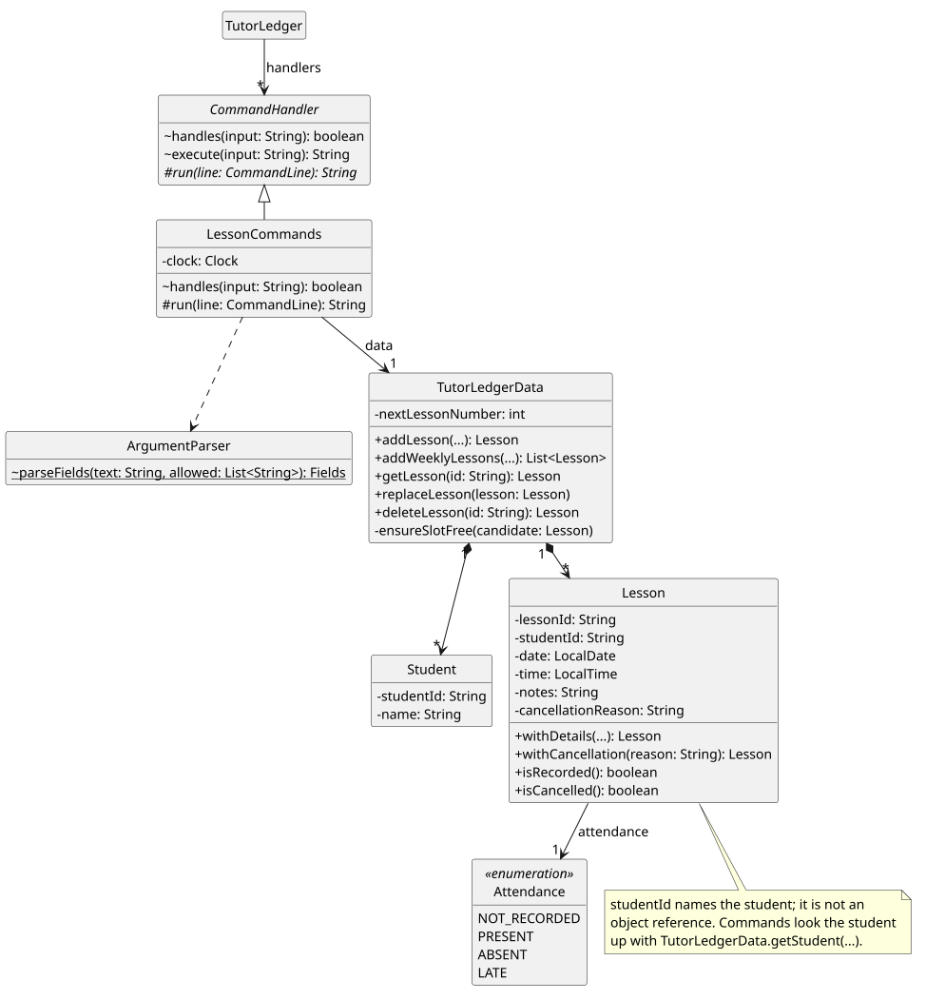
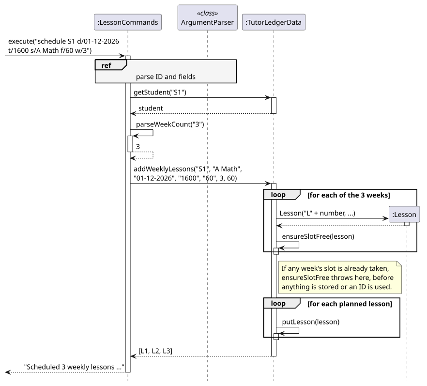

# Reynard Seow — Project Portfolio Page

## Overview

TutorLedger is a Java command-line application for independent tutors teaching primary-school,
secondary-school and junior-college students. It keeps student profiles, lessons, homework, scores and
payment records together in a local data file.

My contributions focus on lessons: planning a tutor's week, recording what happened in each lesson and
handling changes of plan. I also wrote the first complete User Guide, tested the team's v2.1 release, and
refactored the codebase so that every command class shares one structure.

## Summary of contributions

**Code contributed:** [My RepoSense code dashboard](https://nus-cs2113-ay2627-s1.github.io/tp-dashboard/?search=ranoot&breakdown=true)
· [13 merged pull requests](https://github.com/AY2627S1-CS2113-W12-2/tp/pulls?q=is%3Apr+author%3Aranoot).

### Enhancements implemented

* **Lesson commands** ([PR #67](https://github.com/AY2627S1-CS2113-W12-2/tp/pull/67),
  [epic #54](https://github.com/AY2627S1-CS2113-W12-2/tp/issues/54)):
  `schedule`, `lessons [week]`, `record`, `edit` and `delete`. Students share the `edit` and `delete` words,
  so commands are routed by the ID's `L` prefix. I moved the prefix parser out of `StudentCommands` into a shared
  `ArgumentParser`, which six command classes now use.
* **Lesson changes and weekly slots** ([PR #79](https://github.com/AY2627S1-CS2113-W12-2/tp/pull/79),
  issues [#12](https://github.com/AY2627S1-CS2113-W12-2/tp/issues/12),
  [#19](https://github.com/AY2627S1-CS2113-W12-2/tp/issues/19),
  [#27](https://github.com/AY2627S1-CS2113-W12-2/tp/issues/27),
  [#38](https://github.com/AY2627S1-CS2113-W12-2/tp/issues/38),
  [#39](https://github.com/AY2627S1-CS2113-W12-2/tp/issues/39)):
  `log`, `reschedule`, `cancel`, `next` and `schedule ... w/WEEKS`. Weekly scheduling checks every slot
  before storing any, so a clash never leaves a half-scheduled series. The hardest part was that a
  cancelled lesson must not be charged, which affects four teammates' features: I updated `unpaid`/`owed`,
  `progress`, `view` and storage.
* **Topic search** ([PR #117](https://github.com/AY2627S1-CS2113-W12-2/tp/pull/117),
  issue [#28](https://github.com/AY2627S1-CS2113-W12-2/tp/issues/28)):
  `topics k/KEYWORD` finds every lesson that covered a topic, with any student. Lesson notes act as the
  tag, so the tutor never types a topic twice and the data file needed no new column.
* **Refactor for code quality** ([PR #127](https://github.com/AY2627S1-CS2113-W12-2/tp/pull/127),
  58 files, +1,660/−1,195 lines, not visible to users). A new abstract `CommandHandler` replaces the input
  splitting, logging and error handling copied in eight command classes, and turns the main loop's 8-branch
  `if/else` into a list of handlers. `Formats` and `Lesson.isOwedOn` replace rules copied 5–8 times. To
  show nothing changed for users, 100 random sessions gave byte-identical output before and after.
* **Bug fixes** ([PR #107](https://github.com/AY2627S1-CS2113-W12-2/tp/pull/107),
  [#120](https://github.com/AY2627S1-CS2113-W12-2/tp/pull/120),
  [#125](https://github.com/AY2627S1-CS2113-W12-2/tp/pull/125)):
  fixed all four *Known issues* in the User Guide, including a new `uncancel` and editing homework, and
  four more bugs, such as overlapping lessons being accepted. Names with `s/o` or `d/o`, common in
  Singapore, were split into a name and a subject; they are now kept whole, while `s/O Level Math` after a
  name is still a subject. I fixed two edge cases that code reviews found, each with a failing test first.
* **Defensive programming** ([PR #75](https://github.com/AY2627S1-CS2113-W12-2/tp/pull/75)):
  assertions and logging in the lesson features.

### Testing

* Wrote about 150 of the project's 428 JUnit tests, for the lesson commands, parsing, storage and
  end-to-end runs of the real command loop across restarts.
* Tested the whole team's v2.1 features with 16,000 random commands against the release JAR, reloading
  every saved file. There were no crashes, and I fixed the two bugs found.

### Documentation

* **User Guide** ([PR #74](https://github.com/AY2627S1-CS2113-W12-2/tp/pull/74),
  [#79](https://github.com/AY2627S1-CS2113-W12-2/tp/pull/79),
  [#107](https://github.com/AY2627S1-CS2113-W12-2/tp/pull/107),
  [#117](https://github.com/AY2627S1-CS2113-W12-2/tp/pull/117)):
  wrote the first complete [User Guide](../UserGuide.md), which before covered only `save` and `reload`:
  every v1.0 command, the format notes, FAQ and command summary, with outputs from a scripted run of the
  release JAR. I later added the v2.0 lesson commands, `uncancel`, topic search and the `s/o` name rules.
* **Developer Guide** ([PR #94](https://github.com/AY2627S1-CS2113-W12-2/tp/pull/94),
  [#117](https://github.com/AY2627S1-CS2113-W12-2/tp/pull/117),
  [#127](https://github.com/AY2627S1-CS2113-W12-2/tp/pull/127)):
  wrote the sections *Lesson scheduling and records* and *Covered topics and topic search* of the
  [Developer Guide](../DeveloperGuide.md), with design alternatives, user stories and manual tests, and
  drew seven PlantUML diagrams: [class](../diagrams/lesson-class.svg),
  [object](../diagrams/lesson-weekly-object.svg), [activity](../diagrams/lesson-next-activity.svg), three
  sequence diagrams and a shared [`ref` fragment](../diagrams/lesson-parse-sd.svg); later updated five
  diagrams, including teammates', for the refactor.

### Team-based tasks

* Set up the issue tracker with 46 user stories
  ([#7](https://github.com/AY2627S1-CS2113-W12-2/tp/issues/7)–[#52](https://github.com/AY2627S1-CS2113-W12-2/tp/issues/52))
  and 6 feature epics
  ([#53](https://github.com/AY2627S1-CS2113-W12-2/tp/issues/53)–[#58](https://github.com/AY2627S1-CS2113-W12-2/tp/issues/58)),
  with type and priority labels, and created the `v2.0b` milestone.
* Fixed the broken master build with a commit to a teammate's PR
  ([#109](https://github.com/AY2627S1-CS2113-W12-2/tp/pull/109)), and fixed the documentation website, which
  returned 404, and its Mermaid diagrams ([PR #100](https://github.com/AY2627S1-CS2113-W12-2/tp/pull/100)).

### Review contributions

* Reviewed and approved 12 teammates' PRs:
  [#77](https://github.com/AY2627S1-CS2113-W12-2/tp/pull/77),
  [#93](https://github.com/AY2627S1-CS2113-W12-2/tp/pull/93),
  [#95](https://github.com/AY2627S1-CS2113-W12-2/tp/pull/95),
  [#103](https://github.com/AY2627S1-CS2113-W12-2/tp/pull/103),
  [#108](https://github.com/AY2627S1-CS2113-W12-2/tp/pull/108),
  [#109](https://github.com/AY2627S1-CS2113-W12-2/tp/pull/109),
  [#112](https://github.com/AY2627S1-CS2113-W12-2/tp/pull/112),
  [#113](https://github.com/AY2627S1-CS2113-W12-2/tp/pull/113),
  [#115](https://github.com/AY2627S1-CS2113-W12-2/tp/pull/115),
  [#119](https://github.com/AY2627S1-CS2113-W12-2/tp/pull/119),
  [#121](https://github.com/AY2627S1-CS2113-W12-2/tp/pull/121) and
  [#124](https://github.com/AY2627S1-CS2113-W12-2/tp/pull/124). For #119, I requested changes because the
  Quick start broke for new users, then re-checked the fix.
* Beyond the team: left 14 comments on each of two other teams' Developer Guides:
  [CS2113-W10-4 Jaweeper](https://github.com/NUS-CS2113-AY2627-S1/tp/pull/4#pullrequestreview-5677888593)
  and [CS2113-W10-3 NUS BudgetBites](https://github.com/NUS-CS2113-AY2627-S1/tp/pull/10#pullrequestreview-5677866134).

## Contributions to the Developer Guide (extracts)

*The lesson classes, including the `CommandHandler` base class from the refactor.*

*How `schedule ... w/WEEKS` checks every week's slot before it stores any lesson.*

<!-- Draft note: add PE-D bug reports to "Review contributions" if any were reported. -->
